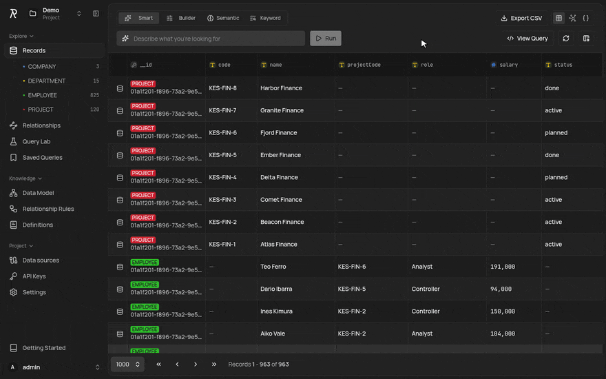

<div align="center">


# RushDB

<sub>AI के लिए database</sub>

**Graph, vector और analytics, एक ही records पर। हर write labels, fields और values का एक live schema बनाए रखता है, इसलिए agents अनुमान लगाने के बजाय असली fields पर query करते हैं।**

[](https://github.com/rush-db/rushdb/actions/workflows/ci.yml)
[](https://github.com/rush-db/rushdb/releases)
[](https://github.com/rush-db/rushdb/blob/main/LICENSE)
[](https://github.com/rush-db/rushdb)

[दस्तावेज़](https://docs.rushdb.com) • [Quickstart](https://docs.rushdb.com/engine/getting-started/quickstart/) • [चर्चाएँ](https://github.com/orgs/rush-db/discussions) • [X](https://x.com/RushDatabase) • [RushDB Cloud](https://app.rushdb.com)

[English](https://github.com/rush-db/rushdb/blob/main/README.md) • [中文](https://github.com/rush-db/rushdb/blob/main/README_ZH.md) • [日本語](https://github.com/rush-db/rushdb/blob/main/README_JA.md) • [한국어](https://github.com/rush-db/rushdb/blob/main/README_KO.md) • [Deutsch](https://github.com/rush-db/rushdb/blob/main/README_DE.md) • [Français](https://github.com/rush-db/rushdb/blob/main/README_FR.md) • [Português](https://github.com/rush-db/rushdb/blob/main/README_PT.md) • [Español](https://github.com/rush-db/rushdb/blob/main/README_ES.md) • **हिन्दी** • [العربية](https://github.com/rush-db/rushdb/blob/main/README_AR.md) • [Bahasa Indonesia](https://github.com/rush-db/rushdb/blob/main/README_ID.md) • [ไทย](https://github.com/rush-db/rushdb/blob/main/README_TH.md)

</div>

---

Data जिस रूप में आपके पास है, उसी रूप में लाइए: nested JSON, CSV, SQL `INSERT`, Cypher
या Mongo-style writes, या आपके databases से change streams। RushDB उसे typed records
के रूप में store करता है जो एक graph में जुड़े होते हैं, और यही records relationship
queries, vector और full-text search, और aggregations का जवाब देते हैं, इसलिए sync में
रखने के लिए कोई दूसरा store नहीं होता। हर write मौजूद labels, fields, types और values
का catalog भी update करता है, इसलिए agent असली fields पर query करता है। HTTP, PostgreSQL
wire protocol, Bolt, gRPC या MCP से connect कीजिए, SDKs से या किसी भी PostgreSQL client
से। एक Rust binary, Apache-2.0।

| Graph | Vector और full-text search | Analytics |
|---|---|---|
| Nested JSON जुड़े हुए records बन जाता है। Relationships के पार filter कीजिए और typed, directed relationships को एक ही query में follow कीजिए। | Vector (exact और HNSW), BM25 full-text और hybrid search, उन्हीं graph predicates से filter किए हुए। | `groupBy` के साथ count, sum, average, min और max, या PostgreSQL wire protocol पर `GROUP BY` वाला सीधा SQL। |

## Quickstart


```bash
# or: brew install rush-db/tap/rushdb
curl -fsSL https://rushdb.com/install.sh | sh
export PATH="$HOME/.rushdb/bin:$PATH"   # or open a new shell
mkdir my-app && cd my-app && rushdb up
```

`rushdb up` `http://127.0.0.1:3000` पर serve करता है; data `./.rushdb` में रहता है और
token `local-token` है। दूसरे terminal में `pip install rushdb` चलाइए:

```python
from rushdb import RushDB

db = RushDB("local-token", direct=True, engine_url="http://127.0.0.1:3000")

# Nested JSON becomes linked records: COMPANY -> DEPARTMENT -> EMPLOYEE
db.records.import_json(label="COMPANY", data={
    "name": "Acme",
    "DEPARTMENT": [
        {
            "name": "Engineering",
            "EMPLOYEE": [
                {"name": "Ada", "role": "Staff Engineer", "salary": 180000},
                {"name": "Linus", "role": "Engineer", "salary": 140000},
            ],
        },
        {
            "name": "Sales",
            "EMPLOYEE": [
                {"name": "Grace", "role": "Account Executive",
                 "salary": 120000},
            ],
        },
    ],
}, options={"relationshipType": "HAS"})

# Graph: filter across relationships by naming the related labels
engineers = db.records.find({
    "labels": ["EMPLOYEE"],
    "where": {
        "role": {"$contains": "Engineer"},
        "DEPARTMENT": {"COMPANY": {"name": "Acme"}},
    },
    "orderBy": {"name": "asc"},
})
print([employee.data["name"] for employee in engineers])  # ['Ada', 'Linus']

# Analytics: headcount and average salary per department
per_department = db.records.find({
    "labels": ["EMPLOYEE"],
    "where": {"DEPARTMENT": {"$alias": "$department"}},
    "select": {
        "people": {"$count": "*"},
        "avgSalary": {"$avg": "$record.salary"},
    },
    "groupBy": ["$department.name"],
})
print([row.data for row in per_department])
# [{'name': 'Engineering', 'people': 2, 'avgSalary': 160000.0},
#  {'name': 'Sales', 'people': 1, 'avgSalary': 120000.0}]

# The live schema an agent reads before it writes a query
print(db.ai.get_schema_markdown().data)
```

<details>
<summary>यही TypeScript में</summary>

`npm install @rushdb/javascript-sdk`:

```typescript
import RushDB from '@rushdb/javascript-sdk'

const db = new RushDB('local-token', {
  direct: true,
  engineUrl: 'http://127.0.0.1:3000'
})

// Nested JSON becomes linked records: COMPANY -> DEPARTMENT -> EMPLOYEE
await db.records.importJson({
  label: 'COMPANY',
  data: {
    name: 'Acme',
    DEPARTMENT: [
      {
        name: 'Engineering',
        EMPLOYEE: [
          { name: 'Ada', role: 'Staff Engineer', salary: 180000 },
          { name: 'Linus', role: 'Engineer', salary: 140000 }
        ]
      },
      {
        name: 'Sales',
        EMPLOYEE: [
          { name: 'Grace', role: 'Account Executive', salary: 120000 }
        ]
      }
    ]
  },
  options: { relationshipType: 'HAS' }
})

// Graph: filter across relationships by naming the related labels
const engineers = await db.records.find({
  labels: ['EMPLOYEE'],
  where: {
    role: { $contains: 'Engineer' },
    DEPARTMENT: { COMPANY: { name: 'Acme' } }
  },
  orderBy: { name: 'asc' }
})
console.log(engineers.data.map((employee) => employee.data.name))
// [ 'Ada', 'Linus' ]

// Analytics: headcount and average salary per department
const perDepartment = await db.records.find({
  labels: ['EMPLOYEE'],
  where: { DEPARTMENT: { $alias: '$department' } },
  select: {
    people: { $count: '*' },
    avgSalary: { $avg: '$record.salary' }
  },
  groupBy: ['$department.name']
})
console.log(perDepartment.data.map((row) => row.data))
// [ { name: 'Engineering', people: 2, avgSalary: 160000 },
//   { name: 'Sales', people: 1, avgSalary: 120000 } ]

// The live schema an agent reads before it writes a query
console.log((await db.ai.getSchemaMarkdown()).data)
```

</details>

SQL पहले से आती है? Labels ही tables हैं:

```bash
PGPASSWORD=local-token psql \
  "host=127.0.0.1 port=5432 user=rushdb dbname=rushdb sslmode=disable" \
  -c "SELECT name, role, salary FROM employee ORDER BY salary DESC"
```

आगे: [पूरा quickstart](https://docs.rushdb.com/engine/getting-started/quickstart/) ·
[Docker और install के दूसरे तरीके](https://docs.rushdb.com/engine/getting-started/installation/)

## क्वेरी से पहले एजेंट क्या देखते हैं

क्विकस्टार्ट की आखिरी पंक्ति वह स्कीमा प्रिंट करती है जिसे एजेंट सबसे पहले पढ़ता है। यह रिकॉर्ड के स्कैन से नहीं, बल्कि उस कैटलॉग से आता है जिसे हर write अपडेट करता है:

```text
# Graph Schema

## Labels

| Label | Count |
|-------|------:|
| `EMPLOYEE` | 3 |
| `DEPARTMENT` | 2 |
| `COMPANY` | 1 |

---

## `EMPLOYEE` (3 records)

### Properties

| Property | Type | Values / Range | Semantic Search |
|----------|------|----------------|-----------------|
| `name` | string | `Ada`, `Linus`, `Grace` | — |
| `role` | string | `Staff Engineer`, `Engineer`, `Account Executive` | — |
| `salary` | number | `120000`..`180000` | — |

### Relationships

| Traversal | Count | Edge Properties |
|-----------|------:|-----------------|
| `(EMPLOYEE)<-[:HAS]-(DEPARTMENT)` | 3 | — |

---

## `DEPARTMENT` (2 records)

### Properties

| Property | Type | Values / Range | Semantic Search |
|----------|------|----------------|-----------------|
| `name` | string | `Engineering`, `Sales` | — |

### Relationships

| Traversal | Count | Edge Properties |
|-----------|------:|-----------------|
| `(DEPARTMENT)<-[:HAS]-(COMPANY)` | 2 | — |
| `(DEPARTMENT)-[:HAS]->(EMPLOYEE)` | 3 | — |

---

## `COMPANY` (1 record)

### Properties

| Property | Type | Values / Range | Semantic Search |
|----------|------|----------------|-----------------|
| `name` | string | `Acme` | — |

### Relationships

| Traversal | Count | Edge Properties |
|-----------|------:|-----------------|
| `(COMPANY)-[:HAS]->(DEPARTMENT)` | 2 | — |
```

बड़े और विविध स्टोर पर एजेंट यह सब एक साथ लोड नहीं करता। वह ओवरव्यू से सटीक values तक, हर बार एक छोटी read करके दायरा घटाता है (ऊपर वाला ही रन):

```python
# 1. Labels and their record counts: a cheap first read on any store
print(db.labels.find({})["data"])
# {'COMPANY': 1, 'DEPARTMENT': 2, 'EMPLOYEE': 3}

# 2. The real names behind the words in a question
print(db.ai.resolve_names("employees.salaries").data)
# [{'label': 'EMPLOYEE', 'property': 'salary', 'score': 1.0}]

# 3. The schema of only the labels the question needs
print(db.ai.get_schema_markdown({"labels": ["EMPLOYEE"]}).data)
# the EMPLOYEE part of the schema above; the other labels are left out

# 4. The fields of the records a filter keeps, with counts
props = db.properties.find({
    "labels": ["EMPLOYEE"],
    "where": {"DEPARTMENT": {"name": "Sales"}},
})["data"]
print([(p["name"], p["recordsCount"]) for p in props])
# [('name', 1), ('role', 1), ('salary', 1)]

# 5. Where a value from the question is stored, even misspelled
matches = db.ai.search_values("enginer", match="similar").data["matches"]
print([(m["label"], m["property"], m["value"]) for m in matches])
# [('EMPLOYEE', 'role', 'Engineer'), ('EMPLOYEE', 'role', 'Staff Engineer'),
#  ('DEPARTMENT', 'name', 'Engineering')]

# 6. The exact stored spellings of one field, with counts
role = next(p["id"] for p in props if p["name"] == "role")
print(db.properties.values(role, query="eng")["data"])
# {'values': ['Engineer', 'Staff Engineer'], 'counts': [1, 1],
#  'distinctCount': 2}
```

`get_schema_summary` वही कैटलॉग JSON में लौटाता है, distinct गिनती और छोटे fields की values के साथ। MCP सर्वर हर read को एक टूल के रूप में देता है: `findLabels`, `resolveNames`, `getSchemaMarkdown`, `findProperties`, `searchValues`, `propertyValues` और `getSchemaSummary`।

## Deploy

| कहाँ | कैसे |
|---|---|
| Docker | `docker run -p 127.0.0.1:3000:3000 -v rushdb:/data -e RUSHDB_TOKEN=change-me rushdb/rushdb:3` |
| Docker Compose | [`deploy/templates/docker-compose`](https://github.com/rush-db/rushdb/tree/main/deploy/templates/docker-compose), Caddy के पीछे HTTPS वाले variant के साथ |
| Kubernetes | [Helm chart](https://github.com/rush-db/rushdb/tree/main/charts/rushdb): `helm install rushdb oci://ghcr.io/rush-db/charts/rushdb --set auth.token="$(openssl rand -hex 32)"` |
| Linux VM | [cloud-init](https://github.com/rush-db/rushdb/tree/main/deploy/templates/cloud-init) DigitalOcean, Hetzner, AWS, Google Cloud और Azure के लिए; [systemd unit](https://github.com/rush-db/rushdb/tree/main/deploy/templates/systemd) |
| Platforms | [Fly.io](https://github.com/rush-db/rushdb/tree/main/deploy/templates/fly), [Render](https://github.com/rush-db/rushdb/tree/main/deploy/templates/render), [Coolify](https://github.com/rush-db/rushdb/tree/main/deploy/templates/coolify), [Dokploy](https://github.com/rush-db/rushdb/tree/main/deploy/templates/dokploy) |

[](https://render.com/deploy?repo=https://github.com/rush-db/rushdb)

Ports, probes, sizing और service की तरह चलाना: [Deployment](https://docs.rushdb.com/engine/operations/deployment/) देखिए। सारे तरीके एक पेज पर:
[docs.rushdb.com/deploy](https://docs.rushdb.com/deploy/)।

### इंस्टॉल करने के दूसरे तरीके

| तरीका | Command | नोट्स |
|---|---|---|
| Install script | `curl -fsSL https://rushdb.com/install.sh \| sh` | Linux (glibc 2.28+) और macOS 11+, x86-64 और arm64। `sh -s -- --version v3.0.0` किसी release को pin करता है। |
| Homebrew | `brew install rush-db/tap/rushdb` | macOS और Linux। `brew services start rushdb` इसे background में चलाता है। |
| Docker | `rushdb/rushdb:3` | `linux/amd64` और `linux/arm64`, `ghcr.io/rush-db/rushdb` पर भी। Tags `3`, `3.0` और exact versions। |
| Cargo | `cargo binstall rushdb-server` · `cargo install rushdb-server --locked` | `binstall` release binary डाउनलोड करता है; `install` compile करता है और उसे C/C++ compiler चाहिए। |
| Release archive | [GitHub releases](https://github.com/rush-db/rushdb/releases) | SHA-256 checksums, SPDX SBOM और Sigstore signatures के साथ archives। |
| Source | `cargo build --release -p rushdb-server --bin rushdb` | Toolchain `rust-toolchain.toml` में pinned है। [Installation](https://docs.rushdb.com/engine/getting-started/installation/) देखिए। |

Windows native रूप से supported नहीं है; WSL 2 या Docker इस्तेमाल कीजिए। किसी node को
loopback से बाहर expose करने से पहले [Security](https://docs.rushdb.com/engine/operations/security/)
पढ़िए।

## आप क्या बना सकते हैं

- **एजेंट मेमोरी.** मेमोरी ऐसे रिकॉर्ड हैं जो user, agent या session के हिसाब से अलग रहते हैं और उस बातचीत के turn से जुड़े होते हैं जिसने उन्हें बनाया, इसलिए recall बताता है कि कोई मेमोरी कहाँ से आई। OpenClaw और Hermes के लिए तैयार providers।
- **कंपनी ब्रेन और RAG.** Docs, CRM, support और billing का डेटा अपने-अपने रूप में आता है और उन keys से जुड़ता है जो उनमें पहले से साझा हैं, जैसे email या account ID। Retrieval पहले सही account या version पर filter करता है, फिर vector और BM25 को साथ मिलाकर rank करता है, और हर तथ्य अपने पीछे के रिकॉर्ड का हवाला देता है।
- **Faceted search.** Filter sidebars जिनकी गिनतियाँ catalog से आती हैं, मौजूदा filter तक सीमित और सटीक, और उसी filter के तहत hybrid search ranking। अलग search index को sync रखने की ज़रूरत नहीं।
- **आपके ऐप में AI search और assistants.** Text और vector indexes डेटाबेस में ही रहते हैं और ऐप के लिखते ही अपडेट रहते हैं; SDK, MCP सर्वर और SQL clients वही रिकॉर्ड पढ़ते हैं।
- **एजेंट-आधारित डेटा एनालिटिक्स.** एजेंट पढ़ता है कि कौन-से labels और fields मौजूद हैं और हर value कैसे लिखी गई है, फिर उन पर SQL, Cypher या aggregation लिखता है। हर जवाब के साथ एक query आती है जिसे कोई भी दोबारा चला सकता है।
- **ऐसे ऐप जिनका schema चलते-चलते बदलता है.** कोई भी JSON भेजें: types infer होते हैं, nested objects जुड़े हुए रिकॉर्ड बनते हैं, और नए fields उन्हें जोड़ने वाले write के साथ ही catalog में दिखते हैं। कोई migration नहीं।

## Features

- **Emergent schema.** Types हर value के हिसाब से infer होते हैं, nested objects जुड़े हुए records बन जाते हैं, और catalog सटीक counts और value lists रखता है। [Schema catalog](https://docs.rushdb.com/engine/data-model/schema-catalog/)
- **Graph queries.** Label के आधार पर relationships के पार filter कीजिए, उन्हें type और direction से सीमित कीजिए, और projections व aggregations के लिए जुड़े records को bind कीजिए। [Relationships और traversal](https://docs.rushdb.com/engine/query/relationships-and-traversal/)
- **Search साथ में।** आपके दिए vectors पर vector indexes, BM25 full-text, और दोनों को मिलाने वाला hybrid search। [Indexes और search](https://docs.rushdb.com/engine/indexes-and-search/)
- **Aggregations.** Counts, sums, averages, time buckets और nested collections के साथ `select` और `groupBy`। [Aggregations](https://docs.rushdb.com/engine/query/aggregations/)
- **वही भाषा जो आप इस्तेमाल करते हैं।** PostgreSQL wire protocol पर SQL, Gremlin, SQL/PGQ, Mongo-style documents, और release candidates के रूप में openCypher और ISO GQL। [Query languages](https://docs.rushdb.com/engine/languages/)
- **Durable.** Write-ahead log, transactions, point-in-time restore वाले backups, और read replicas। [Operations](https://docs.rushdb.com/engine/operations/)
- **एक binary.** एक ही process से HTTP, PostgreSQL wire, gRPC और Bolt, साथ में optional isolated tenants। [Connectivity](https://docs.rushdb.com/engine/connectivity/)

## Connect

| Surface | Default | कैसे चालू करें |
|---|---|---|
| [HTTP native protocol](https://docs.rushdb.com/engine/connectivity/http-api/) | `127.0.0.1:3000`, `POST /protocol/v1/execute` | हमेशा चालू; `--port` से port बदलें |
| [PostgreSQL wire](https://docs.rushdb.com/engine/connectivity/postgresql-wire/) | `127.0.0.1:5432` | `sql` चालू रहने तक चालू (default); `--pgwire-port 0` इसे बंद करता है |
| [gRPC](https://docs.rushdb.com/engine/connectivity/grpc/) (`rushdb.v1.Database/Execute`) | बंद | `--grpc-port <port>` |
| [Bolt 5.0](https://docs.rushdb.com/engine/connectivity/bolt/) | बंद | `--bolt-port <port>`, और `--languages` में `cypher` |

सभी listeners `--listen` address (default `127.0.0.1`) पर bind होते हैं और एक ही TLS
certificate (`--tls-cert`, `--tls-key`) share करते हैं। ज़्यादा जानकारी: [Connectivity](https://docs.rushdb.com/engine/connectivity/),
[Authentication](https://docs.rushdb.com/engine/connectivity/authentication/) और [SQL और Cypher clients](https://docs.rushdb.com/connect/sql-and-cypher/)। SDKs, MCP server और
नीचे के integrations direct mode में self-hosted engine से जुड़ते हैं: [Connect](https://docs.rushdb.com/connect/) देखिए।

## Ecosystem

| Project | किसके लिए |
|---|---|
| [`@rushdb/javascript-sdk`](https://github.com/rush-db/javascript-sdk) · [`rushdb`](https://github.com/rush-db/rushdb-python) (PyPI) | TypeScript और Python apps |
| [`@rushdb/mcp-server`](https://github.com/rush-db/mcp-server) | Claude, Cursor और दूसरे MCP clients |
| [Agent skills](https://github.com/rush-db/skills) · [agent plugins](https://github.com/rush-db/agent-plugins) | Coding agents |
| [LangChain और LangGraph](https://github.com/rush-db/langchain-rushdb) · [LlamaIndex](https://github.com/rush-db/llama-index-rushdb) | Retrieval, memory और property graph stores |
| [OpenClaw](https://github.com/rush-db/rushdb-openclaw-memory) · [Hermes](https://github.com/rush-db/rushdb-hermes-memory) · [memory contract](https://github.com/rush-db/agent-memory-contract) | Agent memory providers |
| [Debezium sink](https://github.com/rush-db/debezium-server-rushdb) · [Obsidian plugin](https://github.com/rush-db/obsidian-plugin) | Change data capture, notes |

ये सभी self-hosted engine के साथ काम करते हैं। RushDB का setup अपने coding agent से
करवाने के लिए उसे [rushdb.com/agent-setup](https://rushdb.com/agent-setup) दीजिए।

## Self-hosted और RushDB Cloud

यह रिपॉज़िटरी इंजन है, और इसे पूरा का पूरा आप खुद होस्ट कर सकते हैं। [RushDB Cloud](https://app.rushdb.com) यही इंजन आपके लिए चलाता है और नीचे चिह्नित सुविधाएँ जोड़ता है। SDK और MCP सर्वर दोनों के साथ काम करते हैं; self-hosted इंजन पर, केवल Cloud वाली कॉल कुछ भी भेजे जाने से पहले `CloudOnlyError` के साथ विफल होती है।



| सुविधा | Self-hosted इंजन | RushDB Cloud |
|---|---|---|
| इंजन और API: रिकॉर्ड, ग्राफ़ क्वेरी, खोज, एग्रीगेशन, लाइव स्कीमा | ✓ | ✓ |
| SDK और MCP सर्वर | ✓ डायरेक्ट मोड, stdio पर MCP | ✓ साथ में OAuth वाला होस्टेड MCP |
| JSON और CSV इंपोर्ट | ✓ | ✓ |
| रिकॉर्ड, ग्राफ़ व्यू और क्वेरी बिल्डर वाला [डैशबोर्ड](https://docs.rushdb.com/rushdb-cloud/) | SDK या कोई भी PostgreSQL क्लाइंट इस्तेमाल करें | ✓ |
| [मैनेज्ड एम्बेडिंग](https://docs.rushdb.com/rushdb-cloud/capabilities/) | अपने मॉडल के वेक्टर लाएँ | ✓ मासिक कोटा |
| [प्राकृतिक भाषा में खोज](https://docs.rushdb.com/learn/search-query/smart-search/) | क्वेरी खुद या किसी एजेंट से बनाएँ | ✓ मासिक कोटा |
| [संबंधों के सुझाव](https://docs.rushdb.com/learn/relationships/suggested-patterns/) | संबंध खुद बनाएँ | ✓ |
| मेट्रिक्स और फ़िल्टर की [परिभाषाएँ](https://docs.rushdb.com/learn/search-query/definitions/) | नियम अपने प्रॉम्प्ट और SQL में रखें | ✓ |
| SaaS टूल से [कनेक्शन](https://docs.rushdb.com/learn/data-sources/connections/), और ऑन-प्रेम डेटाबेस के लिए RushDB Sync | आपका अपना सिंक कोड, या Debezium sink | ✓ |
| प्रोजेक्ट और API कुंजियाँ | टेनेंट और टोकन आप खुद मैनेज करते हैं | ✓ |
| टीम एक्सेस | — | पेड प्लान |
| बैकअप | आप खुद चलाते हैं: बैकअप, पॉइंट-इन-टाइम रिस्टोर, रेप्लिका | पेड प्लान |

RushDB Cloud के नीचे ✓ का मतलब है कि Free प्लान में यह शामिल है। प्लान और कोटा [rushdb.com/pricing](https://rushdb.com/pricing) पर हैं।

## FAQ

**क्या यह production के लिए तैयार है?** SQL, native JSON query language, Gremlin और
Mongo-style documents stable हैं। openCypher, ISO GQL और Bolt release candidates
हैं। Replication asynchronous है और promotion manual होता है।
[Status page](https://docs.rushdb.com/engine/reference/status/) हर surface और उसकी
सीमाएँ बताता है।

**क्या मुझे अलग vector database चाहिए?** नहीं। Vectors, text indexes और
relationships एक ही engine में रहते हैं, और किसी record को उसके vector के साथ एक ही
commit में लिखा जा सकता है। Engine आपके दिए vectors पर search करता है; RushDB
Cloud उन्हें आपके लिए generate कर सकता है।

**Live schema क्या है?** हर label, property, type, value और relationship shape का
catalog, जो हर commit पर सटीक counts के साथ update होता है। एक call उसे लौटा देती
है, इसलिए agents और tools को field names का अनुमान नहीं लगाना पड़ता।
[Schema catalog](https://docs.rushdb.com/engine/data-model/schema-catalog/)

---

[योगदान](https://github.com/rush-db/rushdb/blob/main/CONTRIBUTING.md) •
[Security](https://github.com/rush-db/rushdb/blob/main/SECURITY.md) •
[Changelog](https://github.com/rush-db/rushdb/blob/main/CHANGELOG.md) •
[Apache-2.0](https://github.com/rush-db/rushdb/blob/main/LICENSE)

RushDB 2.x (legacy, Neo4j-आधारित)
[`2.x` branch](https://github.com/rush-db/rushdb/tree/2.x) पर है और उसे
2027-10-28 तक security fixes मिलेंगे। [2.x से upgrade करना](https://docs.rushdb.com/engine/operations/upgrading-from-2x/)
