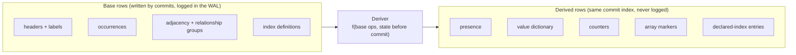
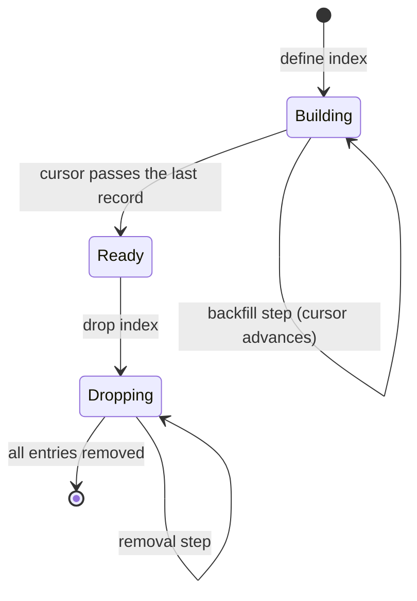

# Derived state

This page explains what RushDB derives from its base data, where that
derived state lives (on disk or in memory), how it stays exact on every
commit, and what happens to it after a restart. It is for operators who
want to know why counts are exact and what a cold start costs, and for
contributors adding a new derived structure.

## Base rows and derived rows

RushDB keeps **one source of truth**: the base rows written by commits —
record and relationship headers, label membership, occurrences, adjacency,
the property catalog, embeddings, index definitions, and pending text
changes. Everything that can be computed from those rows is **derived**:

## Derived rows on disk

| Derived family | What it answers |
|---|---|
| **Presence** — `(kind, label, pid, nullness, owner)` | Which owners of a label carry a property, and whether only as null. Lets the planner narrow a predicate to the owners that have the property at all. |
| **Value dictionary** — `(kind, label, pid, value) → refcount` | How many occurrences hold each distinct value of a property under a label. Feeds exact counts for low-cardinality ranges and value-distribution estimates. Values whose encoding exceeds 96 bytes are not stored: a "long values" counter counts their occurrences, a refcount per value digest (16 bytes of SHA-256) and a distinct-long-values counter keep their distinct count exact. |
| **Counters** | Live records per label; owners carrying each property (total and per label); explicit nulls; per-node degree in each direction; distinct values per property; relationships per `(type, source label, target label)`. |
| **Array markers** | How many owners of a label hold a property as an array, so schema description can report array-ness without a scan. |
| **Declared-index entries** — `(index, value, owner)` | Ordered entries for user-declared indexes ([query execution](query-execution.md#planning-choosing-candidates)). |

### One deterministic deriver

All of these are produced by a single deterministic function, the
**deriver**, which takes a commit's base operations and the state just
before the commit and returns the derived rows to write. The derived rows
are written in the **same backend batch, at the same commit index**, as the
base rows, so a reader can never see one without the other.

Derived rows are deliberately kept out of two places:

- **They are never logged in the WAL.** The WAL carries base operations
  only; every consumer recomputes derived rows.
- **They never enter a transaction's write set.** Two commits that both
  bump the same counter do not conflict with each other.

Because the same function runs everywhere, every path produces identical
bytes from the same base log:

| Path | When the deriver runs |
|---|---|
| Live publication | For each commit of a commit group, against the shard's committed state plus the earlier commits of the group. |
| Crash recovery | For each replayed WAL record, before applying it. The deriver is installed before recovery starts; if a store were ever replayed without it, a later attempt to install it fences the store rather than serve missing derived rows. |
| Point-in-time restore | For each archived record applied. |
| Streaming replication | On the follower, after it re-expands the shipped command. |
| Transaction overlays | A read view carries the deriver, so a transaction's staged writes can be read back with their derived effects (read-your-writes for counts). |

### Exactness

Since derived rows commit atomically with their base rows and are read at
the reader's snapshot, they are **exact**, not eventually consistent. A
label count, a "how many records have this property" count, or a
relationship-type breakdown is answered by reading counters at the
snapshot, without scanning. Estimates are used only to *choose* a plan,
never as a query answer.

### Declared indexes build online

A declared ordered index moves through three states, and its entries are
always exactly what derivation from scratch would produce for the records
it currently covers:

While **Building**, records below the cursor are covered; every commit that
touches a covered record maintains its entries, and each backfill step
covers the next range. The maintenance tick advances builds and drops for
up to 250 ms per tick, off the request path. The planner uses an index only
once it is **Ready**.

Full-text indexes follow a related but different scheme: commits write
*pending* rows (base rows), and the Tantivy index is downstream state
maintained by an applier ([text internals](text-internals.md)).

## Derived state in memory

Some derived structures live only in memory. All of them are caches or
coordination state over durable data, bounded, and safe to lose.

| Structure | Contents | Bound | Lifetime |
|---|---|---|---|
| Sequencer overlay | Net effect of commits assigned an index but not yet published. | Distinct in-flight keys. | Trimmed as commits publish. |
| Conflict window | Write sets of recently published commits, for transaction validation. | 64 MiB, charged to the managed budget. | Oldest evicted first, also when the managed budget cannot admit more; a validation that needs an evicted commit fails with a retryable error. |
| Tenant directory cache | Scope digest → tenant ordinal. | Bounded entry count. | Refilled from the directory rows. |
| Label/count metadata cache | Labels and per-label counts per tenant. | Logical cache budget. | Exact for its commit index and policy generation. |
| Property dictionary cache | Normalized property name → type, per tenant. | Logical cache budget. | Keyed by commit index and policy generation. |
| Planner statistics | Value distributions per property, loaded on demand. | `planner-stats-bytes` (default 32 MiB). | See below. |
| ANN segments | Per vector space: a hot segment and frozen segments ([vector internals](vector-internals.md)). | Vector cache budget (ANN capped at 256 MiB per tenant engine). | Rebuilt or reopened on demand. |
| Open Tantivy indexes | Reader and writer handles per text index. | 256 open indexes. | Reopened from disk on demand. |
| Tenant residency | Per-tenant vector engine and transaction coordinator. | `tenant-resident-bytes` (default 512 MiB). | Evicted when idle `tenant-idle-seconds` (default 300 s). |
| Result cursors | A pinned view plus the cursor's request. | 64 MiB of cursor state. | Until exhausted or expired. |

### Planner statistics on demand

The planner sometimes needs a value distribution — for example, to estimate
how selective `age > 30` is. RushDB does not maintain histograms on every
write. Instead, on a planner miss it walks the property's value dictionary
(a budgeted scan) and caches the resulting distribution. An entry is
dropped when it has not been used for `planner-stats-idle-seconds`
(default 600 s), when the cache needs room (least recently used first), or
when the data has moved more than `planner-stats-max-age-commits`
(default 10 000) commits past the entry. Statistics are estimates and only
steer plan choice; answers always come from rows read at the snapshot.

## After a restart

Nothing derived is rebuilt eagerly at boot, which keeps startup time
proportional to the WAL tail rather than to the data size:

- **On-disk derived rows** are already in redb; replayed WAL records derive
  their rows during recovery.
- **The redb file is not loaded into memory.** Reads go straight to redb
  through its page cache (`storage-cache`).
- **Caches start empty** and fill on use: metadata, property dictionary,
  planner statistics, tenant residency.
- **The conflict window starts empty.** No transaction or cursor survives a
  restart, so no validation can need an earlier write set.
- **ANN segments** are reopened from `vector-segments/` on the first search
  that needs them and reconciled with the canonical bindings; only bindings
  no segment covers are decoded from the stored vectors. The same happens
  when an idle tenant was evicted.
- **Tantivy indexes** reopen from `text/`; pending rows written before the
  restart are still there and are applied by the text applier.

With `--require-index-warmup` (single-tenant only), `/ready` reports `503`
until every vector index has caught up with its source records.

## Verifying derived state

The derived rows of a tenant must equal what the deriver produces from
scratch from its base rows. `rushdb serve --data-dir <dir> --verify` checks
this, together with the base-row invariants, for every tenant and reports
the number of violations.

## See also

- [LMPG layout](lmpg-layout.md)
- [Write path](write-path.md)
- [Query execution](query-execution.md)
- [Indexes](../indexes-and-search/indexes.md)
- [Query planning](../indexes-and-search/query-planning.md)
