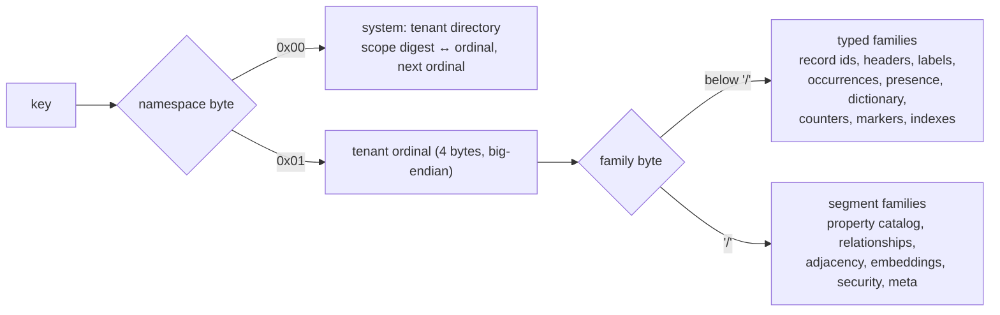
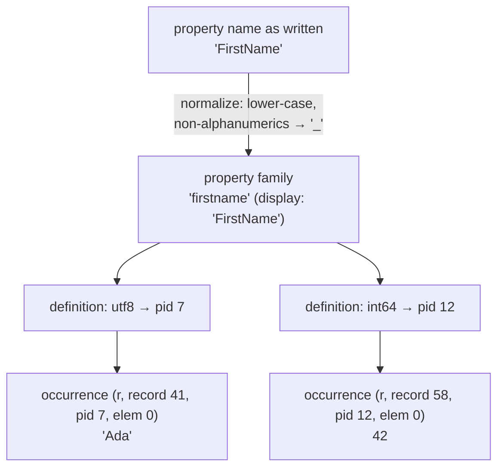

# LMPG layout

This page describes how RushDB lays out its data model, the **Labeled
Meta-Property Graph (LMPG)**, in its ordered key/value store: the **LMPG
occurrence layout**. It covers the key namespaces and the tenant prefix,
record and relationship headers, property families and type definitions,
occurrences, adjacency, and how a record is reconstructed from its keys. It
is for contributors and for operators who want to understand storage growth
and query cost.

## Why occurrences, not documents

A document store keeps each record as one blob. RushDB instead stores
**every property value of every record or relationship as its own key**,
called an *occurrence*, ordered so that related keys sit next to each other.

| Concern | Document layout | Occurrence layout |
|---|---|---|
| Update one property | Rewrite the whole document. | Write one key. |
| Find owners of a property | Scan documents or keep a separate index. | Scan the presence rows of that label and property. |
| Heterogeneous records | Schema-less blobs; types discovered at read time. | Each value is typed when written; one name may hold several types side by side. |
| Counting and statistics | Scan or maintain by hand. | Derived counters and value dictionaries updated on every commit. |
| Reading a whole record | One read. | One ordered prefix scan over the owner's occurrences. |

The trade-off is a larger key fan-out per record in exchange for
property-grained writes, exact counts, and planner statistics that come
from the data itself. The layout is the reason RushDB exists as a separate
engine; there is no document layout underneath.

## Keyspace structure

Every key starts with a **namespace byte**:

```text
0x00 …                          system rows (not tenant-scoped)
0x01 <tenant u32 BE> …          tenant rows — the 5-byte tenant prefix
```



The 5-byte tenant prefix is what isolates tenants: every tenant-owned key
begins with it, so a tenant's data is one contiguous key range, a scan can
never cross into another tenant, and purging a tenant is a range deletion.
See [multitenancy](multitenancy.md).

A few store-wide rows live outside the tenant namespace: retry receipts
(`receipt/…`, `receipt-exp/…`), the commit and retention watermarks
(`meta/…`), and per-tenant vector-index metadata kept under readable
`vector/…/<tenant hex>/` prefixes.

### Typed families

Inside a tenant, the hot families are **typed**: one family byte, then
fixed fields. Integers inside these keys — record ordinals and property ids
— use an order-preserving variable-length encoding (one length byte, then
the minimal big-endian bytes), so byte order equals numeric order and small
numbers take 1–4 bytes instead of 8. A string field that is not last is
length-prefixed.

| Family | Key after the tenant prefix | Value | Kind |
|---|---|---|---|
| Record id | `0x03 ‖ public id (16 bytes)` | record ordinal | base |
| Record header | `0x04 ‖ ordinal` | `public id ‖ label` | base |
| Label membership | `0x05 ‖ label ‖ ordinal` | empty | base |
| Counter | `0x09 ‖ sub-family ‖ fields` | count | derived |
| Value dictionary | `0x0A ‖ kind ‖ label ‖ pid ‖ type tag ‖ value` | refcount | derived |
| Array marker | `0x11 ‖ …` | count | derived |
| Occurrence | `0x12 ‖ kind ‖ owner ordinal ‖ pid ‖ element` | `flags ‖ state/type tag ‖ value` | base |
| Presence | `0x13 ‖ kind ‖ label ‖ pid ‖ nullness ‖ owner ordinal` | empty | derived |
| Index definition | `0x14 ‖ index id` | definition (JSON) | base |
| Index name | `0x15 ‖ name` | index id | base |
| Index entry | `0x16 ‖ index id ‖ type tag ‖ value ‖ owner ordinal` | empty | derived |
| Text pending | `0x17 ‖ index id ‖ owner ordinal` | commit index | base |

*Kind* is `r` for a record owner and `e` for a relationship owner. *Base*
rows are what commits write and what the WAL logs; *derived* rows are
computed from base rows at apply time
([derived state](derived-state.md)).

Counter sub-families include live records per label, owners carrying a
property (in total and per label, in both label-major and property-major
order), explicit-null counts, per-node relationship degree in each
direction, distinct dictionary values, relationships per
`(type, source label, target label)`, and values too long for the
dictionary (their occurrences, a refcount per value digest, and their
distinct count).

### Segment families

Colder or more structured rows use `/`-separated segments after the tenant
prefix. Their family names sort after the typed family bytes, so the two
styles never collide.

| Segment | Purpose |
|---|---|
| `property-family-signature/…` | Normalized property name → family id. |
| `property-family/<fid>` | Family record: namespace, owner scope, normalized and display names. |
| `property-definition/<fid, type state>` | Typed definition slot → property id (pid). |
| `property-row/<pid>` | Definition record: family, type state, cardinality, nullability. |
| `relationship/<id>` | Relationship header by public id. |
| `relationship-ordinal/<ordinal>` | Relationship ordinal → public id. |
| `rel-group/<id>` | Endpoint labels captured when the relationship was created. |
| `adj/out/<node>/<type>/<other>/<rel>`, `adj/in/…` | Adjacency in both directions. |
| `emb-space`, `emb-alias`, `emb-binding`, `vec`, `emb-version`, `emb-reclaim` | Embedding spaces, aliases, bindings, vector slots, binding versions, and pending slot reclamations ([vector internals](vector-internals.md)). |
| `security/…` | The tenant's data-access policy and its generation. |
| `meta/alloc/<name>` | Ordinal and id allocation watermarks. |

## Records and relationships

A record has a stable public id (a 16-byte UUID, shown as hex) and a dense
**ordinal** allocated per tenant. Every other row refers to the record by
its ordinal, which is shorter than the id and keeps per-owner keys clustered
and ordered by creation.

- The **record id** row maps the public id to the ordinal.
- The **record header** maps the ordinal to `(public id, label)`. A record
  has one primary label.
- The **label membership** row puts the ordinal under its label, so all
  records of a label are one ordered prefix scan.

A relationship has a public id, an ordinal, a type, and two endpoints. Its
header records the type and both endpoints by ordinal and by public id.
Creating a relationship writes:

- the header and the ordinal → id row;
- an `out` adjacency row under the source and an `in` adjacency row under
  the target, each naming the type, the other endpoint, and the
  relationship ordinal, so traversal in either direction is a prefix scan;
- a row capturing the endpoints' labels at creation time, so the
  relationship catalog can be decremented correctly even after a cascade
  has deleted an endpoint.

Relationships can carry properties too: their occurrences use owner kind
`e`.

## Properties: families, definitions, occurrences

Property names are organized in two levels.



- A **property family** groups everything written under one normalized
  name for one owner kind. Normalization lower-cases ASCII letters and
  replaces any other non-alphanumeric character with `_`, so `FirstName`
  and `firstname` share a family, while `first-name` normalizes to
  `first_name`, a different one. The family keeps a display name for
  responses.
- A **definition** is one family at one type: `boolean`, `int64`,
  `float64`, `utf8`, or `datetime` (UTC milliseconds), plus an unresolved
  state before any value is seen. Each definition has a property id
  (**pid**). If two records store the same name with different types, the
  family simply has two definitions; no write is rejected for a type
  mismatch.
- An **occurrence** is one value: `(owner kind, owner ordinal, pid,
  element)`. Scalars use element 0; arrays store one occurrence per
  element, in order. The value is `flags ‖ state ‖ payload`, where the
  state is explicit null, the empty-array marker, or the type tag followed
  by the value's **order-preserving encoding** — integers with a sign flip,
  floats with a total-order transform — so comparing encoded bytes compares
  values.

Because occurrence keys are `owner ‖ pid ‖ element`, **all occurrences of
one record are a single contiguous range**, ordered by property and then
array position.

## Reconstruction

Turning keys back into a record is an ordered walk, not a document read:

1. Read the record header by ordinal → public id and label.
2. Prefix-scan the owner's occurrences (`0x12 ‖ r ‖ ordinal`), which come
   back grouped by pid and in element order.
3. For each pid, resolve its definition and family (cached per
   reconstruction session) to get the display name and type.
4. Fold the elements into a scalar or an array, honoring explicit nulls and
   the empty-array marker, and emit the record's id, label, and
   properties.

A projection that selects only some properties skips the decoding of the
others. Relationships reconstruct the same way, adding `type`, `source`,
and `target`. Reconstruction always runs at the caller's snapshot and
treats a malformed row as an error, never as a missing record. When a
data-access policy is active, reconstruction goes through an authorized
view that applies label grants and visible-property lists, so a read path cannot
forget to enforce them.

## Invariants and scrubbing

The layout has invariants that every commit must preserve: every
occurrence has a live owner and a known pid, label membership matches the
record headers, the public-id index matches the headers, adjacency is
symmetric, and every derived row equals what derivation from scratch would
produce. `rushdb serve --data-dir <dir> --verify` runs the scrubber over every
tenant offline and reports the number of violations (zero on a healthy
store).

## See also

- [Derived state](derived-state.md)
- [Query execution](query-execution.md)
- [Multitenancy](multitenancy.md)
- [Records and labels](../data-model/records-and-labels.md)
- [Properties and types](../data-model/properties-and-types.md)
- [Relationships](../data-model/relationships.md)
