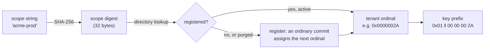

# Multitenancy

This page explains how one RushDB server isolates many tenants: how a
request's scope becomes a tenant, how the tenant prefix partitions the
keyspace, why resolution fails closed, what is shared between tenants and
what is not, and how a tenant is purged. It is for platform builders
running RushDB behind an application that serves many customers, and for
security reviewers.

## Two modes

| | Single-tenant (default) | Multitenant (`--multitenant`) |
|---|---|---|
| Request scope | Must be omitted. | Required on every data request. |
| Keyspace | One fixed tenant. | One keyspace per scope value. |
| Typical use | One application, one database. | A platform hosting many projects or customers. |

The mode is recorded in the data directory's `config.yml` on first start
and is an invariant: a directory cannot be reopened in the other mode,
because that would reinterpret the stored graph under a different isolation
regime. To change modes, migrate to a fresh data directory.

## From scope to tenant

In multitenant mode the trusted host — typically your application backend —
passes an opaque **scope** string with every request. Each transport
carries it in its own channel:

| Transport | Scope carrier |
|---|---|
| HTTP | `X-RushDB-Tenant` header (at most 1024 bytes) |
| PostgreSQL wire | The `database` startup parameter |
| gRPC | `x-rushdb-tenant` metadata |
| Bolt | The `db` field of `HELLO` |

If the protocol envelope also carries `context.scope`, it must equal the
transport's scope; a mismatch is rejected. The scope is then resolved
through the **tenant directory**:

- Only the **digest** is stored; the scope string itself never is.
- **Registration is an ordinary commit.** It is logged, replicated, and
  replayed like any other write, so every node agrees on the mapping.
- **Ordinals are never reused.** Purging a tenant marks its directory rows
  `Purged`; if the same scope is used again it gets a fresh ordinal, so
  nothing left behind under the old ordinal can ever become visible to the
  new tenant.
- A streaming-replication follower never registers tenants (it is
  read-only); an unknown scope there resolves to a sentinel tenant that
  owns no keys, so reads return nothing.

## The tenant prefix is the isolation boundary

Every tenant-owned key starts with the 5-byte prefix `0x01 ‖ ordinal`
([LMPG layout](lmpg-layout.md#keyspace-structure)). This makes isolation
**structural** rather than a filter that a code path could forget:

- Every key constructor requires a tenant; there is no way to build a
  record, occurrence, index, vector, or policy key without one.
- A tenant's data is one contiguous key range. A scan bounded by the prefix
  cannot return another tenant's rows, however the query is written.
- No discriminator property is ever stored on records or relationships, so
  there is nothing for a query to filter on or to spoof.

Derived and auxiliary state follows the same partition: counters, presence,
value dictionaries, and index entries are under the prefix; Tantivy
directories are under `text/<tenant>/`; persisted vector segments are under
`vector-segments/<tenant>/`; and every in-memory cache is keyed by tenant.

## Fail-closed resolution

A request reaches data only after its tenant is resolved. Each failure
stops it before any read or write:

| Situation | Result |
|---|---|
| Multitenant, no scope | `missing_scope` (HTTP 403) before the body is executed. |
| Single-tenant, scope supplied (envelope, gRPC metadata or Bolt `db`) | `scope_mismatch`. |
| Envelope scope differs from the transport scope | `scope_mismatch`. |
| The directory cannot be read or the registration commit fails | `unavailable`; the request runs as a tenant that owns no keys and is rejected before dispatch. |
| A capability token bound to another tenant | Unauthorized. |

The executor holds the resolved tenant as an explicit, immutable value for
the whole request; there is no ambient "current tenant" that could leak
from one request into another. Cursors and transactions are bound to the
tenant that created them, and a cursor id presented by another tenant is
indistinguishable from an unknown one. A backup request in multitenant
mode can export only its own scope.

### Policies inside a tenant

Within a tenant, an optional **data-access policy** can narrow what a
request sees — label grants, visible-property lists, relationship-type denials.
Policies are default-deny and can only narrow, never widen. Every read path
that returns record data reconstructs through an authorized view, so the
policy cannot be skipped by a new code path. The policy generation is read
from the request's snapshot, and a transaction that began under one policy
generation is aborted at commit if the policy changed meanwhile. Operations
that cannot yet intersect an enforced policy are refused rather than served
unfiltered. See [security](../operations/security.md).

## What tenants share

Tenants are isolated logically, not physically. On one node they share:

- **one writer and one WAL.** Commits from all tenants are planned by the
  same logical writer and share commit groups and fsyncs
  ([write path](write-path.md)).
- **one redb file** (unless the experimental multi-shard layout is used)
  and its page cache.
- **the managed memory budgets**: query phases, logical caches, the
  transaction pool.

Controls that keep one tenant from starving others:

| Control | Setting |
|---|---|
| Concurrent requests per tenant (queued or running) | `max-concurrent-requests-per-tenant` (0 = no per-tenant cap below the scheduler queue) |
| Staged transaction bytes per tenant | `tx-max-staged-bytes-per-tenant` (0 = share the pool) |
| Resident per-tenant handles (vector engine, transaction coordinator) | `tenant-resident-bytes`, `tenant-idle-seconds`; when every resident tenant is busy, a new tenant gets a retryable `unavailable` (`tenant_capacity`, HTTP 503) |
| Per-tenant metric series | `metrics-tenant-limit` (0 = none) |

See [resource governance](resource-governance.md).

> **Note:** SQL and graph-language writes commit only if no other commit to
> the same tenant happened since their snapshot; commits of other tenants do
> not affect them. A loser gets the retryable `write_conflict`
> ([write path](write-path.md#query-language-writes)).

## Purging a tenant

`purgeTenant` removes the requesting tenant's data:

1. **Chunked erase.** A sequence of ordinary commits each erases up to
   1 024 of the tenant's keys (with `Purge`, which also discards their
   history). The security policy rows are kept, so enforcement survives a
   data purge. The purge checks for cancellation and the request deadline
   between chunks; completed chunks stay applied, and running the purge
   again resumes it.
2. **Retire.** A final commit marks the tenant's directory rows `Purged`.
   The ordinal is never assigned again.
3. **Local cleanup.** The tenant's text-index directories, persisted vector
   segments, and resident handles are removed.

A purge frees pages without growing the file, so once at least 10 000 keys
have been purged, the background compactor treats the store as worth
compacting at its next quiet window
([storage engine](storage-engine.md#compaction)).

## See also

- [Tenants](../data-model/tenants.md)
- [LMPG layout](lmpg-layout.md)
- [Authentication](../connectivity/authentication.md)
- [Security](../operations/security.md)
- [Resource governance](resource-governance.md)
