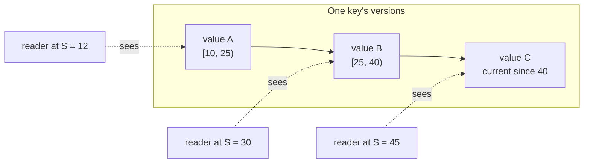

# MVCC and snapshots

This page explains how RushDB gives every reader a consistent view of the
data without blocking writers: what a read view is, how snapshots are pinned
and released, how superseded versions are stored and garbage-collected, and
the isolation guarantees that follow. It is for application developers who
need to know what a query or transaction can observe, and for operators
diagnosing retained history.

## Principles

- **Readers never block writers, and writers never block readers.** There
  are no read locks. A read runs against an immutable snapshot; a write
  creates new versions.
- **One snapshot per unit of work.** A request, a cursor, or a transaction
  pins one commit index and resolves every read at it.
- **History is kept only while someone can read it.** Superseded versions
  are retained for the oldest live reader and reclaimed as soon as no
  reader needs them. There is no configured history window.

## Read views

A **read view** is an owned, pinned snapshot at commit index *S*. It
contains:

- one native redb read transaction per physical shard, which pins redb's
  physical pages so later writes cannot change what the view reads;
- the snapshot commit index *S*;
- a registered **pin** (a reference count, a lease timestamp, and a
  generation) that tells garbage collection *S* is in use;
- a cancellation handle, which garbage collection can trigger for an
  abandoned reader;
- the deriver, so a transaction overlay on top of the view can compute
  derived rows for its staged writes; and the planner-statistics cache.

Opening a view does not wait for the writer: redb read transactions are
independent of the write transaction, and the published watermark only
advances after a commit is durable and applied. Every protocol request opens
one view when its execution context is created, and planning, traversal,
reconstruction, authorization metadata, vector scoring, and SQL or graph
execution all read through it.

### Version visibility

Every current row in redb carries the commit index that wrote it. A read at
*S*:

1. reads the current row; if it was written at or before *S*, that is the
   answer;
2. otherwise walks the key's retained versions — each version covers a
   half-open range `[from, to)` of commit indexes — and returns the one that
   was current at *S*, or "absent".

For the common case — a single-shard store and a view of the latest commit —
redb's own snapshot already holds exactly the state at *S*, and the engine
reads the current table directly.



## Who pins a snapshot

| Holder | Lifetime |
|---|---|
| A protocol request | Until the response is produced. |
| A result cursor | Until it is exhausted or its TTL lapses (`cursor_ttl_ms`, capped by `tx-max-age-seconds`). The cursor id is server-local and does not survive a restart. |
| An interactive transaction | From `begin` until commit, rollback, or TTL expiry. |
| A logical backup or export | For the duration of the export. |
| Background work | The text applier, online index builds, and vector maintenance pin short-lived views. |

## Version storage

Superseded versions are stored separately from current values so that hot
keys stay cheap:

- **History head:** the newest few versions of a key, rewritten on each
  update of that key.
- **History blocks:** when the head overflows, its oldest versions are
  sealed into an immutable block linked from the head. An update to a
  frequently written key rewrites only the bounded head, not the whole
  chain.
- **Expiry index:** one entry per retained version, ordered by the commit
  that superseded it, so garbage collection goes straight to the versions
  that have expired instead of scanning every key.

Internal bookkeeping rows — counters, allocation watermarks, catalogs — are
written with the `Set` operation, which keeps no history. Tenant purges and
retention sweeps use `Purge`, which erases a key together with its history.
See [storage engine](storage-engine.md#the-redb-materialization).

## Garbage collection

The **GC floor** is the oldest commit index that can still be read:

```text
floor = max(previous floor, min(committed index, oldest pinned snapshot))
```

Opening a view and advancing the floor are serialized on the same lock:
garbage collection publishes the new floor while holding it, so a reader
either pinned before the floor moved (and is counted) or sees the new floor
(and cannot pin below it). A request for a snapshot below the floor fails
rather than reading reclaimed data, and the floor never moves backwards.

The maintenance tick (default every 5 s) runs a **bounded, resumable sweep**:
up to 512 keys per tick through the expiry index, so reclamation never
becomes one huge write transaction. Versions superseded at or before the
floor are removed. With no reader pinned, history is reclaimed on the next
sweep; on a quiet store history stays near zero.

Vector slots follow the same rule: re-binding an embedding writes the new
vector to a fresh slot, so a pinned view can still read the old one, and
the old slot is erased once the floor passes the re-bind.

### Abandoned readers

A client that crashes mid-cursor, or a leaked view, must not pin history
forever. Each pin carries a lease timestamp that is refreshed whenever a
view is admitted at that commit index. On every maintenance tick, leases
older than the **read lease** are expired: the views at that index are
cancelled first (their further reads fail with a cancellation error), and
then the pin is released. Each pin has a generation, so a cancelled view
that drops later cannot release a newer reader's pin at the same commit
index.

The read lease is derived so that it outlasts every legitimate reader: the
largest of `tx-max-age-seconds` (which also caps cursor TTLs),
`request-timeout-ms` and one minute, plus 5 seconds of grace. With the
defaults it is 65 seconds.

> **Note:** Without a request timeout, a single query that runs longer than
> the read lease is cancelled. Keep long exports and scans in pages, or
> raise `tx-max-age-seconds` or `request-timeout-ms`.

### Compaction and readers

Physical compaction of the redb file requires that no read transaction is
open. The background compactor defers while readers exist and tries again
later; `rushdb serve --compact` fails with `readers active`. See
[storage engine](storage-engine.md#compaction).

## Isolation contract

This is what clients may rely on.

### Statements and requests

Every request executes against one snapshot. A query, a traversal, an
aggregation, or a describe call never sees a partially applied commit and
never mixes two commit indexes. Two separate requests may see different
commit indexes.

### Transactions: snapshot isolation

Interactive transactions run under **snapshot isolation**, equivalent to
PostgreSQL's `REPEATABLE READ`:

- A transaction sees the committed state as of its `begin`, plus its own
  staged writes.
- It does not see commits made by others after it began.
- Its reads are repeatable for its lifetime.

### Writes: first committer wins

There is no lock manager and no deadlock detection. Writes are validated at
commit time: if another transaction committed a conflicting change after
this one began, the **first to commit wins** and the other aborts with
`write_conflict`, which is retryable. Retry the whole transaction.
`write_conflict` is distinct from `conflict`, which is a non-retryable state
conflict such as "already exists".

| Transport | `write_conflict` appears as |
|---|---|
| HTTP | `409` with code `write_conflict` and `retryable: true` |
| gRPC | `ABORTED` |
| PostgreSQL wire | SQLSTATE `40001` (`serialization_failure`) |
| Bolt | `Neo.TransientError.Transaction.DeadlockDetected` |

The contract permits **write skew**: two transactions that read
overlapping data and write disjoint keys may both commit. The validator is
in fact more conservative than the contract — it also aborts when a
concurrent commit wrote a key the transaction's staging read — but
applications must not rely on that to enforce cross-record invariants.

Native single-operation mutations (autocommit) are planned under the
writer's admission lock against the latest state, so they never fail with
`write_conflict`. See [write path](write-path.md#throughput-characteristics).

### Transaction lifetime

Every transaction has a TTL: the default is 60 s and a client-supplied TTL
is capped by `tx-max-age-seconds` (default 60 s). An expired transaction is
rolled back and its snapshot is released; it cannot commit. A transaction
begun with the autocommit flag is instead committed, best effort, when its
TTL lapses.

### No client-chosen snapshots

There is no operation that reads "as of commit *N*". Snapshots exist for
the duration of a request, cursor, or transaction only. A cursor pins the
snapshot it was created at for its requested lifetime (capped by
`tx-max-age-seconds`); a cursor id is local to the server process and has no
meaning after a restart. Point-in-time
recovery is an offline operation over a base backup and archived WAL
segments, not a query feature; see
[backup and restore](../operations/backup-and-restore.md).

### Idempotent retries

Every commit carries a commit key, and its outcome is recorded in a retry
receipt in the same commit. The server assigns the key; clients never send
one. For an interactive transaction the key is derived from the transaction
id, so re-sending `commit` with the same id within
`idempotency-window-seconds` (default 24 h) returns the recorded outcome —
committed with its commit index, or aborted with its reason — and never
executes twice. A native single-operation mutation gets a fresh key per
request, so retrying it after a lost response is a new commit; see
[Writing data](../query/writing-data.md#commit-order-and-retries) for safe
patterns and [storage engine](storage-engine.md#retry-receipts) for the
receipt layout.

## See also

- [Write path](write-path.md)
- [Storage engine](storage-engine.md)
- [Transactions](../query/transactions.md)
- [Sorting and pagination](../query/sorting-and-pagination.md)
- [Error codes](../reference/error-codes.md)
