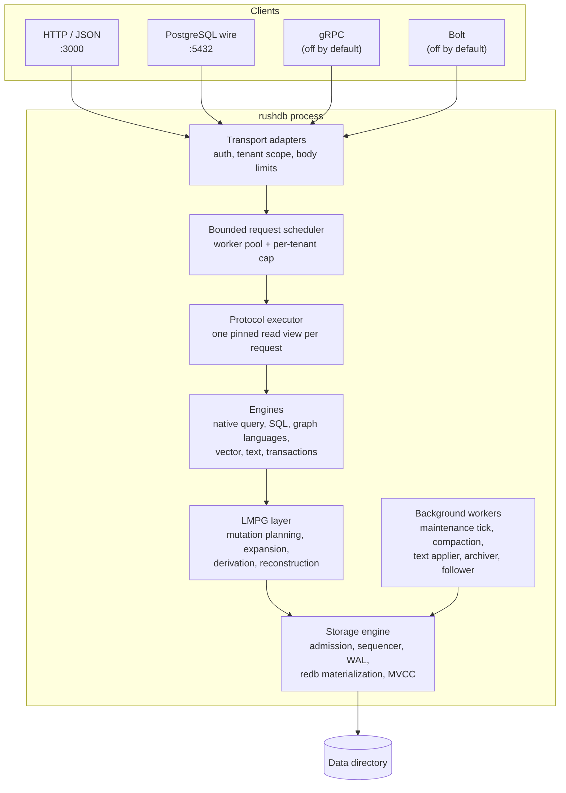
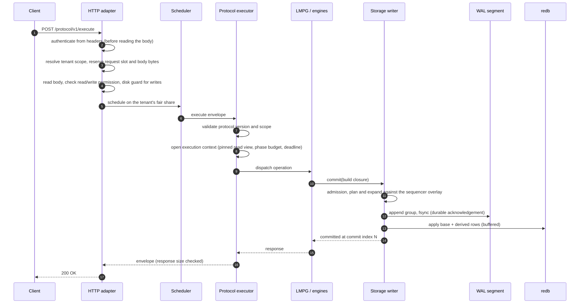

# Architecture overview

This page is the map for the rest of the architecture section. It describes
the RushDB server process, the crates that make up the engine, what lives in
a data directory, and the path a request takes from a wire protocol down to
durable storage and back. Read it first; the other pages zoom into one box
of the diagrams below.

## Design in one paragraph

RushDB is a single-process property-graph database. Every client protocol —
HTTP, the PostgreSQL wire protocol, gRPC, and Bolt — is a thin transport
around one versioned, transport-neutral protocol (`/protocol/v1`), executed
by one protocol executor against one storage engine. Data is stored in the
**Labeled Meta-Property Graph (LMPG) occurrence layout**: each property value of
each record or relationship is its own ordered key, not part of a document
blob. Writes are expressed as deterministic **commit batches**; the engine
expands each batch into key/value operations, appends them to a segmented
**write-ahead log** (the durable truth), and then materializes them into an
embedded ordered store (redb). Reads run against **pinned snapshots**, so a
statement, a cursor, or a transaction sees one consistent committed state.
Everything else — statistics, counters, full-text and vector indexes — is
either derived deterministically from those base rows or is a rebuildable
cache over them.

### Design rules

The engine owns database mechanics only: storage, transactions, durability,
replication, query planning and execution, schema discovery, text and
vector search, ingest, and fail-closed tenant scoping. A few rules keep that
boundary in place:

- **One protocol, many transports.** New behavior is added as a Protocol v1
  operation, never as an HTTP route. The HTTP surface is fixed:
  `/protocol/v1/execute`, `/health`, `/ready`, `/metrics`, and the
  node-to-node replication endpoints.
- **No application concepts in the protocol.** Requests and responses carry
  records, relationships, and tenant scopes, never projects, workspaces,
  users, billing, SDK aliases, or model-provider calls. Those belong to the
  application around the database
  ([introduction](../getting-started/introduction.md#what-is-not-in-the-engine)).
- **Scope comes from the trusted request context.** Every query and mutation
  is bound to the tenant that the transport authenticated before any data is
  read ([multitenancy](multitenancy.md)).
- **No private client wire protocol.** Beyond the native JSON protocol,
  clients use standard protocols (PostgreSQL wire, Bolt, gRPC); operations
  that do not map onto them stay on the native protocol.

## Process model

One `rushdb` process owns one data directory and serves every transport
from a single embedded node.



### Threads and background work

| Component | What it does | Cadence |
|---|---|---|
| HTTP runtime (Tokio) | Accepts connections, authenticates, reads bodies, hands work to the scheduler. | Worker count follows `threads` (default: available parallelism). |
| Request scheduler | A bounded pool of blocking workers that runs protocol execution. Admission never waits: a full queue answers `unavailable` (HTTP 503). | `threads` workers (clamped 2–256), queue of 32 per worker (clamped 64–4096). |
| Transaction reaper | Expires interactive transactions whose TTL lapsed. | Every 1 s. |
| Maintenance tick | Expires abandoned read leases, evicts idle planner statistics, advances online index builds, freezes and merges vector segments, reclaims MVCC history, advances WAL retention, sweeps expired retry receipts, and checkpoints. | Every `checkpoint-interval-seconds` (default 5 s). |
| Compaction worker | Gated idle-time compaction of the redb file. | Every `compact-interval-seconds` (default 300 s). |
| Text applier | Applies pending full-text index changes. | Every 250 ms. |
| Storage statistics | Refreshes per-family byte accounting for `/metrics`. | Every 15 min. |
| WAL archiver | Ships WAL segments to `wal-archive-dir` (when configured). | Every 5 s. |
| Replication follower | Tails a leader's WAL (when `replica-of` is set). | Polls every 200 ms when caught up. |
| RSS watchdog | Logs and reclaims when resident memory exceeds `rss-max` (when set). | Every 10 s. |

Background work runs on the same blocking pool as maintenance closures and
is tracked, so a shutdown waits for in-flight maintenance to finish before
the final checkpoint.

### Boot

Opening a large store can take a while (redb open, WAL replay). The HTTP
port is bound **first** and answers probes while the node boots:
`/health` returns `200` with `{"status":"starting","phase":…}`, `/ready`
returns `503` with the current phase (`starting`, `opening-storage`,
`starting-engines`, `ready`), and protocol requests get a retryable
`unavailable`. When the node is ready, the same socket is handed to the real
router, so the port is never closed during startup.

Boot then:

1. Loads `config.yml` from the data directory (written on first start) and
   validates it against the command line. The tenancy mode recorded there is
   an invariant: a directory created single-tenant cannot be reopened
   multitenant, or the reverse.
2. Validates resource budgets before allocating anything.
3. Opens the store: validates the shard layout, opens redb, opens the WAL,
   and replays any WAL tail beyond the last checkpoint
   ([storage engine](storage-engine.md#crash-recovery)).
4. Installs the deterministic expander and deriver, starts optional engines
   (the Raft Preview, if enabled), and creates the logical caches.
5. Restores durable retention-consumer claims and starts background workers.

### Shutdown

On a shutdown signal the server stops accepting work, cancels in-flight
maintenance scans, drains transports (30 s deadline), waits for maintenance
closures, and runs a **final checkpoint** so the next open needs no WAL
replay. A shutdown step that times out makes the process exit unsuccessfully
rather than claim a clean close. An unclean stop is still safe: the WAL is
the durable truth, and the next boot replays it.

## Crate map

| Crate | Role |
|---|---|
| `rushdb-types` | Shared vocabulary: identifiers, logical value types, the order-preserving value encoding, commit batches, and the byte-exact key constructors for every key family. |
| `rushdb-storage` | The ordered key/value substrate: write admission, the sequencer, group commit, the segmented WAL, the redb backend, MVCC read views, retention, compaction, retry receipts, and the managed byte-budget tree. |
| `rushdb-lmpg` | The Labeled Meta-Property Graph (LMPG) layout: mutation planning into commit batches, deterministic expansion into key/value operations, apply-time derivation, declared-index maintenance, the tenant directory, record reconstruction, and the invariant scrubber. |
| `rushdb-query` | The native query document: parsing, access-path planning, scans, traversal, aggregation, pagination, and on-demand planner statistics. |
| `rushdb-sql` | Relational SQL over Apache DataFusion: labels as tables, relationship types as tables, streaming scan providers. |
| `rushdb-language` | ISO GQL, openCypher, Gremlin, and SQL/PGQ over Grafeo, plus Neo4j-style index DDL. |
| `rushdb-mongodb` | MongoDB-style `find`, aggregate pipelines, and write commands mapped onto the native surface. |
| `rushdb-vector` | Embedding spaces, canonical vector storage, exact search, and the segmented ANN cache (`usearch`). |
| `rushdb-textsearch` | Declared full-text indexes over Tantivy. |
| `rushdb-tx` | The interactive transaction coordinator: staging, limits, TTL expiry, commit. |
| `rushdb-authz` | Graph-aware data-access policies layered inside a tenant (default-deny, narrowing only). |
| `rushdb-engine` | The embedded facade, the per-request execution context, and the bounded scheduler. |
| `rushdb-protocol` | The versioned request/response envelope and error taxonomy shared by every transport. |
| `rushdb-grpc`, `rushdb-bolt` | Transport adapters that carry the canonical envelope (gRPC) or translate Bolt v5 messages onto it. |
| `rushdb-backup` | Logical JSONL export and restore. |
| `rushdb-raft` | The OpenRaft integration behind the experimental `--raft` Preview. |
| `rushdb-server` | The `rushdb` binary (`serve`, `up`, `health`): configuration, transports, the protocol executor, background workers, replication, archiving, and backup tooling. |

RushDB adopts established libraries for everything that is not specific to
its data model: redb (embedded ACID ordered storage), Apache DataFusion
(SQL), Grafeo (graph query languages), Tantivy (BM25 full-text), `usearch`
(approximate nearest neighbours), OpenRaft (consensus), `pgwire`, Axum and
Tower (HTTP), Tonic (gRPC), and the Prometheus client (metrics). The LMPG
layout, its expansion and derivation, the query planner, tenancy, and
authorization are RushDB's own.

## Data directory

A persistent node (`--data-dir`) keeps everything under one directory.
Without `--data-dir` the node runs fully in memory (a test and small-data
mode).

```text
<data-dir>/
├── config.yml                  effective configuration, tenancy mode (invariant)
├── rushdb.redb                 redb materialization (shard 0)
├── rushdb.redb.layout.json     storage layout manifest (shard count)
├── rushdb.redb.wal/            segmented write-ahead log — the durable truth
│   ├── 00000000000000000001.seg
│   └── …                       one file per segment, named by first LSN
├── text/<tenant>/<index-id>/   Tantivy directory per declared text index
└── vector-segments/<tenant>/   persisted frozen ANN segments (cache)
```

`<tenant>` is the tenant ordinal in hex. The redb file and the WAL are the
database; `text/` is derived index state maintained from the database, and
`vector-segments/` is a rebuildable cache. With the experimental
multi-shard layout, additional shard files are named `rushdb.redb-1`,
`rushdb.redb-2`, and so on.

## Life of a request

Every transport converges on the same executor. The sequence below shows a
write over HTTP; pgwire, gRPC, and Bolt differ only in how they authenticate
and frame the envelope.



The important properties:

- **Authentication happens before the body is read.** An unauthenticated
  client cannot make the server buffer a request body.
- **Admission is non-blocking.** If the request slots, the in-flight body
  budget, the scheduler queue, or the per-request phase budget are
  exhausted, the request is refused immediately with a retryable error
  instead of queueing without bound
  ([resource governance](resource-governance.md)).
- **One snapshot per request.** The execution context pins one read view at
  the current commit index; every read in the request — planning,
  traversal, reconstruction, authorization metadata — uses it
  ([MVCC and snapshots](mvcc-and-snapshots.md)).
- **A write is acknowledged only after its WAL record is durable**
  ([write path](write-path.md)).
- **Responses are never silently truncated.** An oversized response is
  rejected with an explicit error.

Reads follow the same path but never touch the writer: they plan and
execute against the pinned view and reconstruct results from occurrence
rows ([query execution](query-execution.md)).

## See also

- [Storage engine](storage-engine.md)
- [Write path](write-path.md)
- [Connectivity](../connectivity/README.md)
- [Deployment](../operations/deployment.md)
- [Configuration reference](../reference/configuration-reference.md)
