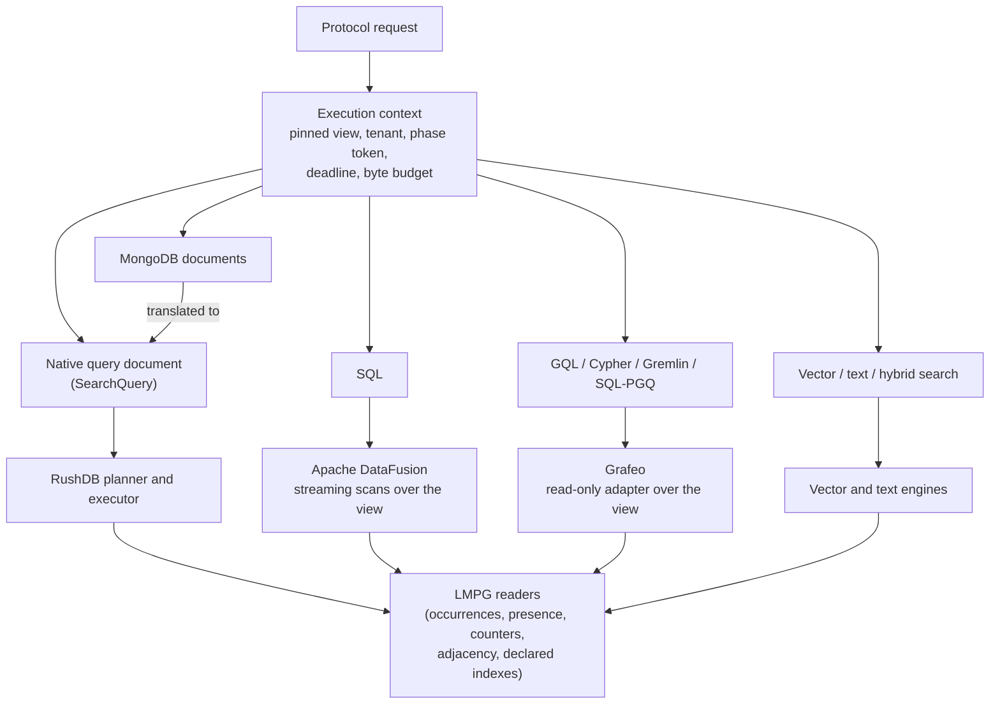
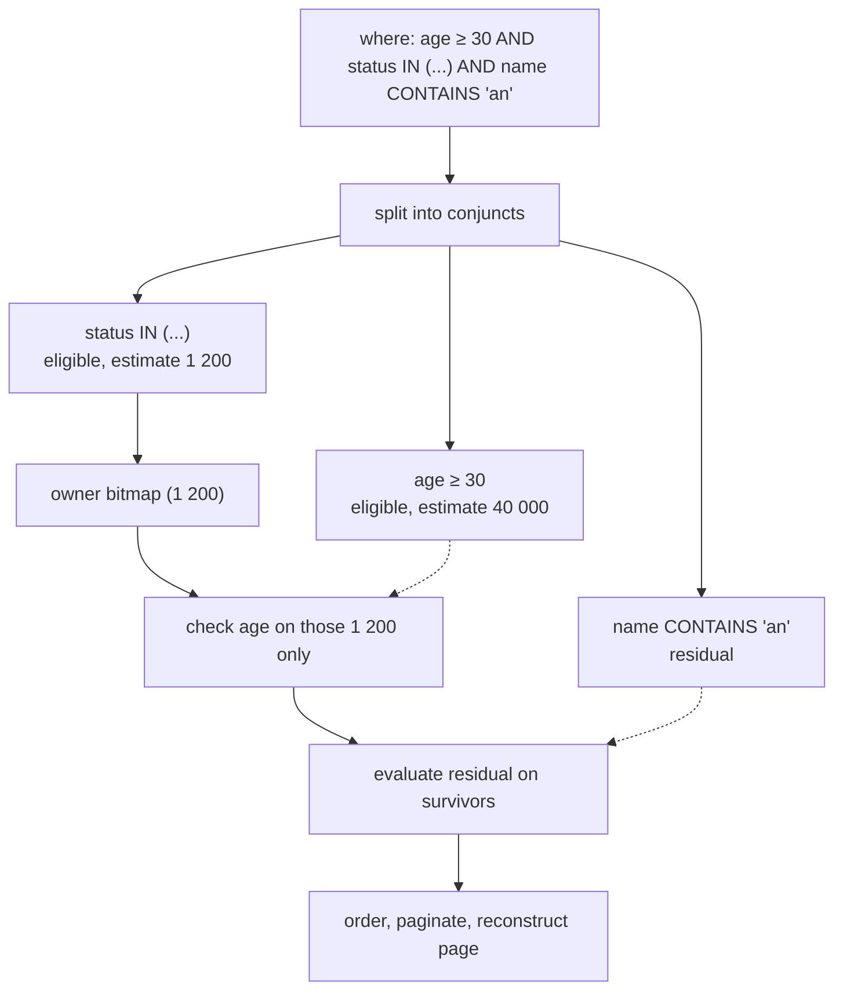

# Query execution

This page explains how RushDB executes reads: the native query document
from parsing to planning to pages and cursors, how SQL runs on Apache
DataFusion and graph languages run on Grafeo, and how every path is bounded
by budgets, deadlines, and cancellation. It is for developers who want to
write efficient queries and for contributors working on the planner.

## One snapshot, many frontends

Every read — whatever its language — runs inside one **execution context**
that the protocol executor opens per request:

- a pinned read view at the current commit index
  ([MVCC and snapshots](mvcc-and-snapshots.md));
- the resolved tenant, which prefixes every key the request can touch;
- a fixed 8 MiB reservation from the shared query-phase pool, which is what
  bounds how many requests execute at once
  ([resource governance](resource-governance.md));
- an optional deadline and a cancellation check;
- a working byte budget equal to the request body limit
  (`server.body-limit` in `config.yml`, default 16 MiB), against which
  results and working sets are charged.



## The native query document

The native query document is the protocol's structured query:

```json
{
  "labels": ["PERSON"],
  "where": { "age": { "$gte": 30 }, "status": { "$in": ["active", "trial"] } },
  "orderBy": { "name": "asc" },
  "limit": 20,
  "skip": 0
}
```

Parsing is strict: unknown keys are rejected. The document lowers into an
expression tree — field predicates (`$eq`, `$ne`, `$gt`/`$gte`/`$lt`/`$lte`,
`$in`/`$nin`, `$contains`, `$startsWith`, `$endsWith`, `$exists`, `$type`,
`$id`), logical operators (`$and`, `$or`, `$nor`, `$xor`, `$not`), and
related-record blocks keyed by label with `$relation` (type, direction,
hops), `$alias`, and nested blocks. Aggregation adds `select`, `groupBy`,
and time buckets. The full grammar is in
[search queries](../query/search-queries.md) and
[filtering](../query/filtering.md).

### Planning: choosing candidates

The planner's job is to avoid touching records that cannot match. It
flattens the top-level `$and` into conjuncts and classifies each one:

- **Eligible leaves** can be answered from maintained structures: equality
  and `$in`, `$exists: true`, null checks, numeric ranges, and `$id`.
- **Residual leaves** cannot: `$ne`, string matching, `$type`, nested
  logic, and relationship predicates. They are evaluated later on the
  candidates that survive.

Each eligible leaf gets a cardinality estimate from derived rows — exact
counts from counters and the value dictionary for equality, and a value
distribution (loaded on demand) for ranges. Leaves are materialized
**most selective first** into compressed owner-ordinal bitmaps, and each
later leaf is checked only against the owners the earlier ones left. The
plan stops early once the intersection is empty.



How a leaf's owners are found:

1. **Declared ordered index.** When every requested label has a `Ready`
   ordered index on the leaf's property, the leaf is answered from index
   entries — equality, `$in`, ranges, and prefixes become ordered range
   reads. Every candidate is re-checked against the predicate, so the
   result is exact.
2. **Presence narrowing.** Otherwise, presence rows give the owners of the
   label that carry the property at all, and their occurrence values
   decide the predicate. RushDB does **not** maintain automatic value
   postings; you declare the indexes you want
   ([indexes](../indexes-and-search/indexes.md)).
3. **Full scan.** If the most selective eligible leaf would still
   materialize more than 2 million owners, or nothing is eligible, the
   executor scans the label (or every record) in bounded, cancellable
   batches instead.

Two shortcuts avoid work entirely:

- When every leaf was answered exactly and there are no relationship
  predicates, per-candidate evaluation and the count rescan are skipped.
- A lone unscoped `$exists: true` with a page size reads its total from the
  property's support counter and materializes only the requested page.

Every index-assisted path is required to return exactly what a forced full
scan returns; that equivalence is tested differentially. `describe.explain`
shows the chosen access path, the residual filter, and estimates without
running the query ([query planning](../indexes-and-search/query-planning.md)).

### Traversal

Relationship blocks resolve through adjacency rows: for a node and
direction, the out- or in-adjacency prefix lists the relationship type,
the other endpoint, and the relationship ordinal in one ordered scan.
Multi-hop and cycle predicates walk adjacency hop by hop at the same
snapshot. See [relationships and traversal](../query/relationships-and-traversal.md).

### Ordering, pagination, and reconstruction

After filtering, the executor holds the matching ordinals, orders them,
applies `skip` and `limit`, and only then **reconstructs** the page: a
prefix scan of each record's occurrences
([LMPG layout](lmpg-layout.md#reconstruction)). A projection decodes only
the selected properties. Records that a data-access policy hides are
removed after reconstruction through the authorized view.

### Cursors

A paginated query whose results do not fit one page can return a cursor.
The cursor keeps the query, its next offset, the total (computed once —
the snapshot cannot change), and its pinned view. Continuations read the
same snapshot, so pages never skip or repeat records because of concurrent
writes. Cursor pages are capped at 10 000 records, cursor state is capped
at 64 MiB per node, and a cursor lives until it is exhausted or its TTL
lapses. Cursor ids are server-local and do not survive a restart. See
[sorting and pagination](../query/sorting-and-pagination.md).

### Aggregation and facets

Grouping and aggregate evaluation run over the matched set with a bounded
group count and a working-set budget; reconstruction for aggregate inputs
is admitted per record. Counts that derived rows can answer — records per
label, owners per property, relationships per type — come from counters at
the snapshot instead of scans. See [aggregations](../query/aggregations.md)
and [facets](../query/facets.md).

## SQL on Apache DataFusion

SQL runs on Apache DataFusion, which owns parsing, planning, optimization,
and execution. RushDB adapts its storage to Arrow:

- each **record label** is a table in the default schema;
- each **relationship type** is a table in the `rushdb_edges` schema.

The catalog is **lazy**: a table's schema is inferred, and its data read,
only when the query references it. Tables are **streaming** scan providers
that reconstruct records from the pinned view in bounded batches, so a
selective query does not load a whole label and `SELECT 1` touches nothing.
DataFusion's memory pool is limited to the request's byte budget. Integer
`SUM` is rewritten to an overflow-checked aggregate, so an overflow is an
error rather than a silently wrapped value.

SQL `INSERT`, `UPDATE`, and `DELETE` on record tables are computed against
the snapshot and committed as one batch
([write path](write-path.md#query-language-writes)). Index DDL
(`CREATE INDEX`, `CREATE VECTOR INDEX`, `DROP INDEX`) is intercepted before
DataFusion and executed as native index operations. See [SQL](../languages/sql.md).

## Graph languages on Grafeo

ISO GQL, openCypher, Gremlin, and SQL/PGQ are parsed, bound, and planned by
Grafeo. For **reads**, RushDB gives Grafeo a thin, tenant-scoped, read-only
storage adapter over the pinned view, so graph queries read LMPG rows
directly with no copy. Result rows are converted and charged against the
request's byte budget; cancellation is checked before execution and between
result rows (the Grafeo execution call itself cannot be interrupted midway).
Because Grafeo's storage callbacks cannot return errors, the adapter records
any storage failure, stops reading, and the statement is rejected — a
storage error is never reported as an empty result.

For **writes**, Grafeo runs the statement against a disposable in-memory
copy of the tenant graph and RushDB commits the resulting diff as one
batch. That copy is bounded (100 000 nodes and 64 MiB), so graph-language
writes suit small and medium tenants; see
[write path](write-path.md#query-language-writes). SQL/PGQ is read-only.

Neo4j-style index DDL (`CREATE INDEX … FOR (n:Label) ON (n.prop)`,
`CREATE FULLTEXT INDEX …`, `DROP INDEX`, `SHOW INDEXES`) is recognized
before the statement reaches Grafeo. See [languages](../languages/README.md).

## MongoDB-style queries

`find` documents translate directly onto the native query
document (filter → `where`, projection → `select`, sort → `orderBy`), and
aggregate pipelines map a supported subset of stages onto native grouping.
They therefore use the same planner and indexes. See
[MongoDB queries](../languages/mongo.md).

## Budgets, deadlines, and cancellation

| Bound | Default | Applies to |
|---|---|---|
| Request working budget | Request body limit, 16 MiB | Native query working sets, DataFusion's memory pool, graph-language output, response size. |
| `query-memory-max` | 256 MiB | Working set of structured queries and aggregations when no request budget applies; aggregations use the smaller of the two. Also caps DataFusion's memory pool and the values an unindexed upsert key holds. A request may set a smaller cap (`context.queryMemoryMaxBytes`). |
| `unindexed-walk-max-owners` | 0 (none) | Records a filter without a usable index may check; above it the query is refused at planning. A request may set a limit (`context.unindexedWalkMaxOwners`). |
| Query-phase reservation | 8 MiB per request, from a pool the size of `managed-limit` | Concurrency of executing requests. |
| Planner materialization cap | 2 million owners | Above it the planner scans instead of building an owner set. |
| Cursor page | 10 000 records | Per continuation. |
| Request deadline | `request-timeout-ms` (0 = none) and the envelope's `context.deadlineMs` (the shorter wins) | Checked between phases and scan batches, including SQL label scans; expiry returns `cancelled`. |

Exceeding a budget returns `resource_exhausted` with a message naming the
limit; an oversized response is rejected, never truncated. Scans poll for
cancellation between batches, so an expired deadline stops a broad scan
instead of letting it run to completion.

## See also

- [Search queries](../query/search-queries.md)
- [Query planning](../indexes-and-search/query-planning.md)
- [Indexes](../indexes-and-search/indexes.md)
- [Derived state](derived-state.md)
- [Languages](../languages/README.md)
- [Resource governance](resource-governance.md)
