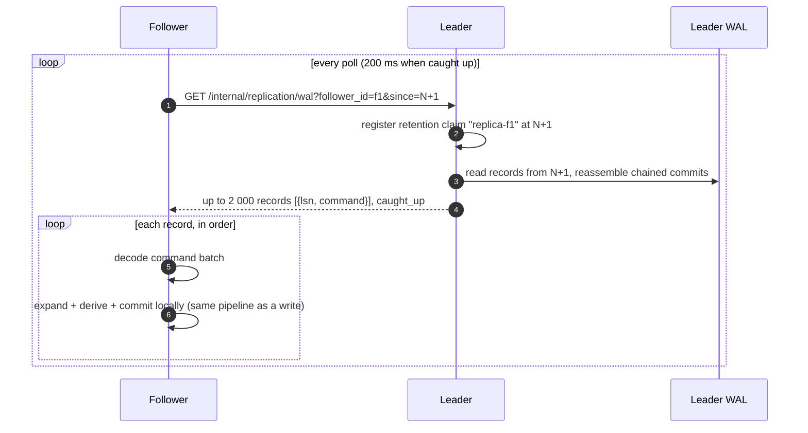

# Replication

This page explains how RushDB copies data from one node to another:
streaming WAL replication from a leader to read-only followers, how a
follower is bootstrapped (from an empty store or from a base backup), how
it is promoted, and how retention protects what a follower still needs. It
also describes the experimental in-process Raft mode, which is a Preview.
For step-by-step setup, see [operations: replication](../operations/replication.md).

## Streaming WAL replication

Streaming replication is a leader/follower design built directly on the
write-ahead log. One node accepts writes (the **leader**); any number of
**followers** tail its WAL and replay every commit locally.



### What is shipped

The follower receives each commit's **command batch** — the canonical,
replayable description of the write — not the leader's key/value
operations and never its derived rows. It applies the batch through the
same commit pipeline a local write uses: deterministic expansion, apply-time
derivation, WAL append, and materialization. Because expansion and
derivation are deterministic and commit indexes are dense, the follower
reproduces the leader's state commit by commit, and its commit index tracks
the leader's LSN.

Each record's position matters: a follower assigns commit indexes
sequentially, so it must replay every commit from its starting point in
order, with no gaps. Normal operation never produces a gap, because aborted
commits never consume an index on the leader.

A follower enforces its own `max-expanded-commit-bytes`. Configure
followers with a ceiling at least as large as the leader's; otherwise a
follower stalls, logging and retrying, on a large commit the leader
accepted, instead of diverging.

### The follower is read-only

While a node is following, every write operation is rejected with
`unavailable` ("writes must go to the leader"); beginning or rolling back a
transaction is allowed, so a client can learn this before staging writes.
Reads are served from the follower's own snapshots and lag the leader by
the replication delay. A follower also never registers new tenants: an
unknown scope resolves to a tenant that owns no keys.

### Authentication

The WAL-tail endpoint is an internal node-to-node route, not part of the
client protocol. It accepts only the leader's boot token, presented as
`Authorization: Bearer <token>` or `X-RushDB-Token`. A follower presents
`--replica-token`, which defaults to its own `--token` for the common
shared-secret deployment. Each follower identifies itself with
`--replica-id` (default `default`).

> **Warning:** Give every follower of a leader a distinct `--replica-id`.
> The leader protects WAL retention per follower identity; two followers
> sharing an id can each release history the other still needs.

### Retention and resync

Before serving a poll, the leader records a retention claim for that
follower at the requested position, so a concurrent maintenance tick
cannot delete a WAL segment the poll is about to read. The claim keeps the
leader's WAL from being pruned below the follower's position — up to the
hard caps (`tx-log-retention-commits`, `tx-log-retention-bytes`). A claim
that is not refreshed for `retention-consumer-lease-seconds` (default 24 h)
expires, so a removed follower stops pinning the WAL.

If a follower asks for history the leader has already reclaimed, the
leader answers `409` with code `resync_required` and the oldest LSN it
still has. The follower stops and logs the condition; it must be re-seeded
from a fresh base backup. Network and decode errors, by contrast, are
retried indefinitely.

See [storage engine: WAL retention](storage-engine.md#wal-retention).

### Bootstrapping a follower

A follower starts tailing at its own `committed index + 1`. There are two
ways to give it a starting point:

| Start from | How | Requirement |
|---|---|---|
| An empty store | Start a fresh data directory with `--replica-of <leader URL>`. It tails from LSN 1. | The leader must still hold its WAL from LSN 1. With the default retention (`tx-log-keep-commits: 0`) a leader keeps only what registered consumers need, so set `tx-log-keep-commits` on leaders that bootstrap followers from empty. |
| A base backup | Restore a base backup of the leader into a fresh data directory, then start it with `--replica-of`. Its committed index is the backup's commit index, and it tails from there. | The leader must still hold its WAL from the backup's commit index onward. |

Attaching from a base backup is the normal way to add a follower to a
leader with a long history: the follower copies the bulk of the data as
files and replays only the tail.

### Promotion

To make a follower writable — for example after losing the leader — call:

```bash
curl -X POST http://follower:3000/internal/replication/promote \
  -H "Authorization: Bearer $RUSHDB_TOKEN"
```

Promotion is cooperative. The request asks the replication task to stop;
the task finishes the batch it is applying, then clears the follower flag
itself, so a write can never race a half-applied batch. The endpoint waits
up to 5 seconds and returns `{"promoted": true}` once the node accepts
writes (or `{"promoted": true, "already_writable": true}` if it was not
following). If the task has not stopped in time it returns `503`; poll
again.

> **Warning:** Streaming replication is not a consensus system. Promotion
> does not fence the old leader. Before promoting, make sure the old leader
> can no longer accept writes, or you will have two diverging writable
> nodes.

### Properties at a glance

| Property | Streaming replication |
|---|---|
| Topology | One writable leader, any number of read-only followers. |
| Shipping | Pull: followers poll the leader over HTTP. |
| Commit acknowledgement | Local to the leader. A commit is acknowledged when it is durable on the leader, before followers have it (asynchronous replication). |
| Follower consistency | Each follower read is a consistent snapshot of a prefix of the leader's history. |
| Failover | Manual, by promotion. |
| Derived state | Recomputed on the follower, never shipped. |

## Raft (Preview)

`rushdb serve --raft N --experimental-raft` starts an **in-process** OpenRaft
cluster of `N` state machines inside the one server process, with this
node's store as one of them. Every local commit is routed through the
elected leader and applied deterministically to every state machine before
it returns. OpenRaft owns elections, terms, membership, log replication,
and quorum acknowledgement; RushDB supplies only the command and
state-machine adapters.

> **Note:** Raft mode is a **Preview** for evaluating consensus-replicated
> commits. The Raft log, votes, membership, and snapshots live in memory and
> are lost on restart; there is no network transport between processes, no
> durable Raft snapshot, and no linearizable read. It provides no
> high-availability or durability guarantee. The server refuses `--raft`
> unless `--experimental-raft` is also given. Use streaming replication for
> real deployments.

## See also

- [Operations: replication](../operations/replication.md)
- [Backup and restore](../operations/backup-and-restore.md)
- [Storage engine](storage-engine.md)
- [Write path](write-path.md)
- [Configuration reference](../reference/configuration-reference.md)
