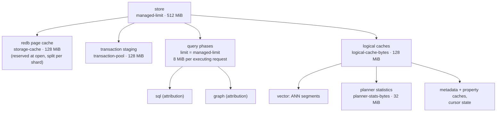
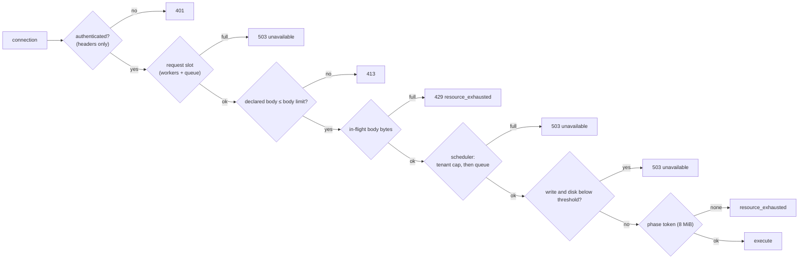

# Resource governance

This page explains how RushDB keeps memory, concurrency, and disk use
bounded: the managed byte-budget tree, request admission and shedding, the
request scheduler, per-request budgets, transaction and commit limits,
tenant residency, and the disk guard. It is for operators sizing a host and
deciding which limits to raise, and for contributors adding a new consumer
of memory.

## Principles

- **Every queue is bounded.** Admission never waits indefinitely: when a
  pool is full the request is refused with a retryable error
  (`unavailable` or `resource_exhausted`) that a client can back off on,
  instead of piling up work the server cannot finish.
- **Budgets are reservations, not an RSS limit.** A component reserves bytes
  from a budget before it holds them and releases the reservation when it
  drops them. Reservations make growth visible and bounded; they do not
  meter every allocation in the process. Set container limits above
  `managed-limit` plus `memory-headroom`.
- **Fail safe, never truncate.** An oversized request, response, commit, or
  working set is rejected with an explicit error. Results are never silently
  cut short.

## The managed budget tree

All managed memory hangs off one root budget, `managed-limit`
(default 512 MiB). Children draw from every ancestor, so the sum of all
children can never exceed the root, even when each child's own limit is
large.

| Pool | Setting | Default | What it governs |
|---|---|---|---|
| Root | `managed-limit` | 512 MiB | Every managed reservation below. |
| Page cache | `storage-cache` | 128 MiB | redb's page cache, reserved for the life of the store. |
| Transaction staging | `transaction-pool` | 128 MiB | Staged writes of interactive transactions. |
| Query phases | (= `managed-limit`) | — | A fixed 8 MiB token per executing request; this is the concurrency ceiling. |
| Logical caches | `logical-cache-bytes` | 128 MiB | ANN segments, planner statistics, metadata and property caches, cursor state. `0` disables them (and with them ANN). |
| Planner statistics | `planner-stats-bytes` | 32 MiB | On-demand value distributions ([derived state](derived-state.md#planner-statistics-on-demand)). |

Configuration is validated before anything is opened: `storage-cache` must
be at least 64 KiB, and `storage-cache` plus `transaction-pool` must fit
inside `managed-limit` with room to spare. If you declare a
`deployment-limit` (your container's memory), `managed-limit` plus
`memory-headroom` (default 128 MiB) must fit inside it.

The `sql`, `graph` and `vector` children exist so each adapter's
use is observable on its own; they share their parent's capacity rather
than partitioning it. Usage is exported as `rushdb_budget_used_bytes`,
`rushdb_budget_peak_bytes`, and `rushdb_budget_limit_bytes` with a `pool`
label (`managed`, `transaction`, `vector`, `sql`, `graph`). Text indexes are
not charged to a pool.

### What the phase pool means for concurrency

Because the page cache holds its reservation permanently, the phase tokens
compete with transaction staging and the logical caches for the rest of the
root. With defaults, at most (512 − 128) / 8 = 48 requests can be executing
at once, and fewer while caches and staging hold bytes. A request that
cannot reserve its token is refused with a retryable `resource_exhausted`.
Raise `managed-limit` to allow more concurrent execution. Transaction
rollback deliberately skips the phase reservation, so cleanup works even
when the pool is exhausted.

## Request admission

A request passes several bounded gates before it executes; each refuses
immediately when full. The diagram shows HTTP; from the scheduler on, the
gates are the same for every transport, including the free-disk guard on
writes.

| Gate | Setting | Default |
|---|---|---|
| Request body limit | `server.body-limit` in `config.yml` | 16 MiB |
| In-flight request bodies, all connections | `http-inflight-body-bytes` | 256 MiB (at least one body limit) |
| Request slots (HTTP) | derived from the scheduler shape | workers + queue |
| Response size | same as the body limit | 16 MiB |
| Request deadline, every transport (a client `deadlineMs` may only shorten it; see [request bounds](#request-bounds)) | `request-timeout-ms` | 0 (none) |

The body budget is reserved from the declared `Content-Length` before a
byte of the body is read; a body without a declared length reserves the
full limit. Authentication happens before that, from headers only, so an
unauthenticated client cannot make the server buffer anything.

## Request scheduler

Protocol execution runs on a bounded pool of blocking workers shared by
every transport (HTTP, PostgreSQL wire, gRPC, and Bolt):

- **Workers:** `threads` (default: the host's available parallelism),
  clamped to 2–256.
- **Queue:** 32 pending jobs per worker, clamped to 64–4096.
- **Per-tenant cap:** `max-concurrent-requests-per-tenant` limits how many
  requests one tenant may have queued or running. It is checked before the
  global queue, so one busy tenant cannot take every slot. `0` means no
  per-tenant cap below the queue size.

Admission is non-blocking: when the tenant's share or the queue is full,
the request fails with `unavailable` ("tenant concurrent request limit
exceeded"). A panic inside one request is contained: that caller gets
`unavailable` ("internal error executing request") and the worker pool
does not shrink.

## Per-request budgets

Inside the executor, each request carries a working byte budget equal to
the body limit. Native queries, aggregations, DataFusion's memory pool, and
graph-language results are charged against it, and `query-memory-max`
(default 256 MiB) bounds structured-query and aggregation working sets
where no request budget applies (aggregations take the smaller of the two).
See [query execution](query-execution.md#budgets-deadlines-and-cancellation).

## Request bounds

A filter without a usable index runs: it walks the records it names, as a
sequential scan does in PostgreSQL or a label scan in Neo4j. On a large
label that can take minutes. Three bounds stop it. The server sets each
one; a request can make each one stricter, never looser, the way
CockroachDB's session settings work.

| Bound | Server setting (default) | Request field | PostgreSQL wire session setting | On breach |
|---|---|---|---|---|
| Time | `request-timeout-ms` (0, none) | `context.deadlineMs` | `statement_timeout` (a bare number is milliseconds) | `cancelled` (pgwire `57014`) |
| Working memory | `query-memory-max` (256 MiB) | `context.queryMemoryMaxBytes` (positive) | `work_mem` (a bare number is kilobytes) | `resource_exhausted` |
| Records an unindexed filter may check | `unindexed-walk-max-owners` (0, none) | `context.unindexedWalkMaxOwners` (`0` refuses every walk) | `disallow_full_table_scans` with `large_full_scan_rows` (default 0) | `invalid_request` naming the index to declare (pgwire `42601`) |

The bound in force is the smaller of the server's and the request's. A
request cannot lift a bound the operator set. A multitenant service
that must refuse long scans for every tenant sets
`unindexed-walk-max-owners` on the server. A client that wants a fast error
instead of a long scan sets its own limit.

`work_mem` here caps the whole statement's working memory, not one sort or
hash as in PostgreSQL. On the PostgreSQL wire the four settings are read
with `SHOW`, set with `SET` (or as startup parameters), and cleared with
`RESET` or `SET … = DEFAULT`; see
[PostgreSQL wire](../connectivity/postgresql-wire.md#session-settings).

The time bound is checked between batches of every scan, including a SQL
`count(*)` that returns nothing until it ends.

## Writes

| Limit | Setting | Default | On breach |
|---|---|---|---|
| One commit's expanded size | `max-expanded-commit-bytes` | 512 MiB | Rejected before an index is assigned, `resource_exhausted` (not retryable). |
| Wait for the writer | `lock-timeout-ms` | 0 (wait) | Retryable `resource_exhausted`. |
| Commits per group / bytes per group / linger | `max-group-count`, `max-group-bytes`, `max-group-delay-ms` | 0 / 0 / 0 | Shapes groups; never rejects. |
| Active transactions | `tx-max-active` | 128 | Retryable at `begin`. |
| Operations per transaction | `tx-max-operations` | 10 000 | Not retryable (shrink the transaction). |
| Staged bytes per transaction | `tx-max-staged-bytes` | 8 MiB | Not retryable (shrink the transaction). |
| Staged bytes per tenant | `tx-max-staged-bytes-per-tenant` | 0 (share the pool) | Retryable. |
| Transaction TTL | `tx-default-ttl-seconds`, `tx-max-age-seconds` | 60 s, 60 s | The transaction expires. |

Writers enter admission first-come, first-served through a FIFO ticket gate
([write path](write-path.md#1-admission)).

## Tenant residency

Per-tenant in-memory handles — the vector engine (with its ANN cache) and
the transaction coordinator — are created on a tenant's first request and
evicted when unused:

- an entry nobody holds, with no open transaction, idle for longer than
  `tenant-idle-seconds` (default 300 s), is evicted and rebuilt on the next
  request (its state is all durable);
- when resident handles exceed `tenant-resident-bytes` (default 512 MiB),
  idle entries go first, least recently used;
- when every resident tenant is active and the budget is spent, a request
  from a new tenant fails with a retryable `unavailable`
  (`tenant_capacity`, HTTP 503). That is a load signal, not a fixed tenant
  count.

## Memory beyond the budgets

Some allocations are not charged to managed budgets — for example
transport buffers, decoded request objects, and allocator overhead — which
is why a headroom is required. Two mechanisms help keep resident memory
near the managed figures:

- **Allocator.** The server uses jemalloc with background purging by
  default, so memory freed after a bulk load is returned to the operating
  system instead of staying at its high-water mark.
- **RSS watchdog.** With `rss-max` set, every 10 s the server compares
  resident memory with the threshold and, when over it, logs a warning,
  attempts an idle compaction, and runs a garbage-collection tick. It is a
  policy signal, not a hard cap.

## Disk

| Guard | Setting | Default |
|---|---|---|
| Free-space threshold | `disk-space-threshold-percent` | 10 % (0 disables) |
| WAL retained bytes (hard cap) | `tx-log-retention-bytes` | 4 GiB |
| WAL retained commits (hard cap) | `tx-log-retention-commits` | 100 000 |
| WAL archive | `wal-archive-retention-seconds`, `wal-archive-retention-bytes` | 7 days, no byte cap |
| Retry receipts | `idempotency-window-seconds` | 24 h |
| File high-water mark | compaction ([storage engine](storage-engine.md#compaction)) | every 300 s when quiet and grown |

When free space on the data directory's filesystem falls below the
threshold, `/ready` reports `503` and writes on every transport are refused
with `unavailable` (HTTP 503) before they can run into an out-of-space
error. A failed write to disk fences the store until restart, so failing
early protects every tenant.

## See also

- [Configuration reference](../reference/configuration-reference.md)
- [Capacity planning](../operations/capacity-planning.md)
- [Monitoring](../operations/monitoring.md)
- [Limits](../reference/limits.md)
- [Write path](write-path.md)
- [Multitenancy](multitenancy.md)
