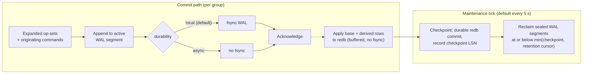
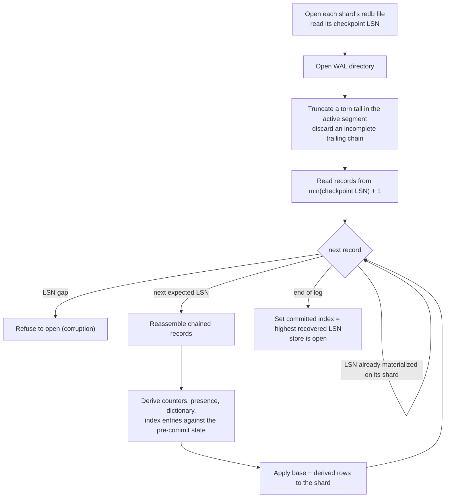

# Storage engine

This page explains how RushDB stores data durably: the **log-first** design
in which a segmented write-ahead log (WAL) is the source of truth and the
embedded redb database is a checkpointed materialization of it. It covers
the WAL format, checkpoints, crash recovery, WAL retention, retry receipts,
and compaction. It is for operators sizing disks or reasoning about
recovery, and for contributors working on durability.

## Log-first in one picture



Strictly, the acknowledgement is sent after the redb apply returns, but the
apply is a buffered write with no fsync. What makes the commit durable is
the WAL fsync; the redb write only makes it readable.

### Why log-first

A commit has two jobs: become durable, and become queryable. Doing both
with one redb transaction per commit means every commit pays redb's
copy-on-write page commit plus an fsync of the B-tree. Splitting the jobs
gives:

- **Cheap, sequential durability.** A commit is durable once a framed
  record is appended to a WAL segment and fsynced. Appends are sequential,
  and one fsync covers a whole group of concurrent commits
  ([write path](write-path.md#5-commit-groups)).
- **Buffered materialization.** Applying the same operations to redb runs
  with redb durability `None`: the B-tree is updated in memory and reaches
  disk at the next checkpoint. Readers see the new state immediately.
- **One recovery story.** Whatever redb lost in a crash is, by
  construction, still in the WAL beyond the last checkpoint and is
  replayed on open. The same records drive replication, WAL archiving,
  and point-in-time restore.

## The write-ahead log

### Segments

The WAL lives beside the redb file in `rushdb.redb.wal/`. It is a sequence
of segment files, each named by the first log sequence number (LSN) it
holds, for example `00000000000000000001.seg`. A segment has a fixed header
(magic `RDBWSEG1`, shard id, first LSN) followed by framed records. When the
active segment reaches its target size (64 MiB) it is sealed and a new one
starts. Segments are only ever deleted whole, and the active segment is
never deleted.

### LSNs are commit indexes

Each committed batch receives a **commit index**, and its WAL record's LSN
is that commit index. Commit indexes are dense: a commit that aborts —
failed precondition, conflict, expansion error, oversized write — never
consumes an index, so the log has no holes. Recovery and replication rely
on that density: a gap in the log is treated as corruption, not as
something to skip.

### Record framing

Every record carries a fixed 32-byte header:

| Field | Size | Purpose |
|---|---|---|
| Magic | 8 bytes | `RDBWAL01`, identifies a RushDB WAL record. |
| Format version | 4 bytes | Framing version; unknown versions are refused. |
| Shard id | 4 bytes | Physical shard the commit belongs to. |
| LSN | 8 bytes | The commit index. |
| Payload length | 4 bytes | Bytes that follow the header. |
| Checksum | 4 bytes | CRC32C of the payload. |

The payload holds the commit's **expanded base operations** (the exact
key/value puts, deletes, overwrites, and purges) together with the
**originating command batch** that produced them. Storing both serves two
consumers:

- Crash recovery and point-in-time restore apply the operations directly,
  with no planning and no expansion needed.
- Streaming replication ships the command batch, which a follower
  re-expands deterministically ([replication](replication.md)).

Derived rows (counters, presence, value dictionary, declared-index entries)
are **never** logged; they are recomputed from the base operations at apply
time on every node and on every replay ([derived state](derived-state.md)).

The checksum and length let recovery tell four cases apart: valid old data,
valid new data, a partially written record, and corruption. A torn record
at the tail of the **active** segment — a crash mid-append — is truncated
on open. A torn or corrupt record inside a **sealed** segment is a hard
error: that data was acknowledged and must not be silently dropped.

### Large commits

One framed record holds at most 64 MiB. A commit whose operations plus
command exceed that is split across several consecutive records that share
one LSN (a chained commit). Recovery, export, and replication reassemble the
chain and apply it once, atomically; an incomplete trailing chain is
discarded on open. A commit larger than `max-expanded-commit-bytes`
(default 512 MiB) is rejected before it receives a commit index, with a
`resource exhausted` error that does not affect the store. Loads beyond that
size belong in an external bulk pipeline, the way PostgreSQL `COPY` or a
dedicated importer would be used elsewhere.

## The redb materialization

redb is an embedded, crash-safe, copy-on-write B-tree. RushDB maps its
ordered keyspace onto a few redb tables:

| Table | Holds |
|---|---|
| `data` | The current value of every live key, prefixed with the 8-byte commit index that wrote it. |
| `history` | The newest retained superseded versions of a key (the head of its version chain). |
| `history_block` | Older superseded versions, sealed into immutable blocks linked from the head. |
| `history_expiry` | One row per retained version, ordered by the commit that superseded it, so garbage collection visits only expired versions. |
| `meta`, `checkpoint` | The GC floor and the durable checkpoint LSN. |

Each operation in an op-set has precise MVCC semantics:

| Operation | Effect |
|---|---|
| `Put` | Write a new current value; the previous value becomes a history version. |
| `Del` | Remove the key; the previous value becomes a history version. |
| `Set` | Overwrite without keeping history, and drop any history the key had. Used for internal bookkeeping such as counters and watermarks, so hot counters do not accumulate version chains. |
| `Purge` | Erase the key and all of its history without a new version. Used by tenant purge and retention sweeps. |

See [MVCC and snapshots](mvcc-and-snapshots.md) for how readers use these
tables.

## Checkpoints

A checkpoint makes the materialization durable and lets the WAL shrink:

1. Commit every shard's redb file with `Immediate` durability, recording
   the checkpoint LSN (and redb's allocator state, so an unclean stop does
   not force a full-file repair on the next open).
2. Fsync the WAL (this is what persists `async` commits).
3. Delete sealed WAL segments whose last record is at or below
   `min(checkpoint LSN, retention cursor)`.

Checkpoints run at the end of every maintenance tick (default every 5 s),
at clean shutdown, and before a base backup copies the store files. A base
backup uses a variant that first drains every pending commit, so the copied
file contains exactly the commit index its manifest claims.

## Crash recovery



Key properties:

- **Replay is idempotent.** A record at or below a shard's checkpoint LSN is
  skipped, so a crash during recovery is harmless.
- **No expander is needed.** Records carry expanded operations, so replay
  does not depend on planning logic; it only needs the deterministic
  deriver, which is installed before recovery starts.
- **A restored base backup without a WAL continues the sequence.** If the
  WAL directory is empty but the materialization has a checkpoint, the log
  continues numbering after that checkpoint rather than restarting at 1.
- **Failure is loud.** A gap, an LSN mismatch, a checksum failure in a
  sealed segment, or an unsupported version stops the open with an error.

### Durability modes

`durability` selects the acknowledgement contract:

| Mode | Acknowledged after | Crash exposure |
|---|---|---|
| `local` (default) | The WAL record is fsynced. | None for acknowledged commits. |
| `async` | The WAL record is appended, without fsync. | Commits since the last checkpoint (at most one maintenance tick, default 5 s) can be lost on a crash, power loss, or hard kill. Use only for re-importable bulk input. |

### Write fencing

If a WAL append, fsync, or materialization apply fails, the outcome on disk
is uncertain. The engine does not retry that commit under another commit
index. Instead it **fences the publisher**: the failing group and every
queued commit fail with the same error, all later writes are refused, and
`/ready` reports `durable publisher failed`. The process must be restarted;
recovery then replays whatever the WAL durably holds. A poisoned internal
lock fences the store the same way.

## WAL retention

Once a checkpoint covers a commit, crash recovery no longer needs it. Other
consumers might:

- a streaming-replication follower that has not yet fetched it;
- the WAL archiver, if `wal-archive-dir` is set;
- a base backup in progress;
- an open cursor that registered a claim;
- an open read view (transaction, cursor, request).

RushDB follows the PostgreSQL rule: **keep only what someone still needs.**
On every maintenance tick the retention floor is computed as:

```text
wanted   = committed − tx-log-keep-commits         (default keep: 0)
hard cap = max(committed − tx-log-retention-commits,  (default 100 000)
               byte floor from tx-log-retention-bytes) (default 4 GiB)
floor    = max(hard cap, min(wanted, oldest consumer claim or open reader))
```

Setting `tx-log-retention-commits` to `0` removes the commit cap, leaving
the byte cap. `tx-log-keep-all` keeps the whole log except what the byte
cap forces out (set `tx-log-retention-bytes` to `0` to keep everything).
Below the hard caps, consumers protect history. The caps themselves are hard: a consumer
the floor passes is dropped and must re-seed from a base backup; a follower
or archiver in that state receives `resync_required`. A consumer that stops
acknowledging loses its claim after `retention-consumer-lease-seconds`
(default 24 h), so a dead replica cannot pin the WAL forever.

Retention advances a durable **retention cursor**. WAL segments are deleted
by the next checkpoint, a whole segment at a time, only once they are below
both the checkpoint and the retention cursor.

> **Note:** WAL retention is unrelated to MVCC history. Superseded row
> versions are kept only for the oldest live reader; see
> [MVCC and snapshots](mvcc-and-snapshots.md#garbage-collection).

## Retry receipts

Every commit carries a **commit key**, and a retry with the same key must
return the original outcome instead of executing again. The server assigns
the key: a fresh one per native mutation, and one derived from the
transaction id for an interactive transaction, which is what makes
re-sending `commit` safe. That fact lives in
one place, a receipt row per commit key:

```text
receipt/<commit key>                  → status ‖ commit index ‖ created_ms ‖ payload
receipt-exp/<created_ms><commit key>  → (expiry index)
```

The receipt is written inside the same commit as the data it describes, so
it is durable exactly when the commit is. Stored response payloads are
zstd-compressed. A terminal abort (failed precondition, write conflict) is
recorded too, so a retry returns the recorded rejection.

Receipts expire by **time**, not commit count: after
`idempotency-window-seconds` (default 24 h) a receipt is treated as absent
even before it is deleted, and a retry with that key executes as a new
commit. The maintenance tick deletes expired receipts in bounded batches
through the expiry index. Receipt storage therefore tracks the commit rate
over the window, not the total commit count. See
[transactions](../query/transactions.md) for the client-facing contract.

## Compaction

redb is copy-on-write: a write produces new pages and frees old ones. Freed
pages are reused, but the file does not shrink on its own; its size is a
high-water mark. Larger files make commits and scans slower, so RushDB
compacts the file when it is safe and worthwhile.

The background compaction worker runs every `compact-interval-seconds`
(default 300 s; `0` disables it) and compacts only when **all** of these
hold:

1. **Quiescence:** no commit in the last `compact-quiesce-seconds`
   (default 10 s). Compaction never competes with a write burst.
2. **Worth it:** the file grew by at least `compact-growth-percent`
   (default 150 %) since the last compaction, **or** at least 10 000 keys
   were purged since then (a tenant purge frees pages without growing the
   file).
3. **No readers:** redb cannot compact while a read transaction is open.
   The worker retries for up to 2 s, then defers to the next interval and
   reports why.

Compaction first reclaims MVCC history up to the current commit, then
rewrites each shard file. It bounds the high-water mark; it does not shrink
the file all the way to the size of live data, because B-tree pages are not
kept full.

For a deterministic reclaim — for example between data-loading campaigns —
stop the server and run `rushdb serve --data-dir <dir> --compact`. It needs
exclusive access and fails with `readers active` if another process holds
the store. See [storage and compaction](../operations/storage-and-compaction.md).

## Experimental multi-shard layout

`shards > 1` (with `--experimental-sharding`) routes tenants to separate redb
files by a stable hash of the tenant ordinal, so different tenants
materialize in parallel. Each shard commits its part of a group as an
independent redb transaction, so a crash between shard commits is **not
crash-atomic** across shards. The engine refuses this layout unless you
acknowledge it explicitly. There is still one WAL and one commit sequence.

## See also

- [Write path](write-path.md)
- [MVCC and snapshots](mvcc-and-snapshots.md)
- [Replication](replication.md)
- [Storage and compaction](../operations/storage-and-compaction.md)
- [Backup and restore](../operations/backup-and-restore.md)
- [Configuration reference](../reference/configuration-reference.md)
