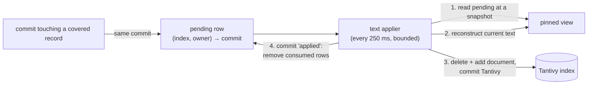

# Text internals

This page explains how RushDB's full-text search works: one Tantivy index
per declared text index, the pending rows that commits leave behind, the
background applier that brings Tantivy up to date, and the difference
between `eventual` and `immediate` consistency. It is for developers
choosing a consistency mode and operators watching text-index lag.

## Division of labour

RushDB delegates everything lexical to **Tantivy**: tokenization and
analysis, postings and positions, document frequencies, phrase matching,
and BM25 scoring. RushDB owns only what Tantivy cannot know:

- **which records belong** to a text index (label, property, and the index's
  build state);
- **what changed** since the index was last brought up to date;
- **consistency** between the Tantivy index and the database snapshot.

A text index is a declared index of kind `text` on one record label and one
property — or every string property of the record, written `*`. It is
declared like any other index (`index.create`, Cypher/GQL
`CREATE FULLTEXT INDEX`, SQL index DDL, or the MongoDB-style `createIndex`
with `"kind": "text"`); see [full-text search](../indexes-and-search/full-text-search.md).

## On-disk layout

Each text index has its own Tantivy directory:

```text
<data-dir>/text/<tenant>/<index-id>/
```

`<tenant>` is the tenant ordinal in hex. The Tantivy schema has two
fields: the record ordinal (indexed, stored, fast) and the text (indexed
for full-text). Directories are memory-mapped; an in-memory node keeps the
indexes in RAM. At most 256 indexes are held open per process; idle ones
are closed and reopened on demand. Dropping a text index deletes its
directory, and purging a tenant deletes the tenant's whole `text/<tenant>/`
tree.

## Pending rows: change capture inside the commit

The database does not call Tantivy during a commit. Instead, every commit
that creates, updates, retypes, or deletes a record covered by a text index
writes a **pending row** in the same commit:

```text
TEXT_PENDING (tenant, index id, record ordinal) → commit index of the change
```

Pending rows are ordinary base rows: logged in the WAL, replicated, and
recovered like everything else. A retype or delete also marks the record
pending under the label it left, so its document is removed from that
label's index. Building a new text index uses the same mechanism: each
backfill step marks the next range of the label's existing records
pending.



## The applier

The text applier runs every 250 ms. For each tenant that has text indexes,
and within a time budget per round, it applies pending changes in batches
of up to 512 records:

1. Open a read view and read up to 512 pending rows of the index.
2. For each record: delete its document from Tantivy; if the record still
   exists, is still covered by the index, and still has the index's label,
   reconstruct it at the view and add a document with its current text.
3. Commit Tantivy and reload its reader.
4. Commit an **applied** marker to the database that removes exactly the
   pending rows it consumed — compared by commit index, so a change that
   arrived after the view was opened stays pending for the next round.

If the process crashes between steps 3 and 4, the rows are still pending
after restart and are applied again. Re-applying is idempotent, because
each step replaces the record's document with its current text. A tenant
without text indexes costs one catalog read per round and never commits.
The applier never pins the WAL.

## Consistency modes

Each text index chooses when a search sees a write:

| Mode | Search behaviour | Use when |
|---|---|---|
| `eventual` (default) | Searches what the applier has applied so far. | High write rates; a lag of a few hundred milliseconds is acceptable. |
| `immediate` | Before searching, applies pending changes itself (up to 32 768 records), then searches. | Read-your-writes: a client searches right after writing. |

An `immediate` search behind a write storm larger than its apply bound
still returns rather than stalling indefinitely; the rest is applied by the
background applier. The per-index backlog is exported as the
`rushdb_text_pending` metric; it is not part of the search response.

> **Note:** The Tantivy index reflects the *applied* state, not the
> request's snapshot, so ranking is computed over the documents applied so
> far. Each hit is then resolved at the request's snapshot, and a hit whose
> record no longer exists there is dropped.

A text index answers searches only once it is `Ready`. While it is still
backfilling, a search against it returns an error naming its state.

## Search

A text search names the index, the query string, and a limit:

- **Query syntax.** The query string is parsed by Tantivy's query parser
  against the text field, so Tantivy's syntax applies (for example a quoted
  phrase). Bare terms are combined with OR.
- **Candidate restriction.** In a hybrid query, the records that pass the
  predicate are applied inside Tantivy's collector, so the lexical top *k*
  is drawn only from records that pass the filters.

Each hit returns the record id and its score.

Hits are ranked by BM25 score; equal scores are ordered by record ordinal,
so results are deterministic. Raw BM25 scores are only comparable within one
result set. Hybrid search fuses text and vector rankings by reciprocal-rank
fusion, which combines ranks rather than raw scores; see
[hybrid search](../indexes-and-search/hybrid-search.md).

## See also

- [Full-text search](../indexes-and-search/full-text-search.md)
- [Hybrid search](../indexes-and-search/hybrid-search.md)
- [Derived state](derived-state.md)
- [LMPG layout](lmpg-layout.md)
- [Monitoring](../operations/monitoring.md)
