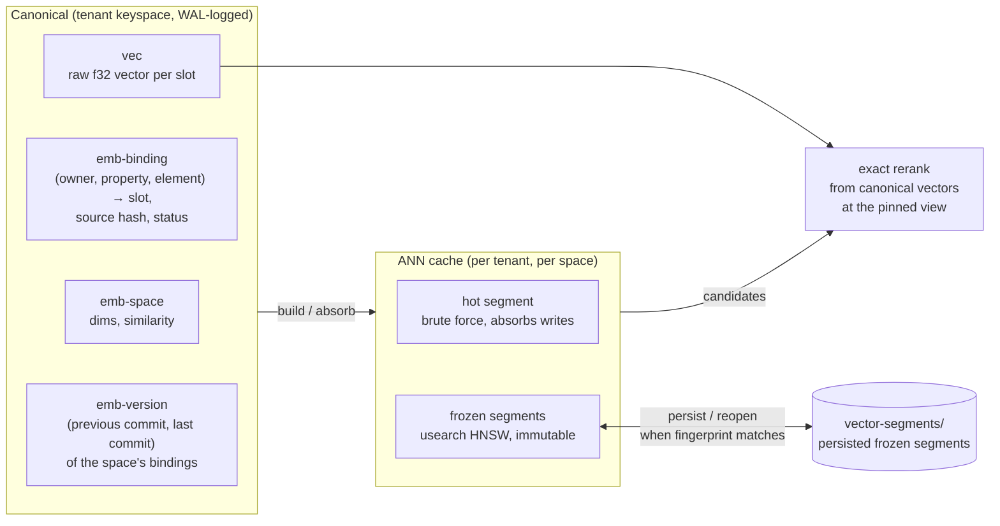
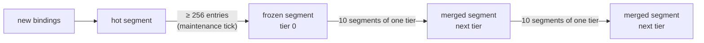
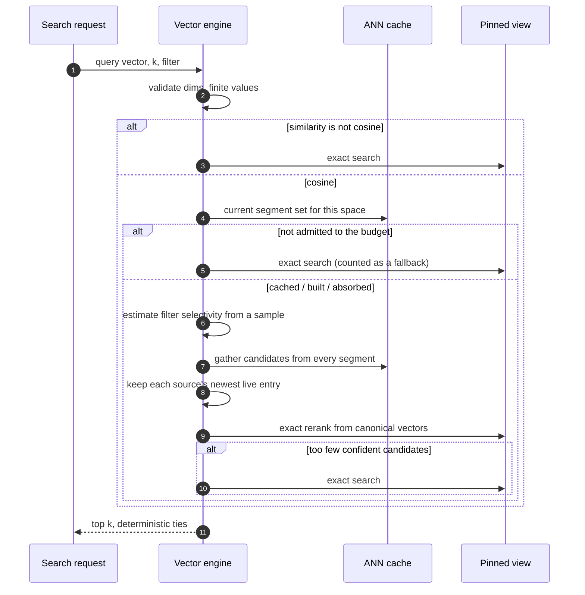

# Vector internals

This page explains how RushDB stores vectors and answers similarity
searches: canonical vector storage inside the LMPG keyspace, the segmented
approximate-nearest-neighbour (ANN) cache built with `usearch`, how
segments are frozen, merged, and persisted, exact reranking, and the
memory budget that governs it all. It is for operators sizing vector
workloads and for contributors working on search.

## Canonical vectors, derived ANN

The rule that shapes everything else: **canonical vectors are the truth,
and the ANN index is a cache.**

- Vectors, their bindings to records, and the vector spaces live in the
  ordinary tenant keyspace and are written through ordinary commits. They
  are durable, replicated, snapshot-isolated, and restored by recovery like
  any other row.
- ANN structures are built from those rows, may be persisted to disk to
  avoid rebuilds, and can be thrown away at any time. A missing, stale, or
  over-budget ANN index never fails a search; the search answers exactly
  instead.

### Spaces, bindings, and slots

- An **embedding space** fixes the dimensionality and the similarity
  metric (`cosine`, `dot`, or `euclidean`) and is addressed through a stable
  alias — the vector index name. Spaces are immutable once created; a
  tenant can hold up to 256.
- A **binding** attaches a vector to a source: an owner (record or
  relationship), a property, and an array element. It records which
  **slot** holds the vector and a hash of the source value at bind time.
  If the source property value changes, a binding that tracks it becomes
  **stale** and is excluded from search until a new vector is supplied.
- A **slot** holds the raw `f32` vector bytes.

Re-binding a source writes the new vector to a **fresh slot** rather than
overwriting the old one, so a snapshot pinned before the re-bind can still
read the old vector. The old slot is queued for reclamation and erased by
the maintenance tick once the MVCC floor passes the re-bind
([MVCC and snapshots](mvcc-and-snapshots.md#garbage-collection)).

Each space also has a **version row** holding the commit that last changed
its bindings and the one before. A cached ANN structure is current when its
version equals the space's latest; a new commit can be absorbed
incrementally when the cache sits exactly at the previous version. Writes
to other spaces or tenants never invalidate it.

## Exact search

Exact search is always available and is the reference result. It streams a
space's bindings from the pinned view in batches (1 024 rows or 4 MiB),
skips bindings that are not eligible or fail the request's filter, scores
each vector against the query, and keeps the top *k*. Ties are broken by a
total order on sources, so results are deterministic.

Exact search is used for:

- spaces whose similarity is `dot` or `euclidean` (the ANN providers gather
  candidates by cosine, and reranking cannot recover neighbours that a
  cosine gather missed);
- any search where the ANN cannot be admitted to the memory budget;
- filtered searches whose allowed set the ANN gather cannot reach with
  confidence.

## The segmented ANN cache

For cosine spaces, each tenant's vector engine keeps a **segment set** per
space:

- one **hot segment** — a small, flat, brute-force-scanned set that absorbs
  new bindings incrementally, without rebuilding anything;
- any number of **frozen segments** — immutable `usearch` HNSW graphs.

A live map records, for every source, which segment holds its current
entry. That one structure gives three behaviours for free: a re-bind moves
the source to its newest segment (newest wins), a retired or deleted
binding disappears from results, and superseded entries left in older
segments are ignored — without touching any segment's physical index.

### Freezing and merging

- The maintenance tick **freezes** a hot segment once it reaches 256
  entries, building a `usearch` graph from it. If maintenance falls behind,
  the write path itself freezes the hot segment at 1 024 entries as a
  backstop.
- The tick then runs at most one **size-tiered merge** per space: when ten
  frozen segments fall in the same size band, they merge into one segment
  of the next band, rebuilt from the live entries' canonical vectors. The
  merge reserves its working set from the vector cache budget first; a tier
  too large to merge within the free budget stays as it is. Segments that
  are at least half dead are rewritten first. The segment
  count therefore grows logarithmically with the space size rather than
  with its write history.
- Freezing and merging run on a fork of the segment set, outside the cache
  lock. The result is published only if the cache entry is still the one
  the work started from; otherwise it is discarded and retried on the next
  tick. Searches never wait for maintenance.

### Persistence

With a data directory, frozen segments are written under
`vector-segments/<tenant>/space-<id>/` (`seg-<uuid>`, with a manifest and an
`.entries` sidecar listing the bindings it holds) and served through
`usearch`'s memory-mapped view. When a space's ANN is not cached (after a
restart, or after its tenant was evicted for being idle), the next search
reopens every segment of the space and reconciles them with the current
bindings: an entry stays live only if it is still its source's binding, a
segment left without a live entry is deleted, and only the bindings no
segment covers are decoded again (usually the unfrozen tail). A damaged or
incomplete segment is deleted and its bindings decoded; it is a cache miss,
never data loss. Eviction keeps the files. A pure in-memory node keeps
segments resident only. Purging a tenant removes its segment directory.

## Search path

- **Filter-aware gathering.** A fixed-size gather wastes its candidates on
  points the filter rejects. For filtered searches, the engine samples 256
  entries to estimate the filter's selectivity and sizes one gather so the
  allowed set is well represented, up to a cap. When even that cannot reach
  enough allowed candidates, the search falls through to exact.
- **Exact rerank.** Candidates are rescored against their canonical vectors
  read at the request's snapshot, so scores are exact and consistent with
  the rest of the request, even though the ANN structure itself may have
  been built at a slightly different commit.
- **Snapshot consistency.** Binding eligibility, filters, and the vectors
  used for scoring are all read from the same pinned view, so a search
  never returns a source deleted before its snapshot.

## Memory budget

ANN structures are charged to the **vector cache budget**, a named child of
the shared logical-cache pool (`logical-cache-bytes`, default 128 MiB):

1. Before decoding any vector, a build reserves its working set: about
   `2 × dimensions + 320` bytes per vector (checked against real builds).
   A space is built in chunks sized to the free budget; each chunk is
   persisted as its own segment and released before the next, so a
   file-backed space larger than the budget is still built. A chunk that
   cannot be reserved refuses the build (the search answers exactly); the
   chunks already persisted are reopened by the next search. One build
   per space runs at a time; concurrent searches wait for it.
2. After the build, the reservation is resized to the structure's real
   measured size (for a file-backed segment, its entries and live map: the
   mapped file is page cache, not charged).
3. Each tenant engine also caps its cached ANN bytes (256 MiB) and the
   number of cached space generations (12), evicting least recently used
   entries.
4. When the budget cannot admit a space's index, the search answers
   exactly and increments `rushdb_ann_exact_fallbacks_total`.

> **Note:** ANN requires a logical cache budget. With
> `logical-cache-bytes: 0` there is nothing to bound ANN memory, so no
> ANN is built and every search answers exactly.

The per-tenant vector engine itself is a resident handle governed by
tenant residency: it is dropped when the tenant is idle and rebuilt on the
next request ([resource governance](resource-governance.md#tenant-residency)).

## See also

- [Vector search](../indexes-and-search/vector-search.md)
- [Hybrid search](../indexes-and-search/hybrid-search.md)
- [Derived state](derived-state.md)
- [Resource governance](resource-governance.md)
- [Metrics](../reference/metrics.md)
