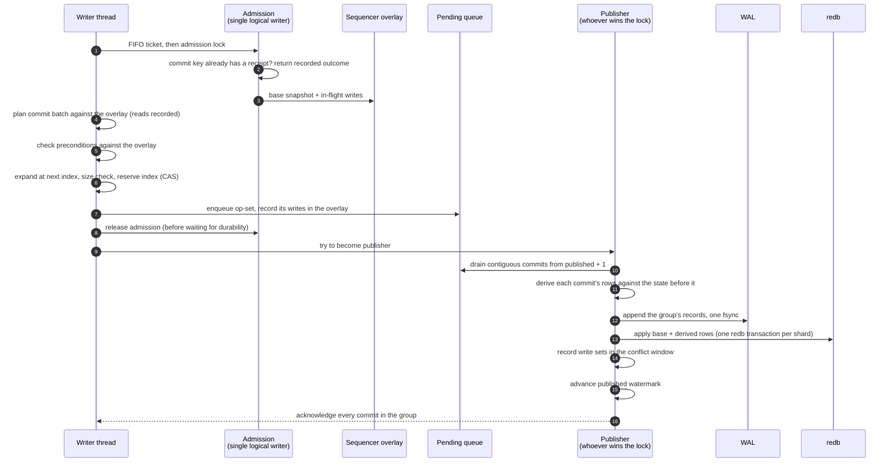
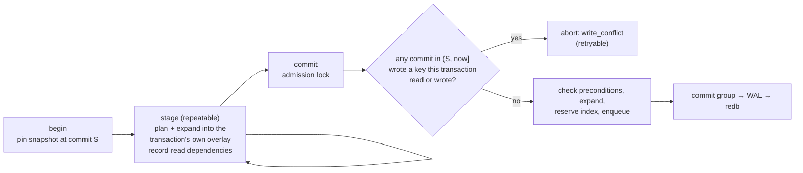

# Write path

This page follows a write from the moment the executor hands a mutation to
storage until the client receives a commit index. It explains admission,
planning and deterministic expansion, the sequencer overlay that lets
commits pipeline, commit groups and the shared fsync, apply-time
derivation, publication, and how interactive transactions and
query-language writes fit in. It is for operators tuning write throughput
and contributors working on the commit pipeline.

## Vocabulary

| Term | Meaning |
|---|---|
| **Commit batch** | The canonical, replayable description of a write: a tenant, a commit key, a list of LMPG mutations (create a record header, put an occurrence, link a relationship, …), and preconditions (a key must exist, or must be absent). |
| **Expansion** | The deterministic function that turns a commit batch, applied to the current state, into key/value operations (`Put`, `Del`, `Set`, `Purge`). |
| **Derivation** | A second deterministic function that computes derived rows (counters, presence, value dictionary, declared-index entries) from a commit's base operations and the state before it. |
| **Commit index** | The position of a commit in the single, dense commit sequence; also its WAL LSN. |
| **Published watermark** | The highest commit index that is durable and visible to new readers. |

## The pipeline

### 1. Admission

All local writes pass through one **admission lock**: RushDB has a single
logical writer per node. Planning and expansion of commit *N + 1* must
observe everything commit *N* wrote, including store-wide metadata such as
the tenant directory, so they are serialized. In front of the lock sits a
FIFO ticket gate, because a plain mutex does not hand off in arrival order
and a waiting writer could otherwise lose every race to writers that
re-acquire it.

By default a writer waits for its turn indefinitely. With `lock-timeout-ms`
set, a writer that cannot acquire admission in time fails with a retryable
`resource exhausted` error instead of stalling.

The first thing admission does is look up the **retry receipt** for the
commit key. If the key already committed, the recorded commit index and
response are returned without executing anything; if it was terminally
aborted, the recorded rejection is returned
([storage engine](storage-engine.md#retry-receipts)).

### 2. Planning against the sequencer overlay

Planning turns a protocol mutation (for example "put this record") into a
commit batch. It reads state — does the record exist, which property family
and type definition does this value use, which ordinal comes next — and must
see the effects of every earlier commit, even ones that are not yet durable.

Waiting for each predecessor to be fsynced would cap throughput at one
commit per fsync. Instead, the writer reads through the **sequencer
overlay**: a fresh snapshot of the committed state layered with the net
key effects of every commit that has been assigned an index but not yet
published. The overlay holds only distinct in-flight keys, is trimmed as the
publisher advances, and opens no long-lived read pin, so it never blocks
garbage collection.

Every key the planner reads is recorded as a read dependency. Preconditions
in the batch (`Exists` or `Absent`) are checked against the same overlay. A
violated precondition is terminal: the engine records an aborted receipt
for the commit key, so a retry returns the same rejection rather than
running again.

### 3. Expansion and index reservation

The batch is expanded into key/value operations at the next commit index.
Expansion also adds the commit's retry receipt and the "last applied"
watermark row. The expanded size, including the serialized command, is
checked against `max-expanded-commit-bytes` (default 512 MiB) before an
index is reserved.

The index is reserved with a compare-and-swap **after** expansion succeeds.
A failed expansion or an oversized commit therefore never consumes an index,
which keeps the commit sequence dense. If another reservation slipped in
first, the writer expands again at the new index.

### 4. Enqueue and release

The op-set enters the pending queue keyed by its commit index, and its
writes are folded into the sequencer overlay. Only then does the writer
**release admission**, before it waits for durability. The next writer can
plan immediately, against an overlay that already contains this commit.
This is what lets many commits share one fsync.

### 5. Commit groups

The committing thread then tries to become the **publisher**. Whoever holds
the publish lock drains the pending queue in commit-index order, starting at
`published + 1`, and stops at the first gap: a lower index still being
expanded. The drained commits form a **commit group**, which is bounded by:

| Setting | Default | Effect |
|---|---|---|
| `max-group-count` | 0 (no cap) | Maximum commits per group. |
| `max-group-bytes` | 0 (no cap) | Maximum op-set bytes per group. |
| `max-group-delay-ms` | 0 | How long the publisher lingers so more commits can join one fsync. Raising it trades a little latency for bulk throughput. |

A commit planned against the sequencer overlay has already read every
predecessor, so it may share a group with the commits it depends on: the
group applies strictly in commit-index order. A commit that was not planned
that way, and whose reads or writes overlap an earlier member of the group,
waits for the next group so that it applies on top of published state.

A publisher publishes only up to its own commit and then hands off, so the
thread that happened to win the lock is not stuck publishing everyone
else's work while its own request waits.

### 6. Derivation

For each commit in the group, the deriver computes derived rows —
counters, presence rows, value-dictionary refcounts, array markers,
declared-index entries — from the commit's base operations and the state
just before it: the shard's committed state plus the earlier commits of the
same group. Derived rows are **not** logged and never enter a conflict set;
every node and every replay recomputes them identically from the same base
log. See [derived state](derived-state.md).

### 7. WAL append and fsync

The group's records — base operations plus the originating command batch,
one record per commit, chained when larger than 64 MiB — are appended to the
active WAL segment, followed by one fsync under the default `local`
durability. This is the **durable acknowledgement boundary**. Under `async`
durability the fsync is skipped and the next checkpoint persists the
records.

### 8. Apply, publish, acknowledge

The base and derived operations are applied to redb, one write transaction
per physical shard per group, with redb durability `None` (the WAL already
made them durable). Then, in order:

1. The group's write sets are recorded in the in-memory **conflict window**
   that transaction validation uses.
2. The published watermark advances to the last commit of the group. New
   read views now see the group.
3. Every waiter in the group is acknowledged with its commit index.

If any step from WAL append onward fails, the outcome on disk is uncertain,
so the publisher fails the group and every queued commit, and fences the
store against further writes until restart
([storage engine](storage-engine.md#write-fencing)).

## Interactive transactions

Interactive transactions (`transaction.begin` / `stage` / `commit` /
`rollback`) reuse the same pipeline with one difference: they are planned
against a pinned snapshot and validated at commit.

- **Read-your-writes.** Each staged statement plans against the snapshot
  plus the writes staged so far, so a later statement sees an earlier
  statement's records.
- **First committer wins.** At commit the engine inspects the write sets of
  every commit published since the snapshot. If one of them touched a key
  the transaction wrote or a key its staging read, the transaction aborts
  with a retryable `write_conflict` and its receipt records the abort. No
  locks are taken during the transaction and there is no deadlock
  detection.
- **Bounded history.** The conflict window keeps recent write sets in
  memory under a 64 MiB cap, charged to the managed memory budget (it
  shrinks, oldest first, when the budget is full). A transaction old enough that a needed write
  set was evicted fails with a retryable error rather than risking a missed
  conflict.
- **Bounded staging.** Staged bytes are charged to the transaction pool;
  `tx-max-active`, `tx-max-operations`, and `tx-max-staged-bytes` cap active
  transactions and their size, and every transaction has a TTL (default and
  maximum 60 s).

The isolation contract that clients code against is described in
[MVCC and snapshots](mvcc-and-snapshots.md#isolation-contract) and
[transactions](../query/transactions.md).

## Query-language writes

SQL `INSERT`/`UPDATE`/`DELETE` and graph-language writes (Cypher, GQL,
Gremlin) are executed against the request's pinned snapshot first:

- **SQL** computes the changed rows with DataFusion and turns them into a
  commit batch.
- **Graph languages** load the tenant's graph from the snapshot into a
  disposable in-memory Grafeo graph, run the statement there, and diff the
  result into one commit batch. The working set is bounded (100 000 nodes,
  64 MiB, or less if the request budget is smaller); a statement over a
  larger tenant fails with a resource error instead of cloning it.

The resulting batch commits only if **no commit since the snapshot wrote
the same tenant**, whether published or still in flight; commits to other
tenants do not matter. This prevents a lost update within the tenant. A
statement that loses fails with the retryable `write_conflict`.

> **Warning:** Under concurrent writes to the same tenant, SQL and
> graph-language writes fail with `write_conflict` when another write to
> that tenant commits during their execution. Retry them, or use the native
> mutation operations, which plan under admission and do not conflict.

## Throughput characteristics

- **Planning and expansion are serialized node-wide.** One logical writer
  plans every commit; what parallelizes is durability (one fsync per group)
  and materialization. Many small commits from many clients coalesce well;
  a single client issuing one record per request pays planning plus a
  round trip per record. Batch writes (ingest documents in bulk, or put
  many records per request) for throughput.
- **Autocommit mutations do not conflict.** A native mutation is planned
  against the latest state (including in-flight commits) while it holds
  admission, so it never fails with `write_conflict`. It can still be
  rejected by planning (for example `conflict` when a record already exists)
  or by a violated precondition.
- **Writes are admitted fairly.** Writers acquire admission in arrival
  order. Across tenants, the request scheduler caps how many requests one
  tenant may have queued or running
  ([resource governance](resource-governance.md#request-scheduler)).

## See also

- [Storage engine](storage-engine.md)
- [Derived state](derived-state.md)
- [MVCC and snapshots](mvcc-and-snapshots.md)
- [Writing data](../query/writing-data.md)
- [Transactions](../query/transactions.md)
- [Capacity planning](../operations/capacity-planning.md)
