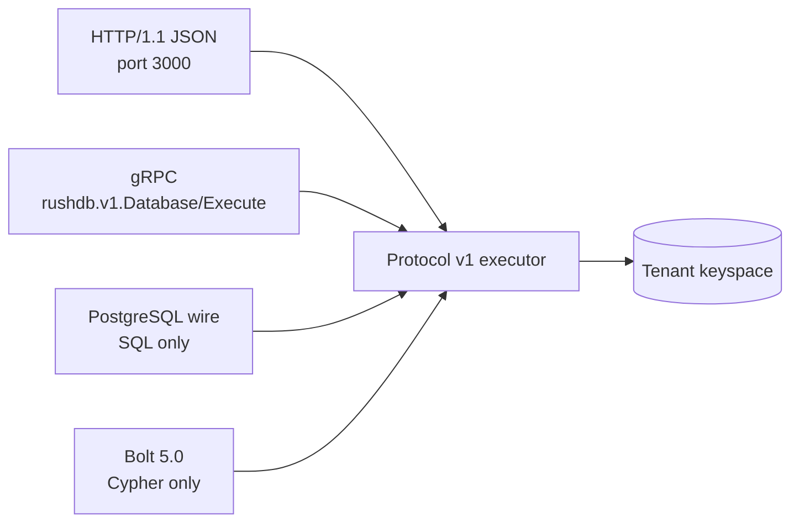

# Connectivity

This section explains how applications and tools reach a RushDB server: which
network protocols exist, what each one can express, and how clients
authenticate and select a tenant. Start here when you choose a client library
or put RushDB behind a proxy.

## One protocol, several transports

All transports execute the same versioned request envelope (Protocol v1)
against the same engine. HTTP and gRPC carry that envelope directly. The
PostgreSQL wire and Bolt listeners translate their native messages into it.

| Transport | Default | Enabled when | Carries | TLS |
|---|---|---|---|---|
| [HTTP](http-api.md) | port `3000` | always | every operation and every enabled language | yes (`--tls-cert`/`--tls-key`) |
| [gRPC](grpc.md) | off | `--grpc-port` is non-zero | every operation and every enabled language | no |
| [PostgreSQL wire](postgresql-wire.md) | port `5432` | the `sql` language is enabled | single SQL statements | no |
| [Bolt](bolt.md) | off | `--bolt-port` is non-zero and `cypher` is enabled | Cypher statements and Bolt transactions | no |

What each transport can express:

| Capability | HTTP | gRPC | PostgreSQL wire | Bolt |
|---|:-:|:-:|:-:|:-:|
| Native record, relationship, and aggregate queries | yes | yes | via SQL | via Cypher |
| All enabled statement languages | yes | yes | SQL only | Cypher only |
| Vector, full-text, and hybrid search | yes | yes | no | no |
| Multi-request transactions | yes | yes | no | yes (`BEGIN`/`COMMIT`) |
| Ingest, index management, backup, tenant purge | yes | yes | no | no |
| Capability tokens | yes | no | no | no |

## Listener security

All listeners bind the `--listen` address (default `127.0.0.1`). Only HTTP can
terminate TLS. The other three transports are cleartext and authenticate with
the bootstrap token only, so the server enforces two guards at startup:

1. On a **multitenant** server, gRPC, PostgreSQL wire, and Bolt refuse to bind
   to a non-loopback address, because the bootstrap token is not bound to a
   tenant and would let any holder select any tenant.
2. On a single-tenant server, binding them to a non-loopback address requires
   `--allow-insecure-listen`.

For remote access to these transports, run them on loopback behind a trusted
local proxy that terminates TLS and authenticates callers. See
[Security](../operations/security.md).

## Choosing a transport

- **Application backends and SDKs:** HTTP. It exposes everything, supports TLS
  and per-tenant capability tokens, and is the recommended bulk-load path
  (HTTP/1.1 keep-alive).
- **Service meshes:** gRPC, which carries the identical envelope over HTTP/2.
- **SQL tools and BI clients:** PostgreSQL wire with a PostgreSQL driver.
- **Neo4j-style applications:** Bolt with Cypher.

## Pages in this section

1. [HTTP API](http-api.md): the Protocol v1 envelope, operations, and errors.
2. [PostgreSQL wire protocol](postgresql-wire.md): psql and drivers.
3. [gRPC](grpc.md): the `Database.Execute` service.
4. [Bolt](bolt.md): Cypher over the Neo4j wire protocol.
5. [CLI](cli.md): the `rushdb` command.
6. [Authentication](authentication.md): tokens, capability tokens, and tenant
   selection.

## See also

- [Query languages](../languages/README.md)
- [HTTP endpoint reference](../reference/http-endpoints.md)
- [Error codes](../reference/error-codes.md)
- [Configuration](../operations/configuration.md)
