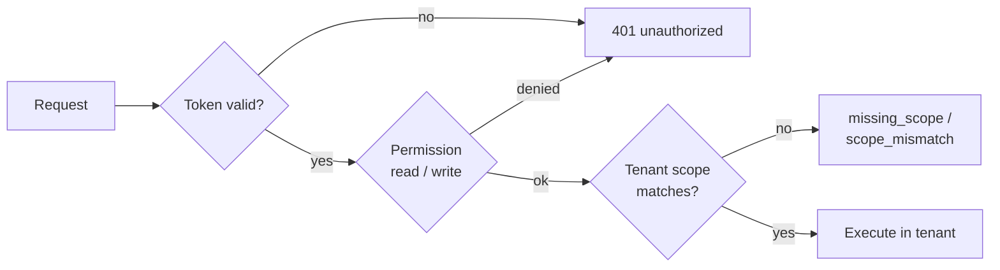

# Authentication

This page explains how RushDB decides who may call it and which tenant a call
operates on: the bootstrap token, signed capability tokens, how each transport
selects a tenant, and how data-access policies narrow what a caller can read.
It is for operators securing a deployment and for developers writing a proxy
or SDK.

## Model

RushDB has no user accounts. Identity, users, sign-in, and per-user
permissions belong to the application in front of the database. The engine
checks three things on every request:

1. **Credential.** Is the token valid? Either the bootstrap token or a
   signed capability token.
2. **Permission.** Does the credential allow this operation (`read` or
   `write`)?
3. **Tenant.** Which tenant keyspace does the request use, and is the
   credential allowed to use it?



## Bootstrap token

The bootstrap token is the server's root credential. Set it with `--token` or
the `RUSHDB_TOKEN` environment variable:

```bash
RUSHDB_TOKEN="$(openssl rand -hex 32)" rushdb serve --data-dir ./data
```

| Property | Value |
|---|---|
| Default | `local-token`. Always change it outside local development. |
| Authority | Every operation on every tenant. |
| Transports | All: HTTP, gRPC, PostgreSQL wire (as the password), Bolt (as `HELLO` credentials). |
| Storage | Never written to `config.yml`. |

Tokens are compared in constant time. On HTTP, send the token in
`Authorization: Bearer <token>` or `X-RushDB-Token: <token>`:

```bash
curl -s http://127.0.0.1:3000/protocol/v1/execute \
  -H "Authorization: Bearer $RUSHDB_TOKEN" \
  -H 'Content-Type: application/json' \
  -d '{"protocolVersion":1,"operation":{"kind":"describe","describe":{"kind":"labels","query":{}}}}'
```

Treat the bootstrap token as operator authority. Give applications and
services capability tokens instead.

## Capability tokens

A capability token is a short-lived, signed credential that grants specific
permissions and, on a multitenant server, exactly one tenant. Capability tokens
are accepted **on HTTP only**.

### Enabling

Start the server with an HMAC secret, given as hex:

```bash
rushdb serve --data-dir ./data --multitenant \
  --capability-secret "$(openssl rand -hex 32)"
```

The secret can also come from `RUSHDB_CAPABILITY_SECRET`. It is never written
to disk. The bootstrap token keeps working alongside capability tokens.

### Token format

A token is `<claims>.<signature>`, where:

- `<claims>` is the base64url encoding (no padding) of a JSON object;
- `<signature>` is the base64url encoding (no padding) of
  HMAC-SHA256(secret, `<claims>` as ASCII text).

| Claim | Type | Meaning |
|---|---|---|
| `sub` | string | Subject the token was issued to (informational). |
| `scope` | string | Space-separated permissions: `read`, `write`, or `*` for all. |
| `tenant` | string | The one tenant the token may use. Required on a multitenant server; must be absent on a single-tenant server. |
| `iat` | integer | Issued-at, Unix seconds. |
| `exp` | integer | Expiry, Unix seconds. An expired token is rejected. |

### Minting a token

RushDB does not issue tokens over the network; your control plane mints them
with the shared secret. For example, in Python:

```python
import base64, hashlib, hmac, json, os, time

def b64url(data: bytes) -> str:
    return base64.urlsafe_b64encode(data).rstrip(b"=").decode()

secret = bytes.fromhex(os.environ["RUSHDB_CAPABILITY_SECRET"])
now = int(time.time())
claims = {
    "sub": "reporting-service",
    "scope": "read",
    "tenant": "tenant-a",        # omit on a single-tenant server
    "iat": now,
    "exp": now + 3600,
}
payload = b64url(json.dumps(claims, separators=(",", ":")).encode())
signature = b64url(hmac.new(secret, payload.encode(), hashlib.sha256).digest())
print(f"{payload}.{signature}")
```

Use it exactly like the bootstrap token, together with the tenant header it is
bound to:

```bash
curl -s http://127.0.0.1:3000/protocol/v1/execute \
  -H "Authorization: Bearer $CAPABILITY" \
  -H 'X-RushDB-Tenant: tenant-a' \
  -H 'Content-Type: application/json' \
  -d '{"protocolVersion":1,"context":{"scope":"tenant-a"},
       "operation":{"kind":"query","query":{"kind":"records","query":{"labels":["NOTE"],"limit":10}}}}'
```

The same token sent with `X-RushDB-Tenant: tenant-b` is rejected with 401.

### Permissions

| Permission | Operations |
|---|---|
| `read` | `query`, `describe`, `backup` (of the token's own tenant), and `GET /metrics` |
| `write` | `mutate`, `ingest`, `index`, `transaction`, `purgeTenant` |
| `*` | everything |

A token that needs both reads and writes uses `"scope": "read write"`. A
request whose body cannot be parsed requires `write`.

### Rotation and revocation

There is no revocation list. Keep lifetimes short and rotate the secret to
invalidate every outstanding token at once: restart the server with a new
`--capability-secret`, and tokens signed with the old secret stop verifying.

## Selecting a tenant

On a single-tenant server there is one keyspace and no tenant selector; an
envelope that carries `context.scope` fails with `scope_mismatch`. On a multitenant server (`--multitenant`) every request must
name its tenant, and the server fails closed when it is missing:

| Transport | Tenant selector | Accepted credentials |
|---|---|---|
| HTTP | `X-RushDB-Tenant` header **and** the same value in `context.scope` | bootstrap token, or a capability token bound to that tenant |
| gRPC | `x-rushdb-tenant` metadata **and** the same value in `context.scope` | bootstrap token |
| PostgreSQL wire | `database` startup parameter | bootstrap token |
| Bolt | `HELLO` field `db` (see [Bolt](bolt.md)) | bootstrap token |

Tenant values are opaque strings of up to 1024 bytes. A new value creates its
tenant on first use. See [Tenants](../data-model/tenants.md).

> **Warning:** gRPC, PostgreSQL wire, and Bolt accept only the bootstrap token,
> which can select any tenant. That is why, on a multitenant server, the engine
> refuses to bind them to a non-loopback address. Put them behind a trusted
> local proxy, and use HTTP with capability tokens for direct per-tenant
> access.

## Data-access policies

Below the tenant boundary, a tenant can carry a data-access policy that
narrows what reads may see:

| Policy element | Effect |
|---|---|
| Allowed labels | Records of other labels are not readable. |
| Denied relationship types | Traversal through those types is refused. |
| Visible properties | Per label, the only properties returned (an allow-list). |
| Maximum results | Upper bound on rows a query may return. |

A policy is either `BoundaryOnly` (tenant isolation only) or `PolicyEnforced`.
Under `PolicyEnforced`, native record queries, aggregates, single-record
reads, vector search, the catalog reads (`describe.schema`, `labels`,
`properties`, `schemaSummary`, `names`, `valueOverlap`, `propertyValues`,
`searchValues`) and SQL `SELECT` apply the policy: they see only allowed
labels, their visible properties and allowed relationship types. A request
outside it fails with `unauthorized`. Operations that cannot yet apply a
policy fail closed with `unauthorized` ("policy-enforced reads are
unavailable for this adapter"): Cypher, GQL, Gremlin, SQL/PGQ and Mongo
statements, `joinPairs`, `vectorIndexCandidates`, `text` search,
`describe.explain`, and `backup`.

Policies are read and installed with the `policy` operation, which only the
boot token may call: a capability token can never change the policy that
limits it (see [Security](../operations/security.md#data-access-policies)). A
tenant without a policy has no restrictions beyond its own boundary.

## See also

- [Security](../operations/security.md)
- [HTTP API](http-api.md)
- [Tenants](../data-model/tenants.md)
- [Connectivity overview](README.md)
- [Error codes](../reference/error-codes.md)
