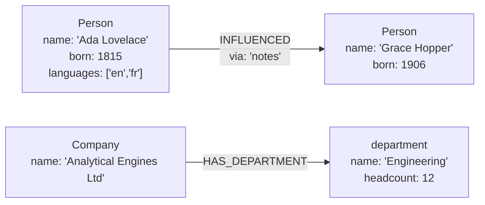

# Data model

This section describes how RushDB represents data, as seen from a client:
what a record is, which values a property can hold, how relationships work,
what the engine learns about your data on its own, how tenants isolate data,
and how nested JSON becomes a graph. Read it before designing the shape of
your data; the [Querying](../query/README.md) section builds on it.

## The model at a glance

RushDB's model is the **Labeled Meta-Property Graph (LMPG)**. Records and
relationships form a graph, and properties are first-class: each property is
a typed definition shared by every record that uses it, and each value is
stored as its own occurrence rather than inside a per-record map. The model
follows a few deliberate rules:

- **One primary label per record.** A record is a `Person` or a `Company`,
  never both. The label can be changed atomically later.
- **Typed, multi-value properties.** Each value is a boolean, number, string
  or datetime. A property may hold several values, and `null` is stored as an
  explicit value distinct from "absent".
- **Typed, directed relationships** that can carry properties.
- **An emergent schema.** Nothing is declared up front; the engine keeps an
  exact catalog of the labels, properties, types and relationship shapes that
  exist, and you can query it.
- **Tenant keyspaces.** A node holds either one keyspace or many isolated
  ones.

## Pages

1. [Records and labels](records-and-labels.md) — record identity, the single
   primary label, and creating, updating, retyping and deleting records.
2. [Properties and types](properties-and-types.md) — value types, type
   inference, arrays, explicit null, and property-name rules.
3. [Relationships](relationships.md) — relationship types, direction,
   properties, and the ways to create and remove them.
4. [Schema catalog](schema-catalog.md) — what the engine records about your
   data and how to inspect it.
5. [Tenants](tenants.md) — single-tenant and multitenant modes and how each
   request selects its keyspace.
6. [Nested import](nested-import.md) — turning nested JSON into records and
   relationships, with type inference and upsert options.

## See also

- [Concepts](../getting-started/concepts.md)
- [LMPG layout](../architecture/lmpg-layout.md) — how the model is stored on
  disk
- [Writing data](../query/writing-data.md)
