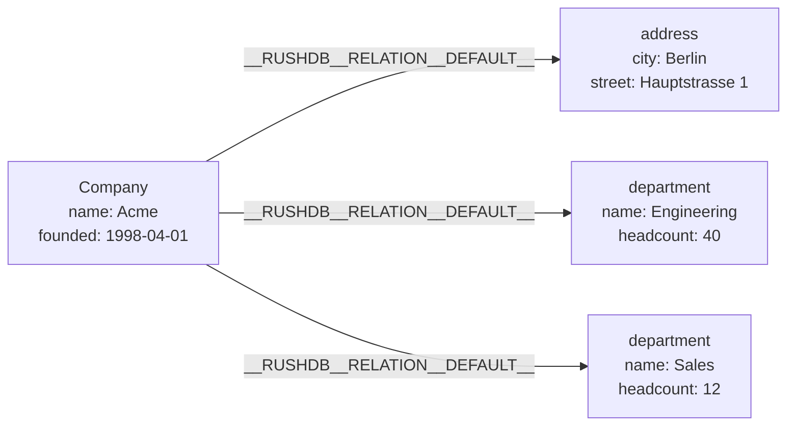

# Nested import

This page explains how the `ingest` operation turns nested JSON documents
into records and relationships: how labels are chosen, how nesting becomes
relationships, which options control typing and relationship names, how
upserts (merges) work, and how large imports are committed. It is for
developers loading existing JSON — API payloads, exports, fixtures — into
RushDB without reshaping it first. The `rdb` helper used in the examples is
defined in the [Quickstart](../getting-started/quickstart.md#1-install-and-start-a-node).

## The idea

`putRecord` writes one flat record. `ingest` accepts a whole document tree
and decomposes it breadth-first:

- every JSON **object** becomes a **record**;
- an object nested under a key becomes a **child record** whose label is the
  key;
- every child is joined to its parent by a **relationship** from parent to
  child;
- scalar values and arrays of scalars become **properties**.

```bash
rdb '{
  "protocolVersion": 1,
  "operation": {
    "kind": "ingest",
    "ingest": {
      "kind": "documents",
      "label": "Company",
      "documents": {
        "name": "Acme",
        "founded": "1998-04-01",
        "address": { "city": "Berlin", "street": "Hauptstrasse 1" },
        "department": [
          { "name": "Engineering", "headcount": 40 },
          { "name": "Sales", "headcount": 12 }
        ]
      },
      "options": { "returnResult": true }
    }
  }
}'
```

produces this graph:



and responds with:

```json
{
  "protocolVersion": 1,
  "response": {
    "kind": "ingested",
    "count": 4,
    "relationships": 3,
    "records": [ "… four canonical records, parents before children …" ]
  }
}
```

Nesting can go as deep as you like; each level becomes another hop in the
graph.

## The request

| Field | Required | Meaning |
|---|---|---|
| `label` | See [Labels](#labels) | The label of the top-level record(s). |
| `documents` | Yes | One JSON object, or an array of objects (each becomes a top-level record). |
| `options` | No | An object with the options below. Unknown option keys are ignored; a known key with the wrong JSON type is rejected with `invalid_request`. |

The response kind is `ingested`, with `count` (records in the document tree),
`relationships` (parent → child links in the tree) and `records`.

## Labels

- **Top-level records** take the request's `label`.
- **Child records** take the JSON key they appear under, verbatim: the
  `department` key above produces records labelled `department`.
- With `capitalizeLabels: true`, every label — including the top-level one —
  is upper-cased (`COMPANY`, `ADDRESS`, `DEPARTMENT`).

You may omit `label` when `documents` is a **container object**: an object
whose every value is an object or an array of objects. Each top-level key
then becomes a label, and the container itself is not stored:

```bash
rdb '{"protocolVersion":1,"operation":{"kind":"ingest","ingest":{"kind":"documents",
  "documents": {
    "planet":    { "name": "Alderaan" },
    "character": [ { "name": "Leia Organa" }, { "name": "Han Solo" } ]
  },
  "options": { "capitalizeLabels": true }
}}}'
```

This stores one `PLANET` and two `CHARACTER` records, with no relationship
between them. A request without `label` whose `documents` is an array, an
empty object, or an object with scalar properties is rejected with
`invalid_request` ("label is required …").

> **Note:** The same "container" rule applies to a labelled top-level object
> that has **no scalar properties and at most one nested key**: the wrapper
> is not stored, and its child becomes a top-level record. For example, with
> `label: "Order"`, the document `{"customer": {"name": "Ada"}}` stores one
> `customer` record and no `Order`. Give the wrapper at least one scalar
> property if you want it stored.

## How values are mapped

| JSON value under a key | Becomes |
|---|---|
| Scalar (`"x"`, `1`, `true`) | A property |
| `null` | A property holding an explicit null |
| Array of scalars | A multi-value property |
| `[]` | A property holding an empty array |
| Object | A child record (label = key) and a relationship |
| Array containing objects | One child record per element, each with a relationship |

The full rules for types, arrays and null are on
[Properties and types](properties-and-types.md). Two import-specific
cautions:

- In an array that contains objects, **every** element becomes a child
  record; a scalar element mixed in produces a child record with no
  properties.
- The key `$vectors` is reserved: it attaches embeddings instead of becoming a
  property (see [Attaching vectors](#attaching-vectors)).

## Options

| Option | Type | Default | Effect |
|---|---|---|---|
| `suggestTypes` | boolean | `true` | Store ISO date/datetime strings as datetimes. With `false`, every value is stored as text. |
| `convertNumericValuesToNumbers` | boolean | `false` | With `suggestTypes`, store numeric strings (`"42"`) as numbers. |
| `skipEmptyValues` | boolean | `false` | Do not store empty strings; drop empty strings from arrays. |
| `capitalizeLabels` | boolean | `false` | Upper-case every label. |
| `relationshipType` | string | `__RUSHDB__RELATION__DEFAULT__` | Type for every parent → child relationship. |
| `relationshipTypes` | object | `{}` | Per-key relationship types, e.g. `{"department": "HAS_DEPARTMENT"}`. Keys not listed fall back to `relationshipType`. |
| `returnResult` | boolean | `false` | Return the created or updated records in `records`. |
| `mergeBy` | array of strings | absent | Upsert instead of create, matching on these properties. `[]` matches on every incoming property. |
| `mergeStrategy` | string | absent | `append` or `rewrite`; see [Upserts](#upserts-merge). |
| `merge` | boolean | `false` | Shorthand for `mergeBy: []` with `mergeStrategy: "append"`. |

Name relationships at import time so you never have to rename them later:

```json
"options": {
  "relationshipTypes": { "address": "HAS_ADDRESS", "department": "HAS_DEPARTMENT" }
}
```

If you already imported with the default type, rename afterwards with
`retypeRelations` (see [Relationships](relationships.md#rename-a-relationship-type)).

`returnResult` returns records only for imports of up to 1,000 records; above
that, `records` is empty and you can read the data back with a query.

## Upserts (merge)

Without merge options every import **creates** new records, so importing the
same document twice stores it twice. Merge options turn the import into an
upsert: for each record in the tree, the engine looks for an existing record
with the **same label** whose merge keys hold the **same values**; if it finds
one, it updates it, otherwise it creates a new record.

| Options | Matching keys | On match |
|---|---|---|
| `mergeBy: ["email"]` | `email` | `append` |
| `mergeBy: ["email"], mergeStrategy: "rewrite"` | `email` | `rewrite` |
| `mergeBy: []` or `merge: true` | Every property in the incoming record | `append` |
| `mergeStrategy` alone | Every property in the incoming record | That strategy |

| Strategy | Effect on a matched record |
|---|---|
| `append` | Incoming properties are set; properties not in the document are kept. |
| `rewrite` | All existing properties are removed, then the incoming ones are set. |

Example — keep one record per person, keyed by email, and refresh the rest:

```bash
rdb '{"protocolVersion":1,"operation":{"kind":"ingest","ingest":{"kind":"documents",
  "label": "Person",
  "documents": [
    { "email": "ada@example.com",   "name": "Ada Lovelace", "visits": 3 },
    { "email": "grace@example.com", "name": "Grace Hopper", "visits": 1 }
  ],
  "options": { "mergeBy": ["email"] }
}}}'
```

Running it again with `"visits": 4` for Ada updates Ada's record instead of
adding a third person.

Rules worth knowing:

- **Matching applies to every record in the tree**, children included, using
  the same keys. A record that lacks a merge key — on either side — never
  matches and is created. For nested documents, either choose keys that every
  label carries or use `merge: true`.
- **Values compare with their types**: `17` matches `17` and `17.0`, but not
  `"17"`. A multi-value key must match as a whole list.
- **`__id` is the record's id, not a property.** A document's `__id` (a
  UUID, dashes optional) becomes the new record's id; with
  `mergeBy: ["__id"]` the record is found by id, and a miss creates it with
  that id. Other names starting with `__` are reserved and refused; `_id` is
  an ordinary property.
- **Index the merge keys of large labels.** Without an ordered index on a
  key, the upsert reads the key on every record of the label that has it,
  and holds those values in memory: over `query-memory-max` it fails with
  `resource_exhausted`, and over an unindexed-walk limit, when one is set,
  it is refused up front. Both errors name the index to declare.
- **Relationships are not duplicated.** After records are matched or created,
  each parent → child link is created only if an edge of that type does not
  already join the two records. Re-importing a merged document therefore
  links a new parent to existing children instead of copying them.
- **Rows that share a key inside one request** are applied in order, so a
  later row updates the record an earlier row created.

## Attaching vectors

A `$vectors` array on any object attaches embeddings to the record created
from it, in the same request:

```json
{
  "title": "Ticket 42",
  "body": "The printer is on fire",
  "$vectors": [
    { "propertyName": "embedding", "vector": [0.12, 0.98, 0.05], "index": "ticket-embedding" }
  ]
}
```

| Field | Meaning |
|---|---|
| `propertyName` | The vector property, matching the index definition. |
| `vector` | The components; the length must match the index's dimensions. |
| `index` | The name of an existing vector index. Required unless the node was configured to derive index names. |

The vector index must exist before the import (create it with
`index.createVector`); an unknown index name fails the request before any
record is written. If binding the vectors fails after the records were
written, a plain (non-merge) import removes the records it just created; a
merge import reports the partial progress instead, and can be retried. See
[Vector search](../indexes-and-search/vector-search.md).

## How an import is committed

An import is **not** one transaction. It commits in bounded steps:

| Import kind | Commits |
|---|---|
| Plain create | All records in one atomic commit, then all relationships in a second |
| Merge | Records in atomic chunks of 1,024, then all relationships in one commit |

A reader can therefore briefly see the new records before their
relationships exist, and a failure between steps leaves the earlier steps in
place. Merge imports are safe to retry after a failure — matched records are
updated, not duplicated. A plain create import is not: retrying it creates
the records again. When you need retry safety, use merge options.

Size limits:

- One request body is limited to 16 MiB by default (`server.body-limit`).
- Batches of about **500 documents per request** are the recommended size:
  larger requests risk `413 Payload Too Large` or timeouts without loading
  faster.
- A single commit is capped by `max-expanded-commit-bytes` (512 MiB by
  default); larger loads are refused with `resource_exhausted` and belong in
  multiple requests.

For all-or-nothing writes across several records and relationships, use a
[transaction](../query/transactions.md) instead of `ingest`.

## See also

- [Properties and types](properties-and-types.md)
- [Relationships](relationships.md)
- [Writing data](../query/writing-data.md)
- [Vector search](../indexes-and-search/vector-search.md)
- [Limits](../reference/limits.md)
