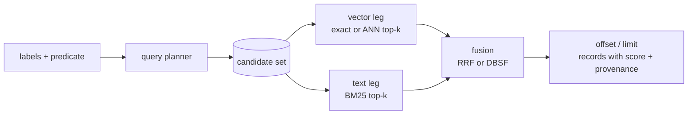

# Hybrid search

This page explains `query.hybrid`, which combines graph filtering, vector
similarity and BM25 keyword ranking in one request and fuses the rankings,
by reciprocal-rank fusion (RRF) or distribution-based score fusion (DBSF). It is for developers building retrieval for RAG
or search experiences where neither semantic nor keyword matching alone is good
enough.

Before you start, you need a [vector index](vector-search.md) with bound
vectors, a [text index](full-text-search.md) on the same label, or both.

## How a hybrid query runs



1. **Filter once.** `labels` and `predicate` are resolved by the
   [query planner](query-planning.md) into one candidate set of records.
2. **Rank inside the candidates.** The vector leg and the text leg each rank
   only records in that set. Filtering happens before ranking, so a record
   outside the predicate can never take a top slot.
3. **Fuse.** Each leg contributes to every record it returned, by the
   chosen [fusion](#fusion). A record found by both legs receives both
   contributions. Raw cosine and BM25 scores are never compared directly.
4. **Page and return.** Fused results are sorted by fused score (ties by
   record), `offset` results are skipped, and up to `limit` full records are
   returned.

Each leg fetches `prefetchLimit` hits before fusion, by default
`4 × (offset + limit)`, so that records ranked moderately by both legs can
still surface and deep pages are not under-filled.

## Fusion

| `fusion` | A leg's contribution to a record | Use when |
|---|---|---|
| `rrf` (default) | `weight / (rrfK + rank + 1)`, `rank` from 0 | The legs' scores are not comparable or their spread does not matter; robust default. |
| `dbsf` | `weight × normalized score`: each leg's scores are mapped by that leg's own mean ± 3 standard deviations to `[0, 1]` (clamped) | How far ahead a record is within a leg should count, not just its place. |

- DBSF follows Qdrant's definition. A leg whose returned scores do not spread
  (one hit, or all equal) maps them all to 0.5. Normalization uses the scores
  the leg returned, so `prefetchLimit` shapes the distribution.
- `weight` (default 1) sets a leg's share: `0` leaves the other leg's order,
  `2` doubles a leg's pull. At least one leg's weight must be above 0.
- With one leg, `score` is that leg's own score, and `fusion` and `weight` do
  not apply.

## Request

| Field | Type | Required | Default | Description |
|---|---|---|---|---|
| `labels` | string[] | no | `[]` | Labels a candidate must carry; empty matches every label. |
| `predicate` | object | no | `{}` | Filter applied before either leg ranks (same syntax as `query.records`). |
| `vector` | object | one of `vector`/`text` | — | Vector leg (below). |
| `text` | object | one of `vector`/`text` | — | Lexical leg (below). |
| `offset` | integer | no | 0 | Fused results to skip. |
| `limit` | integer | yes | — | Fused results to return (minimum 1). |
| `fusion` | string | no | `rrf` | `rrf` or `dbsf` ([Fusion](#fusion)). |
| `rrfK` | number | no | 60 | RRF smoothing constant (≥ 0). |

At least one leg is required; with both set the query is a true hybrid.

**Vector leg**

| Field | Required | Default | Description |
|---|---|---|---|
| `property` | yes | — | Vector property. |
| `vector` | yes | — | Query vector with the index's dimensions. |
| `index` | yes¹ | — | Vector index name. |
| `similarity` | no | `cosine` | Only used to derive the index alias when `index` is omitted. |
| `mode` | no | `auto` | `auto`, `exact` or `ann` (see [Vector search](vector-search.md#exact-versus-approximate-ann)). |
| `ef` | no | `resources.vector-default-ef` | ANN breadth when the leg runs on the ANN graph. |
| `scoreThreshold` | no | — | Drop vector hits scoring below this before fusion. |
| `weight` | no | 1 | This leg's share of the fused score (≥ 0). |
| `prefetchLimit` | no | `4 × (offset + limit)` | Hits this leg ranks before fusion, 1 to 10,000. Below `offset + limit`, a page can hold fewer results. |

¹ Required while `resources.require-vector-index-name` is on (the default).

**Text leg**

| Field | Required | Description |
|---|---|---|
| `index` | yes | Text index name. The index must be `ready`. |
| `query` | yes | Query string ([syntax](full-text-search.md#query-syntax)). |
| `allTerms` | no | Unmarked terms must all match (AND) instead of any (OR). Default `false`. |
| `phrase` | no | Match the whole query as one phrase. Default `false`. |
| `weight` | no | This leg's share of the fused score (≥ 0). Default 1. |
| `prefetchLimit` | no | Hits this leg ranks before fusion, 1 to 10,000. Default `4 × (offset + limit)`. |

Hybrid search covers **records** only. For relationship vectors, use
`query.vector` directly.

## Example

The text index `docs` covers `Doc` with `property: "*"` and the vector index
`doc-embedding` holds 2-dimensional vectors:

```bash
curl -s http://127.0.0.1:3000/protocol/v1/execute \
  -H "Authorization: Bearer $RUSHDB_TOKEN" \
  -H "Content-Type: application/json" \
  -d '{
    "protocolVersion": 1,
    "operation": {
      "kind": "query",
      "query": {
        "kind": "hybrid",
        "query": {
          "labels": ["Doc"],
          "predicate": { "tag": "keep" },
          "vector": {
            "property": "embedding",
            "vector": [1.0, 0.0],
            "index": "doc-embedding"
          },
          "text": { "index": "docs", "query": "quick" },
          "limit": 10,
          "rrfK": 60
        }
      }
    }
  }'
```

```json
{
  "protocolVersion": 1,
  "response": {
    "kind": "records",
    "total": 2,
    "records": [
      {
        "id": "0192f0c4-7a1e-7b8a-9c3d-2f6e5a4b3c21",
        "label": "Doc",
        "properties": { "tag": "keep", "body": "the quick brown fox" },
        "propertyTypes": { "tag": "string", "body": "string" },
        "score": 0.03278688524590164,
        "provenance": ["vector:0", "lexical:0"]
      },
      {
        "id": "0192f0c4-7a1e-7b8a-9c3d-2f6e5a4b3c22",
        "label": "Doc",
        "properties": { "tag": "keep", "body": "a lazy dog sleeps" },
        "propertyTypes": { "tag": "string", "body": "string" },
        "score": 0.016129032258064516,
        "provenance": ["vector:1"]
      }
    ]
  }
}
```

A third `Doc` with `tag: "drop"` and identical text and vector would match
both legs perfectly, but is never returned: it is outside the predicate.

### Response fields

| Field | Meaning |
|---|---|
| `score` | With both legs, the fused score: under RRF at most `(vector weight + text weight) / (rrfK + 1)`, under DBSF between 0 and the sum of the weights. With one leg, that leg's own score: BM25 for `text`, similarity for `vector`. Only comparable within one response. |
| `vectorScore` | The record's similarity, when the vector leg ranked it. |
| `textScore` | The record's BM25 score, when the text leg ranked it. |
| `provenance` | One `"<leg>:<rank>"` entry per leg that returned the record: `vector:<rank>` and/or `lexical:<rank>`, ranks starting at 0. |
| `total` | Number of records in this page. |
| `vectorSearch` | How the vector leg ran (as for [`query.vector`](vector-search.md)). |
| `fusion` | With both legs: the fusion that combined them. |
| `textSearch` | The text leg's `matches` (records matching the query inside the filtered candidates, beyond this page) and `pending` (changes the index had not applied). |

## Choosing parameters

| Goal | Setting |
|---|---|
| Default, well-tested fusion | `fusion: rrf`, `rrfK: 60` |
| Let a strong lead within a leg count, not only rank | `fusion: dbsf` |
| Trust one leg more | raise its `weight` (for example `text.weight: 0.5` to halve the keyword pull) |
| Wider candidate pool per leg | larger `prefetchLimit` (more work per query) |
| Let top-ranked hits of either leg dominate | smaller `rrfK` (for example 10–20) |
| Flatten differences between ranks, favour agreement between legs | larger `rrfK` |
| Keyword-only search with filters, paging and full records | `text` leg only |
| Similarity search across all labels | `vector` leg with `index`, `labels: []` |
| Lower latency on large vector indexes | `mode: auto` (the default) switches large cosine indexes to ANN; `ef` tunes its breadth |

Pages are stable: for the same data, `offset: 5, limit: 5` returns exactly
results 6–10 of `offset: 0, limit: 10`.

## Consistency and security

- Both legs and record reconstruction read the same snapshot. With an
  `eventual` text index, the lexical leg reflects what the applier has
  processed; use an `immediate` index when results must include the caller's
  own latest writes.
- Every returned record is reconstructed through the tenant's data-access
  policy. When a policy is enforced, the query must name only allowed labels
  (an empty `labels` list is refused unless the policy allows every label
  with `"*"`).

## See also

- [Vector search](vector-search.md)
- [Full-text search](full-text-search.md)
- [Query planning](query-planning.md)
- [Vector internals](../architecture/vector-internals.md)
- [Text internals](../architecture/text-internals.md)
