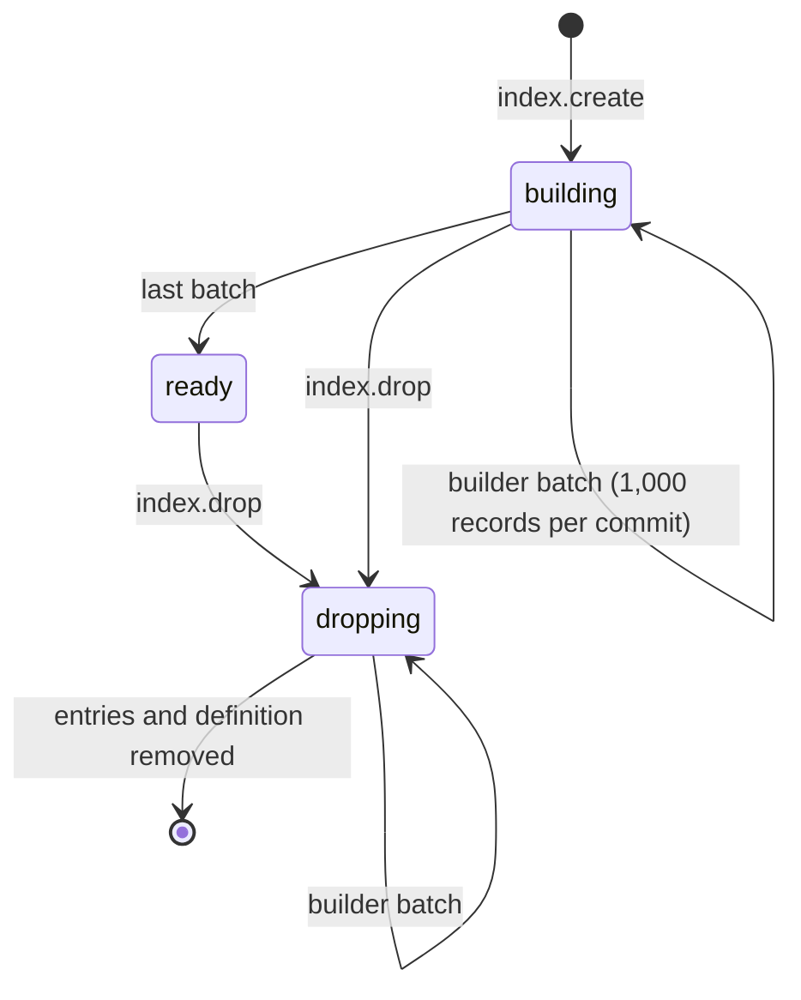

# Indexes

This page explains declared **ordered indexes**: what they are, how to create,
list and drop them from the protocol and from every statement language, how
they are built online, which filters they answer, and what they cost. It is for
developers tuning read paths and for operators who need to know what an index
does to write throughput. Text indexes share the same catalog and lifecycle;
their search behaviour is covered in [Full-text search](full-text-search.md).

## Why you declare indexes

RushDB has no automatic value indexes. Without a declared index, a filter such
as `{"price": {"$gte": 40}}` on label `Item` is answered by walking the `Item`
records that carry `price` (the engine keeps an exact presence catalog per
label and property, so it never visits records that lack the property) and
checking each value. That is cheap when few records carry the property and
expensive when millions do.

An ordered index stores one sorted entry per `(value, record)` for one label
and one property. A filter leaf on that property is then answered by a range
read over the sorted entries instead of a walk over the property's owners.

> **Note:** An index belongs to exactly **one record label** and **one
> property**. Composite (multi-property) indexes and relationship-property
> indexes are not supported.

## What an ordered index answers

A ready ordered index answers these predicate leaves on its property:

| Operator | Example | Notes |
|---|---|---|
| equality (`$eq` or bare value) | `{"status": "open"}` | every stored type the value can match is probed, as without an index |
| `$in` | `{"status": {"$in": ["open", "held"]}}` | `null` members make the leaf ineligible |
| `$gt`, `$gte`, `$lt`, `$lte` | `{"price": {"$gte": 40}}` | numeric and datetime values; ISO-8601 strings are accepted as datetime bounds |
| `$startsWith` | `{"sku": {"$startsWith": "AB-"}}` | string prefix; **only** answerable through an ordered index |

Every candidate the index produces is re-checked against the predicate, so
results are identical with or without the index. Array-valued properties index
every element.

An ordered index does **not** answer `$ne`, `$nin`, `$contains`,
`$endsWith`, `$type`, `$exists`, datetime-component operators (`$year`, …),
or `$or`/`$not` groups. Those leaves are evaluated on the candidates other
leaves produced (see [Query planning](query-planning.md)). Indexes are not
used to produce sort order.

### Every requested label needs its own index

The planner uses an index for a leaf only when **every** label in the query's
`labels` has a ready ordered index on that property. A query without `labels`
never uses a declared index, because an index belongs to a label.

```json
{ "labels": ["Item"], "predicate": { "price": { "$gte": 40 } } }
```

uses `item_price`; the same predicate with `"labels": []` or with
`"labels": ["Item", "Product"]` (and no index on `Product.price`) does not.

## Create an index

### Protocol

`index.create` takes an `IndexDefinition`:

| Field | Type | Required | Description |
|---|---|---|---|
| `name` | string | yes | Tenant-unique index name. |
| `label` | string | yes | Record label whose records are indexed (matched exactly). |
| `property` | string | yes | Property name. Stored normalized (lower-case, non-alphanumerics become `_`), so `unitPrice` is listed as `unitprice`. |
| `kind` | string | no | `ordered` (default), `text` or `structural` (see [Structural embeddings](structural-embeddings.md)). Vector indexes use `createVector`. |
| `consistency` | string | no | Text indexes only: `eventual` (default) or `immediate`. Rejected for `ordered`. |
| `dimensions` | integer | structural only | Vector dimensions of a structural index, 8 to 4,096. Rejected for other kinds. |

```bash
curl -s http://127.0.0.1:3000/protocol/v1/execute \
  -H "Authorization: Bearer $RUSHDB_TOKEN" \
  -H "Content-Type: application/json" \
  -d '{
    "protocolVersion": 1,
    "operation": {
      "kind": "index",
      "index": {
        "kind": "create",
        "definition": { "name": "item_price", "label": "Item", "property": "price" }
      }
    }
  }'
```

The response describes the new index. It always starts in `building`:

```json
{
  "protocolVersion": 1,
  "response": {
    "kind": "index",
    "index": {
      "name": "item_price",
      "label": "Item",
      "property": "price",
      "kind": "ordered",
      "state": "building"
    }
  }
}
```

Creating an index whose name already exists fails with
`index <name> already exists`. Index operations require write permission and
are rejected while the server is in maintenance mode or running as a
replication follower.

### Statement languages

The same operation is reachable from every statement language that is enabled
on the server. Send DDL as a **mutation** (`mutate.statement`); Cypher and GQL
reject DDL sent through `query.statement`, except `SHOW INDEXES`.

| Language | Create | Drop | List |
|---|---|---|---|
| Cypher / GQL | `CREATE INDEX [name] [IF NOT EXISTS] FOR (n:Label) ON (n.prop)` | `DROP INDEX name [IF EXISTS]` | `SHOW INDEXES` (or `SHOW INDEX`) |
| SQL | `CREATE INDEX name ON Label(prop)` | `DROP INDEX name` | — |
| Mongo | `{"createIndex": {"collection": "Label", "property": "prop", "name": "…"}}` | `{"dropIndex": {"name": "…"}}` | — |

When Cypher/GQL or Mongo omit the name, it defaults to `<Label>_<prop>`.
A Cypher/GQL `ON (...)` clause takes exactly one property; `ON (n.a, n.b)` is
rejected. A Mongo `createIndex` **with** a `dimensions` field creates a vector
index instead (see [Vector search](vector-search.md)).

```bash
curl -s http://127.0.0.1:3000/protocol/v1/execute \
  -H "Authorization: Bearer $RUSHDB_TOKEN" \
  -H "Content-Type: application/json" \
  -d '{
    "protocolVersion": 1,
    "operation": {
      "kind": "mutate",
      "mutation": {
        "kind": "statement",
        "language": "cypher",
        "statement": "CREATE INDEX item_a IF NOT EXISTS FOR (n:Item) ON (n.a)"
      }
    }
  }'
```

A statement DDL answers with a `statementMutation` response: `affected` is `1`
when it changed the catalog and `0` when `IF NOT EXISTS` / `IF EXISTS` made it
a no-op; `status` carries the index name on create.

## List indexes

`describe.indexes` lists the tenant's declared (ordered, text and structural)
indexes with their state. Text and structural indexes also report `pending`:
records whose change their applier has not processed yet (counted up to one
million), so `0` means the index is current. Vector indexes are listed
separately by `describe.vectorIndexes` (a structural index appears there too,
as the vector index it searches).

```bash
curl -s http://127.0.0.1:3000/protocol/v1/execute \
  -H "Authorization: Bearer $RUSHDB_TOKEN" \
  -H "Content-Type: application/json" \
  -d '{"protocolVersion": 1, "operation": {"kind": "describe", "describe": {"kind": "indexes"}}}'
```

```json
{
  "protocolVersion": 1,
  "response": {
    "kind": "indexes",
    "indexes": [
      { "name": "item_price", "label": "Item", "property": "price", "kind": "ordered", "state": "ready" },
      { "name": "docs", "label": "Doc", "property": "*", "kind": "text", "state": "ready", "consistency": "immediate" }
    ]
  }
}
```

`SHOW INDEXES` through `query.statement` (Cypher or GQL) returns the same
objects as `rows`.

## Lifecycle



| State | Meaning | Used by queries |
|---|---|---|
| `building` | Backfill has covered records up to an internal cursor. | No |
| `ready` | Every record of the label is covered. | Yes (ordered: planner; text: `query.text`) |
| `dropping` | Entries are being removed in batches. | No |

### How the online build works

- Declaring an index is a single, fast commit. The backfill runs in the
  background on the server's maintenance tick (every
  `checkpoint-interval-seconds`, 5 s by default). Each tick spends up to 250 ms
  advancing building and dropping indexes, committing at most 1,000 records
  per commit, so a build never holds a long write transaction.
- Writes are never blocked. While an index is `building`, records already
  passed by the build cursor are kept current by every commit; records ahead
  of the cursor are picked up when the cursor reaches them. At every moment
  the index holds exactly what a from-scratch build would hold for the records
  it covers.
- Queries ignore an index until it is `ready`. There is no partially-correct
  window: a query either uses a complete index or does not use it at all.
- Poll `describe.indexes` (or watch `describe.explain` switch its
  `accessPath`) to know when the index is in use.

### Drop an index

```bash
curl -s http://127.0.0.1:3000/protocol/v1/execute \
  -H "Authorization: Bearer $RUSHDB_TOKEN" \
  -H "Content-Type: application/json" \
  -d '{"protocolVersion": 1, "operation": {"kind": "index", "index": {"kind": "drop", "name": "item_price"}}}'
```

The response is `{"kind": "mutation", "affected": 1}`. The index switches to
`dropping` immediately, so the planner stops using it in the same commit; its
entries are removed in background batches and it disappears from
`describe.indexes` when the drop finishes. For a text index, its on-disk files
are deleted at that point.

`DROP INDEX name` and Mongo `dropIndex` first look for a declared index with
that name; if none exists, they drop a **vector index** with that name.

## What an index costs

| Cost | When | Size of the work |
|---|---|---|
| Write amplification | Every commit that changes the indexed property of a record with the indexed label, changes a record's label, or creates/deletes such a record | One entry row added or removed per changed value (per array element), in the same commit |
| Storage | Always | One row per `(value, record)`, keyed by the order-preserving encoding of the value |
| Build | Once, after `create` | Batches of 1,000 records per commit, up to 250 ms per maintenance tick |
| Drop | Once, after `drop` | Same batching as the build |

Maintenance is synchronous: an acknowledged commit's index entries are already
written, so there is no index lag to monitor. Commits that do not touch an
indexed label/property pair pay only a catalog lookup.

> **Tip:** Each tenant's commits are serialized. An index on a property that
> every write updates adds work to every one of those commits; measure your
> write path after adding one (see
> [Capacity planning](../operations/capacity-planning.md)).

## When to declare an index

Declare an ordered index when **all** of these hold:

- You filter a single label on the property in a hot query, with `labels` set.
- The filter uses equality, `$in`, a numeric/date range, or `$startsWith`.
- Many records of that label carry the property, so walking its owners is
  expensive, and the filter is selective (it keeps a small fraction).

Do **not** declare one when:

- The property is rare on the label: the presence catalog already narrows the
  walk to the records that carry it.
- The filter keeps most records (`status != "deleted"`, wide ranges): the
  planner gains little and you pay on every write.
- You only sort by the property: indexes are not used for ordering.
- You need keyword or similarity search: use a
  [text index](full-text-search.md) or a [vector index](vector-search.md).

Use [`describe.explain`](query-planning.md#inspect-a-plan-with-describeexplain)
before and after: its `accessPath` changes from `property_walk:<property>`
(or `label_scan`) to `index:<name>` once the index is ready.

## See also

- [Query planning](query-planning.md)
- [Full-text search](full-text-search.md)
- [Vector search](vector-search.md)
- [Structural embeddings](structural-embeddings.md)
- [Filtering](../query/filtering.md)
- [Derived state](../architecture/derived-state.md)
- [Configuration reference](../reference/configuration-reference.md)
