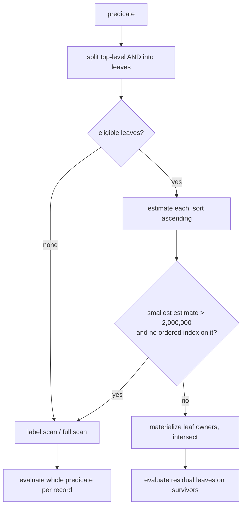

# Query planning

This page explains how RushDB's native query planner turns a `predicate` into
a set of candidate records: which filter shapes it can narrow without reading
records, how it orders them, when it gives up and scans, where its statistics
come from, and how to inspect its choice with `describe.explain`. It is for
developers writing filters that must stay fast as data grows.

The planner described here serves native `records` queries and the filter
stage of vector and hybrid searches (both resolve their `labels` and
`predicate` through it before ranking).

## The model in one paragraph

A predicate's top-level `$and` (or the implicit conjunction of fields in one
object) is split into **leaves**. Each leaf is either *eligible* — the planner
can compute its exact set of matching records from maintained catalogs or a
declared index — or *residual* — it must be checked record by record. The
planner estimates how many records each eligible leaf matches, materializes
them most-selective first as compressed bitmaps of record ordinals, intersects
them, and then evaluates the residual leaves only on the survivors. If no leaf
is eligible, or even the most selective one is too large to walk without a
declared index, it scans the label.



## Eligible and residual leaves

| Leaf | Eligible? | How it is resolved | Estimate |
|---|---|---|---|
| equality / `$in` (non-null values) | yes | declared ordered index if ready; otherwise the label's owners of the property, filtered by value | exact count from the value dictionary |
| `$gt` / `$gte` / `$lt` / `$lte` | yes | declared ordered index if ready; otherwise owners of the numeric/datetime property, filtered by value | histogram estimate (see below) |
| `$startsWith` | only with a ready ordered index | index prefix range | unknown (sorts last) |
| `$exists: true` | yes | presence catalog | unknown; a lone `$exists` with a `limit` is answered from a maintained count |
| `null` equality | yes, as a superset prefilter | presence catalog | unknown |
| `$id` / `$id: {$in: [...]}` | yes | record-id index | number of ids |
| `$ne`, `$nin`, `$contains`, `$endsWith`, `$type`, `$not`, `$or`, `$nor`, `$xor`, datetime components, relationship (`$relation`) blocks | residual | evaluated on candidates | — |

When **every** leaf is eligible (and none is a null test or a relationship
traversal), the candidate set is already the exact answer: the planner skips
per-record evaluation and the separate count pass.

> **Note:** Range leaves compare numbers and datetimes. A range bound on a
> property that only holds strings matches nothing.

## Statistics on demand

RushDB does not run a background `ANALYZE`. The planner reads two kinds of
statistics, both derived from data the engine already maintains:

- **Exact counts.** Equality and `$in` estimates are the sum of the value
  dictionary's per-value counts for the queried labels. They are exact at the
  query's snapshot.
- **Range histograms.** For a range leaf, the planner loads the property's
  value distribution on first use with a budgeted walk of the value
  dictionary, and caches it. When the property has at most 256 distinct
  values and the walk saw all of them, the range count is computed exactly
  instead of interpolated.

The histogram cache is bounded and self-refreshing:

| Setting (env) | Default | Effect |
|---|---|---|
| `RUSHDB_PLANNER_STATS_BYTES` | 32 MiB | Byte budget of the cache (part of the logical-cache budget). `0` disables caching: every estimate walks the dictionary. |
| `RUSHDB_PLANNER_STATS_IDLE_SECONDS` | 600 | An entry unused this long is evicted. |
| `RUSHDB_PLANNER_STATS_MAX_AGE_COMMITS` | 10,000 | An entry older than this many commits is recomputed. |

Statistics only change the **order** in which leaves are materialized and
whether the planner falls back to a scan. They never change results.

## When the planner scans

The planner returns to a scan of the requested labels (or of every record when
`labels` is empty) when:

- the predicate has no eligible leaf (for example only `$contains` or an
  `$or`);
- the most selective eligible leaf is estimated above **2,000,000** records
  and no ready ordered index answers it (an indexed leaf of any size is read
  from the index);
- a leaf without an index would have to walk more than 2,000,000 owners of its
  property and no earlier leaf has already narrowed the candidates.

Candidate bitmaps count against `query-memory-max` (default 256 MiB). A dense
bitmap costs a few bits per record, so even a leaf of millions of records fits;
a query whose working set exceeds the cap fails with `resource_exhausted`
rather than returning a partial answer.

A scan or walk runs to the end, as in PostgreSQL and Neo4j; the request's
time and memory bounds stop it. To fail fast instead, the server
(`unindexed-walk-max-owners`) or the request (`context.unindexedWalkMaxOwners`)
sets the most records a filter without a usable index may check; above it the
query is refused at planning with `invalid_request` naming the index to
declare ([request bounds](../architecture/resource-governance.md#request-bounds)).

SQL label tables read their candidates from the same planner: a statement's
`column OP literal` conditions are planned like `where` leaves, and the
statement is bounded and refused the same way
([SQL § Large labels](../languages/sql.md#large-labels)).

## Pages and totals

A records query visits its candidates in record order and keeps only what the
page needs:

- **Without `order`**, it keeps the first `offset + limit` matches. When the
  total is already known, it stops there. The total is known without
  counting when nothing is left to check per record: from the label or tenant
  record counters for a query without a predicate, and from the size of the
  candidate bitmap when every leaf was eligible. Otherwise it keeps counting
  matches without keeping them, so the total stays exact.
- **With `order`**, it keeps the best `offset + limit` rows seen so far. It
  reads only the ordering properties of each match, not the whole record
  (arrays and system fields are the exception).
- **Residual leaves** are evaluated on their own, reading only the properties
  they name, not the whole record.

Measured on one tenant of 10M records (2026-10-19): a first page without a
predicate 7 ms; `status = "active" AND city = "Oslo"` on two ordered indexes
(667,819 matches, exact total) 0.9 s; the same ordered by an indexed property
2.2 s; adding an unindexed `age < 25` (65,078 matches) 22 s, because every
one of the 667,819 candidates is checked. Declare an ordered index on a
property you filter by to keep such reads short.

## Inspect a plan with `describe.explain`

`describe.explain` takes the same `QueryDocument` as `query.records` and
reports the plan without executing the query.

```bash
curl -s http://127.0.0.1:3000/protocol/v1/execute \
  -H "Authorization: Bearer $RUSHDB_TOKEN" \
  -H "Content-Type: application/json" \
  -d '{
    "protocolVersion": 1,
    "operation": {
      "kind": "describe",
      "describe": {
        "kind": "explain",
        "query": { "labels": ["Item"], "predicate": { "price": { "$gte": 40 } }, "limit": 20 }
      }
    }
  }'
```

```json
{
  "protocolVersion": 1,
  "response": {
    "kind": "explain",
    "plan": {
      "accessPath": "index:item_price",
      "labels": ["Item"],
      "predicate": { "price": { "$gte": 40 } },
      "scanEstimate": 50,
      "rangeSelectivityEstimate": 0.2,
      "limit": 20,
      "offset": 0
    }
  }
}
```

| Field | Meaning |
|---|---|
| `accessPath` | `index:<name>` when a ready declared ordered index covers a predicate leaf for every requested label (several names are comma-separated, one per label); `property_walk:<property>` when an eligible leaf without an index narrows the candidates (see `unindexedWalk`); otherwise `label_scan` when `labels` is set, or `full_scan` when it is empty. |
| `unindexedWalk` | For a `property_walk`: `property`, `owners` (the records carrying the property under the requested labels, each visited with one point read) and `suggestedIndexes` (one `{label, property}` ordered index per walked label that would answer the leaf instead). Omitted otherwise. |
| `labels` | The labels the query is constrained to. |
| `predicate` | The predicate as submitted. |
| `scanEstimate` | Exact number of records carrying the requested labels (from label counters). `0` when `labels` is empty. |
| `estimatedCardinality` | Exact match count of the most selective equality / `$in` / `$id` leaf, counted under the requested labels (all labels when `labels` is empty). Omitted when no such leaf exists. Never an estimate. |
| `rangeSelectivityEstimate` | Approximate fraction (`0.0`–`1.0`) of the property's values satisfying the first range leaf, from the histogram. Omitted when there is no range leaf or no numeric data. Always approximate. |
| `limit`, `offset` | Paging as submitted. |

> **Note:** A `property_walk` reads every record that carries the property,
> one point read each. Its cost grows with `unindexedWalk.owners`, not with
> the number of matches. Declaring one of the `suggestedIndexes` turns it into
> an `index:` path. Queries whose walk visits more than 10,000 owners are
> counted in the `rushdb_unindexed_walks_total` metric.

`describe.explain` is not available when a data-access policy is enforced.
For vector queries, use `describe.explainVector` (see
[Vector search](vector-search.md#inspect-a-vector-query)). There is no
`PROFILE`-style execution profile; use server timing (`serverTimingMs` on the
response envelope) and [metrics](../operations/monitoring.md) for runtime
measurements.

## Writing efficient filters

- **Always set `labels`.** Estimates, presence narrowing, and declared indexes
  are all per label. A query without labels cannot use a declared index and
  scans every record when nothing else narrows it.
- **Prefer conjunctions of positive leaves.** Equality, `$in`, ranges and
  `$exists: true` narrow; `$ne`, `$nin`, `$not` and `$or` are residual. Rewrite
  `{"status": {"$ne": "closed"}}` as `{"status": {"$in": ["open", "held"]}}`
  when the domain is small.
- **Put the selective condition at the top level.** Only top-level
  conjuncts are planned; a selective leaf nested inside an `$or` is evaluated
  per record.
- **Use `$id` for known records.** It resolves through the record-id index in
  one lookup per id.
- **Declare an ordered index for `$startsWith`.** Without one, a prefix
  filter is always evaluated per record.
- **Use typed values that match how you stored them.** Equality probes every
  type a JSON value can match, but a range only matches numeric and datetime
  values.
- **Page with cursors, not deep offsets.** See
  [Sorting and pagination](../query/sorting-and-pagination.md).
- **Check `describe.explain` after schema changes.** Confirm the
  `accessPath` and that `estimatedCardinality` is small; a `property_walk`
  with many `owners` names the index to declare.

## See also

- [Indexes](indexes.md)
- [Filtering](../query/filtering.md)
- [Search queries](../query/search-queries.md)
- [Query execution](../architecture/query-execution.md)
- [Derived state](../architecture/derived-state.md)
- [Configuration reference](../reference/configuration-reference.md)
