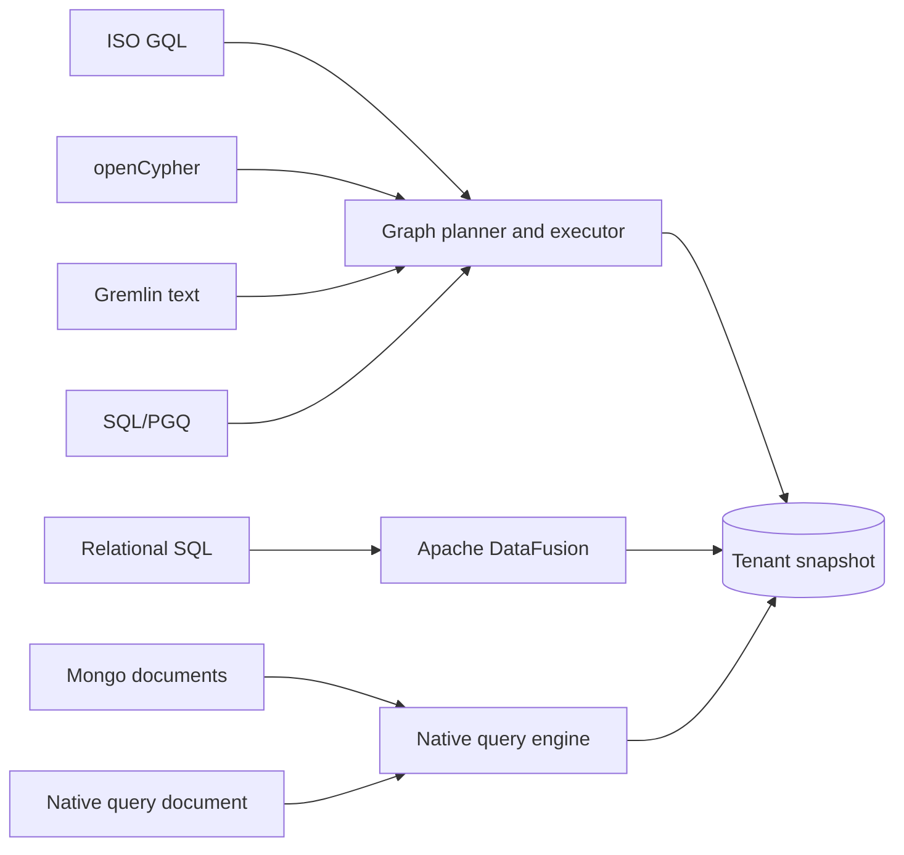

# Query languages

RushDB stores one property graph per tenant and lets you read and write it in
several query languages. This section explains how the languages relate to the
storage model, how to turn them on, and how a client discovers at runtime what
a server actually supports. Read it before you pick a language for an
application or point an existing driver at RushDB.

## One graph, many frontends

Every language works on the same data: records (each with exactly one primary
label and a set of properties) connected by typed relationships. Nothing is
copied between languages. A record you create with Cypher is immediately
visible to SQL, Gremlin, or the native query document.

| Language | Wire id in requests | Enable with | Status | Access |
|---|---|---|---|---|
| Native query document ("SearchQuery") | (operation kinds, not a statement) | always on | Stable | read/write |
| [SQL](sql.md) | `sql` | `sql` | Stable | read/write |
| [ISO GQL](gql.md) | `gql` | `gql` | Release candidate | read/write |
| [openCypher](cypher.md) | `cypher` | `cypher` | Release candidate | read/write |
| [Gremlin text traversals](gremlin.md) | `gremlin` | `gremlin` | Stable (text traversal) | read/write |
| [SQL/PGQ `GRAPH_TABLE`](sql-pgq.md) | `sqlPgq` | `sql-pgq` | Stable (read-only) | read |
| [Mongo-style documents](mongo.md) | `mongo` | `mongodb` | Stable | read/write |

The status column is exactly what the server reports through
`describe.queryLanguages` (see [Discovering capabilities](#discovering-capabilities-at-runtime)):

- **Stable**: the documented profile is implemented and exercised by the
  test suite.
- **Release candidate**: reads and writes are implemented, but the standard's
  external conformance suite (the openCypher TCK, the public GQL corpus) has
  not yet passed in full. Do not treat these as full-standard
  implementations.
- **Coming soon**: advertised for planning only, not implemented. No language
  currently reports this status; individual features that are not
  implemented are listed as limitations instead.

> **Note:** "GQL" here means ISO/IEC 39075 Graph Query Language. It is not
> GraphQL.

### How the engines divide the work



- GQL, Cypher, Gremlin, and SQL/PGQ share one graph planner and executor
  (Grafeo). They see records as nodes and relationships as edges.
- Relational SQL uses Apache DataFusion. It sees each label as a table and
  each relationship type as a table in the `rushdb_edges` schema.
- Mongo-style documents are translated into the native query document and run
  on the native query engine.

Every statement is bound to the request's tenant before it is planned, runs
against one consistent snapshot, and cannot see another tenant's data.

### How writes are committed

A write statement never publishes partial results. GQL, Cypher, Gremlin, and
SQL `INSERT`/`UPDATE`/`DELETE` each execute against a private copy of the
snapshot, and the resulting change set is published as **one atomic commit**.
If the tenant changed underneath the statement, or the statement fails, nothing
is published. Mongo-style multi-document commands are the exception; see
[Mongo-style documents](mongo.md#writes).

Write statements must be sent with the write-authorized operation
(`mutate.statement`). The read operation (`query.statement`) rejects writes, so
a read-only credential can never change data through a query language.

## Enabling languages

By default the native query document and the stable languages are enabled:
SQL (with the PostgreSQL wire listener), Gremlin, SQL/PGQ and MongoDB.
openCypher and GQL are release candidates and are opt-in; Bolt serves Cypher,
so it is opt-in too. A disabled language is refused with the
`language_disabled` error.

On the command line, pass a comma-separated list to `rushdb serve`. The list
replaces the default set, so name every language you want:

```bash
rushdb serve --data-dir ./data --languages sql,cypher,gql,gremlin,sql-pgq,mongodb
```

The accepted names are `sql`, `gql`, `cypher`, `gremlin`, `sql-pgq`, and
`mongodb`. An unknown name, or `searchquery` (which is always on and cannot be
listed), stops the server at startup.

The setting is persisted in the `languages:` section of the data directory's
`config.yml`:

```yaml
languages:
  sql: true
  gql: false
  cypher: false
  gremlin: true
  sql-pgq: true
  mongodb: true
```

> **Warning:** Once a data directory has a `config.yml`, that file is the
> source of truth. Passing `--languages` with a value that disagrees with the
> stored file is a startup error. Edit `config.yml` and restart to change the
> enabled set.

Enabling a language can also open a listener:

| Setting | Effect on listeners |
|---|---|
| `sql` enabled | The PostgreSQL wire listener binds on `--pgwire-port` (default `5432`). |
| `cypher` enabled, and `--bolt-port` set | The Bolt listener binds. |
| `--grpc-port` set | The gRPC listener binds and serves every enabled language. |

See [Connectivity](../connectivity/README.md) for each transport, and
[Configuration](../operations/configuration.md) for the full startup reference.

## Running a statement

Every language uses the same Protocol v1 operation. Reads use
`query.statement`:

```bash
curl -s http://127.0.0.1:3000/protocol/v1/execute \
  -H "Authorization: Bearer $RUSHDB_TOKEN" \
  -H 'Content-Type: application/json' \
  -d '{
    "protocolVersion": 1,
    "operation": {
      "kind": "query",
      "query": {
        "kind": "statement",
        "language": "cypher",
        "statement": "MATCH (n:FACTION) RETURN n.name AS name ORDER BY name"
      }
    }
  }'
```

The response carries the result rows as JSON objects keyed by column name:

```json
{
  "protocolVersion": 1,
  "serverTimingMs": 1,
  "response": {
    "kind": "rows",
    "rows": [{ "name": "Galactic Republic" }, { "name": "Jedi Order" }, { "name": "Sith Order" }],
    "total": 3
  }
}
```

Writes use `mutate.statement` with the same fields and return a
`statementMutation` response:

```json
{
  "protocolVersion": 1,
  "operation": {
    "kind": "mutate",
    "mutation": {
      "kind": "statement",
      "language": "gql",
      "statement": "INSERT (:FACTION {name: $name})",
      "parameters": { "name": "Rebel Alliance" }
    }
  }
}
```

```json
{
  "response": {
    "kind": "statementMutation",
    "rows": [],
    "total": 0,
    "affected": 1,
    "commitIndex": 42
  }
}
```

`affected` counts the graph changes in the commit (for SQL and Mongo, the
affected rows or documents), and `commitIndex` identifies the commit that
published them. `parameters` is optional; each language page shows its
placeholder syntax.

Statements can also be sent over [gRPC](../connectivity/grpc.md) (same
envelope), and SQL and Cypher have native wire protocols:
[PostgreSQL wire](../connectivity/postgresql-wire.md) and
[Bolt](../connectivity/bolt.md).

## Discovering capabilities at runtime

Clients should not infer support from a version string. Ask the server.

`describe.queryLanguages` returns one profile per **enabled** language:

```bash
curl -s http://127.0.0.1:3000/protocol/v1/execute \
  -H "Authorization: Bearer $RUSHDB_TOKEN" \
  -H 'Content-Type: application/json' \
  -d '{"protocolVersion":1,"operation":{"kind":"describe","describe":{"kind":"queryLanguages"}}}'
```

```json
{
  "response": {
    "kind": "queryLanguages",
    "languages": [
      {
        "language": "cypher",
        "status": "release_candidate",
        "profile": "openCypher property-graph profile",
        "implementation": "Grafeo 0.5.42",
        "access": "readWrite",
        "parameterStyles": ["named"],
        "transports": ["protocolJson"],
        "mutationTransports": ["protocolJson"],
        "features": ["match", "filter", "projection", "parameters", "optionalMatch",
                     "aggregation", "unwind", "order", "pagination", "createNode",
                     "updateProperties", "deleteNode", "createRelationship",
                     "deleteRelationship", "atomicStatementCommit"],
        "limitations": ["singlePrimaryLabelPerRecord", "statementLabelMutationUnavailable",
                        "noFullOpenCypherTckConformance", "noProcedures",
                        "limitedTemporalTypes"]
      }
    ]
  }
}
```

| Field | Meaning |
|---|---|
| `status` | `stable`, `release_candidate`, or `coming_soon`. |
| `access` | `readWrite` or `readOnly`. |
| `parameterStyles` | `positional` (`$1`) and/or `named` (`$name`). |
| `transports` | Where reads are accepted: `protocolJson` (HTTP and gRPC) and, for SQL, `pgwire`. |
| `mutationTransports` | Where writes are accepted. Empty for read-only profiles. |
| `features` | Stable identifiers for what the profile implements. |
| `limitations` | Explicit boundaries. Treat each as "not supported". |

`describe.capabilities` returns a flat list of feature flags for the whole
server. The language-related flags are `language:searchquery` (always present),
`statementLanguages` (present when any statement language is enabled), one
`language:<id>` flag per enabled language, using the same ids as
`describe.queryLanguages` (`language:sql`, `language:gql`, `language:cypher`,
`language:gremlin`, `language:sqlPgq`, `language:mongo`),
`pgwire` when SQL is enabled, and `bolt` when Cypher is enabled.

`GET /health` (no authentication) also lists the enabled languages:

```json
{ "status": "ok", "engine": "rushdb-lmpg", "protocolVersion": 1,
  "queryLanguages": ["cypher", "searchQuery", "sql"] }
```

## Limitations shared by the graph languages

- **One label per record.** A record has exactly one primary label. Creating a
  node with several labels (`CREATE (:Person:Employee)`) fails and publishes
  nothing. To change a record's label, use the native `retypeRecord` mutation;
  graph statements cannot add or remove labels.
- **Writes load the tenant graph.** A GQL, Cypher, or Gremlin write builds a
  private working copy of the tenant's graph. Writes are refused when the
  tenant has more than 100,000 records, or when the working copy exceeds
  64 MiB. Use the native write operations or SQL DML for larger tenants.
- **Statements are read in full.** Results are materialized before they are
  returned; there are no server-side cursors for statement languages. Page
  with `SKIP`/`LIMIT` (or the language's equivalent). Resumable cursors exist
  only for native `records` queries.
- **Data-access policies.** When a tenant has an enforced data-access policy,
  statement queries are refused with `unauthorized`; only native operations
  that apply the policy are served. See
  [Authentication](../connectivity/authentication.md#data-access-policies).

## Pages in this section

1. [SQL](sql.md): relational SQL over record and relationship tables.
2. [ISO GQL](gql.md): `MATCH`/`INSERT` graph statements.
3. [openCypher](cypher.md): Cypher reads, writes, and index DDL.
4. [Gremlin](gremlin.md): text traversals.
5. [SQL/PGQ](sql-pgq.md): read-only `GRAPH_TABLE` queries.
6. [Mongo-style documents](mongo.md): find, aggregate, and CRUD commands.

## See also

- [HTTP API](../connectivity/http-api.md)
- [Native search queries](../query/search-queries.md)
- [Transactions](../query/transactions.md)
- [Indexes](../indexes-and-search/indexes.md)
- [Error codes](../reference/error-codes.md)
