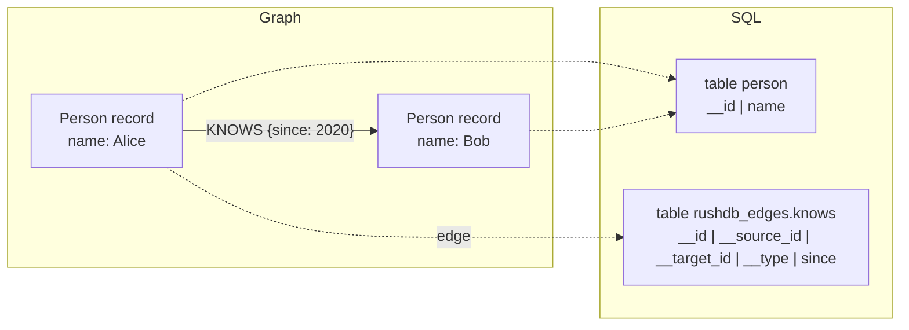

# SQL

RushDB accepts relational SQL in the PostgreSQL dialect. Parsing, planning,
optimization, and execution are done by Apache DataFusion over a consistent
snapshot of one tenant. This page explains how records and relationships appear
as tables, which statements are supported, and where the limits are. Use it if
you want to query RushDB from SQL tools, BI clients, or application code that
already speaks SQL.

| Property | Value |
|---|---|
| Status | Stable |
| Enabled | By default (`languages.sql: true`); a `--languages` list must name `sql` to keep it |
| Wire id | `sql` |
| Profile | PostgreSQL-dialect relational SQL (DataFusion 54.1) |
| Access | read and write |
| Parameters | positional (`$1`) and named (`$name`) |
| Transports | Protocol v1 (HTTP, gRPC) and [PostgreSQL wire](../connectivity/postgresql-wire.md) |

## How the graph maps to tables



**Record tables.** Every label is a table in the default schema. The table
name is the label name; lookups are case-insensitive, so the label `Person` is
`person`, `Person`, or `PERSON` in SQL. Each table has:

| Column | Type | Content |
|---|---|---|
| `__id` | text | The record's stable id (UUID). |
| one column per property | from the catalog | Every property any record of that label has. |

Column types come from the label's property catalog at the snapshot: the
types its records store under each property (integers, floats, strings,
booleans, datetimes as epoch milliseconds, arrays). Mixed types widen the way
JSON values do: integers and floats read as floats, any other mix as text. An
array that has only ever been empty takes the element type its property was
defined with. Property columns come in the order the properties were first
created, then `__id`. Building a table reads no record, whatever the label's
size. A record that lacks a property reads as `NULL` in that column.

**Relationship tables.** Every relationship type is a table in the
`rushdb_edges` schema, named after the type in lowercase (`KNOWS` becomes
`rushdb_edges.knows`). Each table has:

| Column | Content |
|---|---|
| `__id` | The relationship id. |
| `__source_id` | `__id` of the source record. |
| `__target_id` | `__id` of the target record. |
| `__type` | The relationship type. |
| one column per property | Relationship properties. |

Relationship tables are read-only. They stream like label tables: resolving
`rushdb_edges.knows` reads the type's columns and row count from the
relationship catalog, without reading a relationship, and a scan reads the
relationships in batches, so there is no relationship cap. A scan still reads
past the relationships of other types (there is no per-type index yet), so
its cost grows with the graph, not only with the type.

> **Note:** Labels that differ only in letter case (`Person` and `PERSON`)
> resolve to the same SQL table name. Keep label names case-distinct if you
> plan to query them from SQL.

## Reading data

DataFusion provides the full `SELECT` surface: filtering, projection, joins,
common table expressions, window functions, aggregation, `ORDER BY`, and
`LIMIT`/`OFFSET`.

```sql
SELECT name FROM FACTION ORDER BY name;
```

```sql
SELECT founded_year_bby < 0 AS ancient, COUNT(*) AS n
FROM FACTION
GROUP BY ancient;
```

Window functions and CTEs:

```sql
WITH ranked AS (
  SELECT name, department, salary,
         ROW_NUMBER() OVER (PARTITION BY department ORDER BY salary DESC) AS rank
  FROM person
)
SELECT name, salary, rank
FROM ranked
WHERE rank = 1
ORDER BY salary DESC;
```

Traverse relationships by joining a record table to a relationship table:

```sql
SELECT p.name, e.since
FROM person p
JOIN rushdb_edges.knows e ON p.__id = e.__source_id
WHERE e.since >= 2020
ORDER BY e.since;
```

Search a text index with the `text_search` table function, which returns
`(id, score)` rows best first; join them to a label table on `__id`:

```sql
SELECT d.title, t.score
FROM text_search('docs', 'quick fox', 20) AS t
JOIN doc d ON d.__id = t.id
ORDER BY t.score DESC;
```

See [Full-text search](../indexes-and-search/full-text-search.md#from-statement-languages).

`EXPLAIN` is accepted and returns DataFusion's plan.

### Large labels

A label table streams its records, so a label of any size can be read.
Filters use the same [query planner](../indexes-and-search/query-planning.md)
as native queries:

- A `column = literal`, `>=`, `<=`, `>` or `<` condition on a property with an
  ordered index (and `__id = '…'`) narrows the records read to the index's
  candidates. Conditions combined with `AND` are intersected; other
  conditions beside them are checked on those candidates.
- When the index answers a filter exactly (`=` on a property that holds one
  kind of value, or `>=`/`<=` on a numeric one), no record is read for it:
  `SELECT count(*) FROM "User" WHERE status = 'active' AND city = 'Oslo'`
  counts index entries.
- A filter with no usable index walks the label, like a PostgreSQL
  sequential scan: on millions of records it takes minutes. The request's
  time and memory bounds stop it, and a session can refuse such filters
  outright with `SET disallow_full_table_scans = on` (or the server with
  `unindexed-walk-max-owners`); the statement then fails with
  `invalid_request` naming the property to index, as native queries do.
  See [request bounds](../architecture/resource-governance.md#request-bounds).
- `SELECT count(*)` with no filter reads the label's record counter, and a
  `LIMIT` without a filter stops after its rows.

### Parameters

Bind values instead of concatenating them into the statement. Positional
placeholders take a JSON array, named placeholders take a JSON object:

```json
{
  "protocolVersion": 1,
  "operation": {
    "kind": "query",
    "query": {
      "kind": "statement",
      "language": "sql",
      "statement": "SELECT name FROM person WHERE salary > $1 ORDER BY name",
      "parameters": [130000]
    }
  }
}
```

```json
{
  "kind": "statement",
  "language": "sql",
  "statement": "SELECT name FROM person WHERE department = $department ORDER BY name",
  "parameters": { "department": "research" }
}
```

Parameter values must be scalars or arrays of a single type. Object-valued
parameters are rejected.

## Writing data

`INSERT`, `UPDATE`, and `DELETE` are supported against record tables. Send them
with `mutate.statement`:

```bash
curl -s http://127.0.0.1:3000/protocol/v1/execute \
  -H "Authorization: Bearer $RUSHDB_TOKEN" \
  -H 'Content-Type: application/json' \
  -d '{
    "protocolVersion": 1,
    "operation": {
      "kind": "mutate",
      "mutation": {
        "kind": "statement",
        "language": "sql",
        "statement": "UPDATE person SET salary = salary + $increment WHERE name = $name",
        "parameters": { "increment": 5000, "name": "Alice" }
      }
    }
  }'
```

```sql
INSERT INTO person (name, department, salary) VALUES ('Dora', 'research', 90000);
DELETE FROM person WHERE salary < 100000;
```

How DML is applied:

1. DataFusion evaluates the statement against a private, mutable copy of the
   target table.
2. RushDB compares the result with the original rows by `__id` and builds
   one change set (records created, fields changed, records deleted).
3. The change set is published as one atomic commit, but only if the tenant
   has not changed since the statement's snapshot. Otherwise the statement
   fails and nothing is published. Retry it. Because of this check, DML is
   best suited to moderate write rates; for high-throughput loads, batch
   rows into fewer statements or use the native ingest and write operations.

Rules:

- Exactly one statement per request. Multi-statement batches are rejected.
- The target must be an existing record table, written unqualified
  (`person`, not `rushdb_edges.knows`). A label is created by its first
  record, which you write through the native API, ingest, or a graph
  language.
- Columns must already exist in the table (that is, some record of the label
  already has the property). Add new properties with the native API.
- `__id` is stable. An `INSERT` may supply a UUID in `__id`; if omitted, a
  UUIDv7 is generated. An `UPDATE` that changes `__id` fails.
- `UPDATE` with joins, and `DELETE` over several tables, are rejected.
- Relationship tables cannot be written. Create and delete relationships with
  the native API or a graph language.

## Index DDL

The SQL frontend recognizes index statements before DataFusion sees them. Send
them with `mutate.statement` over Protocol v1:

```sql
-- Ordered index: equality, IN, ranges, and prefix filters on one property
CREATE INDEX item_price ON Item(price);

-- Full-text (BM25) index; IMMEDIATE makes searches read their own writes
CREATE INDEX note_body ON Note(body) USING TEXT IMMEDIATE;

-- Vector index (SIMILARITY defaults to cosine; DIMENSIONS is required)
CREATE VECTOR INDEX note_embedding ON Note(embedding) SIMILARITY cosine DIMENSIONS 768;

-- Drops a declared index of that name, otherwise a vector index
DROP INDEX item_price;
```

The response `status` carries the created vector index's name. See
[Indexes](../indexes-and-search/indexes.md) for how indexes are built and used.

> **Note:** Index DDL is a mutation: send it as `mutate.statement` over HTTP
> or gRPC. Over the PostgreSQL wire protocol it is recognised and run as a
> mutation automatically.

## Transactions

Each SQL statement commits atomically on its own. There are no `BEGIN`,
`COMMIT`, or `ROLLBACK` statements in SQL, and SQL statements cannot be staged
in a [multi-request transaction](../query/transactions.md). If you need to
change several records atomically across statements, use the native
transaction operations or a single DML statement that covers all of them.

## Limits

| Limit | Value | Error |
|---|---|---|
| Writes one `INSERT`, `UPDATE` or `DELETE` plans (ids and new values) | the request's response budget | `resource_exhausted` |
| Result rows per statement | 100,000 | `resource_exhausted` |
| Result bytes | the request's response budget (the body limit, 16 MiB) | `resource_exhausted` |
| Working memory (sorts, groups, joins) | the response budget plus 16 MiB, and at most `query-memory-max` (256 MiB) or the request's smaller cap (`work_mem` over pgwire) | `resource_exhausted` |
| Time | `request-timeout-ms` (none), or the request's shorter deadline (`statement_timeout` over pgwire) | `cancelled` |
| Records an unindexed filter walks | none, unless `unindexed-walk-max-owners` or the request sets a limit (`disallow_full_table_scans` over pgwire) | `invalid_request` |

Reads of label tables stream and have no record cap (see
[Large labels](#large-labels)). DML statements read the same way: an `UPDATE`
or `DELETE` finds its rows like a `SELECT` with the same `WHERE` (planned on the
indexes), and only the rows it touches are held until the single atomic commit,
so a statement can change any number of records within the request budget.
Relationship tables stream too; a join with them is bounded by working
memory, not a row count. For deep traversals, the
[native query document](../query/search-queries.md) walks relationships
without joins.

## Under a data-access policy

When the tenant's [data-access policy](../operations/security.md) is
enforced, SQL `SELECT` sees only what the policy allows: a table for each
allowed label, a column for each of its visible properties, and a
`rushdb_edges` table for each relationship type that is not denied, holding
only relationships whose source and target labels are both allowed. A hidden
table or column fails exactly like one that does not exist (`not_found`), and
no error or suggestion names it. `text_search` is not available under an
enforced policy, and SQL DML and the other statement languages still fail
with `unauthorized`.

## Errors

| Situation | Protocol error | SQLSTATE over pgwire |
|---|---|---|
| SQL not enabled | `language_disabled` | `0A000` |
| Unknown table or column (the message suggests close names: `Did you mean 'Patient'?`) | `not_found` | `42P01` |
| Unsupported DML form (multi-statement, relationship table, non-DML on the write path, `RETURNING`, `ON CONFLICT`, `ORDER BY`/`LIMIT` in DML) | `unsupported` | `0A000` |
| Limit exceeded | `resource_exhausted` | `53200` |
| Cancelled or deadline elapsed | `cancelled` | `57014` |
| Syntax error, or a write sent through `query.statement` | `invalid_request` | `42601` |
| A filter without a usable index over more records than the server's or the request's unindexed-walk limit | `invalid_request` | `42601` |
| A DML statement lost to another write to the same tenant after its snapshot (retry it) | `write_conflict` | `40001` |
| Other failures | `execution_failed` | `XX000` |

## Not supported

- Explicit SQL transactions, savepoints, and cursors.
- `CREATE TABLE`, `ALTER TABLE`, and other schema DDL. Tables follow labels.
- Writes to relationship tables.
- Vector or full-text search from SQL. Use the protocol's `vector`, `text`,
  and `hybrid` queries ([Vector search](../indexes-and-search/vector-search.md)).
- PostgreSQL system catalogs (`pg_catalog`, `information_schema`), extensions,
  and PostgreSQL-specific functions that DataFusion does not implement.

## See also

- [PostgreSQL wire protocol](../connectivity/postgresql-wire.md)
- [Records and labels](../data-model/records-and-labels.md)
- [Relationships](../data-model/relationships.md)
- [SQL/PGQ](sql-pgq.md) for graph pattern matching from SQL
- [Query languages overview](README.md)
