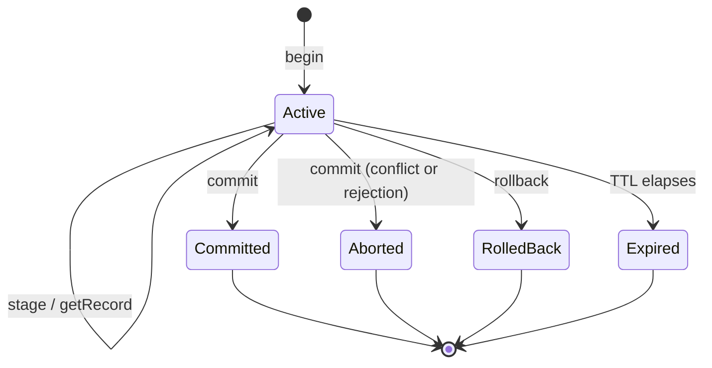

# Transactions

A transaction groups several writes, sent in separate requests, into one
atomic commit. Until it commits, its writes are invisible to everyone else;
inside it, you can read your own staged writes. This page describes the
transaction lifecycle from a client's point of view: beginning, staging,
reading, committing and rolling back, lifetimes, isolation, conflicts, and
how to retry safely. For how snapshots and versions work internally, see
[MVCC and snapshots](../architecture/mvcc-and-snapshots.md).

Single native writes (`mutate`) are already atomic on their own (see
[Writing data](writing-data.md)); use a transaction when several writes must
succeed or fail together, when writes come from different services, or when
you need to discover the outcome of a commit whose response was lost.

## Lifecycle



All transaction operations use `operation.kind: "transaction"`.

### 1. Begin

```bash
curl -s http://127.0.0.1:3000/protocol/v1/execute \
  -H "Authorization: Bearer $RUSHDB_TOKEN" \
  -H "Content-Type: application/json" \
  -d '{
    "protocolVersion": 1,
    "operation": { "kind": "transaction", "transaction": { "kind": "begin", "ttlMs": 30000 } }
  }'
```

```json
{ "protocolVersion": 1, "response": { "kind": "transactionBegun", "transactionId": "0192f1f0a4c27b3e9d5f1a2b3c4d5e6f" } }
```

| Field | Default | Meaning |
|---|---|---|
| `ttlMs` | server default (`transactions.default-ttl-seconds`, 60 s) | Lifetime of the transaction, counted from `begin`. Capped at `transactions.max-age-seconds` (default 60 s). Must be greater than 0. |
| `autocommit` | `false` | When `true`, a transaction whose TTL elapses is committed (best effort) instead of discarded. |

The transaction id is an opaque string. You can hand it to other services
that talk to the same server and tenant; any of them may stage, commit, or
roll back.

### 2. Stage writes

Each `stage` call adds one write to the transaction:

```bash
curl -s http://127.0.0.1:3000/protocol/v1/execute \
  -H "Authorization: Bearer $RUSHDB_TOKEN" \
  -H "Content-Type: application/json" \
  -d '{
    "protocolVersion": 1,
    "operation": {
      "kind": "transaction",
      "transaction": {
        "kind": "stage",
        "transactionId": "0192f1f0a4c27b3e9d5f1a2b3c4d5e6f",
        "mutation": {
          "kind": "createRecord",
          "label": "Person",
          "id": "00000000-0000-0000-0000-000000000001",
          "properties": { "name": "Ada" }
        }
      }
    }
  }'
```

```json
{ "kind": "transactionStaged", "transactionId": "0192f1f0a4c27b3e9d5f1a2b3c4d5e6f" }
```

Staged mutations:

| `mutation.kind` | Fields | Effect |
|---|---|---|
| `createRecord` | `label`, optional `id`, `properties`, optional `options` | Create a record. Pass an explicit `id` so later stages and other services can reference the record before commit. `options` types values as `putRecord` does (`suggestTypes`, `convertNumericValuesToNumbers`, ...). |
| `updateRecord` | `record`, `properties`, optional `replace` | Set the given properties (`null` stores an explicit null). With `replace: true`, also delete every property not named, as `putRecord` mode `replace` does. |
| `retypeRecord` | `record`, `fromLabel`, `toLabel` | Change the record's label. |
| `deleteRecord` | `record` | Delete the record. |
| `createRelationship` | `relationType`, `source`, `target`, `properties` | Create a relationship `source → target`. |
| `statement` | `language` (`gql`, `cypher`, or `gremlin`), `statement`, optional `parameters` | Run a graph-language write; its exact changes are staged. |
| `ingest` | `ingest`: an import as for the `ingest` operation (`documents` or `csv`) | Stage the import's records (each with its id pinned) and the relationships between them. The response is `transactionIngested` with `count` and `relationships`. An import with `mergeBy`/`mergeStrategy` or inline vectors is refused with `unsupported`. |
| `getRecord` | `record` | Read a record inside the transaction (see below). |

`record`, `source` and `target` are record references of the form
`{ "id": "<record id>" }`. The engine resolves the id inside the transaction,
so a reference can name a committed record or a record created earlier in the
same transaction (pin its `id` in `createRecord`). The lookup joins the
transaction's conflict checks: if another writer deletes the record before
commit, the commit aborts. A stage naming an id that does not exist fails with
`record not found: <id>` and stages nothing.

Each staged write is applied immediately to the transaction's private view,
so later stages and statements see it. A statement staged later in the same
transaction can match records created earlier in it:

```json
{ "kind": "statement", "language": "cypher", "statement": "CREATE (:T5 {tag: 'seed', v: 1})" }
```

```json
{ "kind": "statement", "language": "cypher", "statement": "MATCH (n:T5 {tag: 'seed'}) SET n.v = 2" }
```

If a `stage` call fails, roll the transaction back and start again.

### 3. Read your own writes

`getRecord` returns a record as this transaction sees it: the committed state
at `begin` plus this transaction's staged writes.

```json
{
  "kind": "stage",
  "transactionId": "0192f1f0a4c27b3e9d5f1a2b3c4d5e6f",
  "mutation": { "kind": "getRecord", "record": { "id": "00000000-0000-0000-0000-000000000001" } }
}
```

```json
{
  "kind": "transactionGet",
  "transactionId": "0192f1f0a4c27b3e9d5f1a2b3c4d5e6f",
  "record": { "__id": "00000000000000000000000000000001", "__label": "Person", "properties": { "name": "Ada" } }
}
```

The record has the shape `{ "_id", "__label", "properties" }`, with the id in
compact hex form. A record the tenant's data-access policy hides returns
`unauthorized`. Every record you read this way becomes part of the
transaction's read set, checked again at commit (see [Isolation](#isolation)).

### 4. Commit

```json
{
  "protocolVersion": 1,
  "operation": {
    "kind": "transaction",
    "transaction": { "kind": "commit", "transactionId": "0192f1f0a4c27b3e9d5f1a2b3c4d5e6f" }
  }
}
```

```json
{
  "kind": "transactionOutcome",
  "transactionId": "0192f1f0a4c27b3e9d5f1a2b3c4d5e6f",
  "status": "committed",
  "commitIndex": 1842,
  "retryable": false
}
```

All staged writes are published in one atomic commit. The commit outcome is
returned in the response body with HTTP 200, including when the transaction
did **not** commit; always check `status`.

### 5. Roll back

```json
{ "kind": "rollback", "transactionId": "0192f1f0a4c27b3e9d5f1a2b3c4d5e6f" }
```

```json
{ "kind": "transactionOutcome", "transactionId": "0192f1f0a4c27b3e9d5f1a2b3c4d5e6f", "status": "rolled_back", "retryable": false }
```

Rollback discards every staged write and records the transaction as aborted,
so a later `commit` with the same id cannot succeed. Rollback is accepted
even when the request deadline has passed or the server is under memory
pressure, so you can always release a transaction.

## Commit outcomes

| `status` | `retryable` | Meaning | What to do |
|---|---|---|---|
| `committed` | `false` | Durably committed at `commitIndex`. | Done. Committing again returns the same outcome. |
| `aborted` | `true` | Lost a write conflict to a concurrent commit (`reason` mentions the conflict). | Begin a new transaction and redo the work, reading fresh state. |
| `aborted` | `false` | Rejected: rolled back earlier, the data-access policy changed during the transaction, or a write was invalid. `reason` explains. | Do not retry unchanged. |
| `expired` | `false` | The TTL elapsed before commit and nothing was committed. (With `autocommit`, an expired transaction that committed reports `committed` instead; `expired` then means its best-effort commit failed.) | Begin a new transaction. |
| `unknown` | `true` | The server holds no outcome for this id right now. | Send the same `commit` again. If it stays `unknown`, the transaction is gone without committing (for example after a server restart); begin a new one. |
| `rolled_back` | `false` | Returned by `rollback`. | — |

### Idempotent commit and outcome discovery

The outcome of every commit is recorded durably under the transaction id.
Sending `commit` again with the same id never executes the transaction a
second time; it returns the recorded outcome. This makes the "committed, but
the response was lost" case safe: if a commit request times out or the
connection drops, resend the same `commit` until you get `committed`,
`aborted`, or `expired`.

Recorded outcomes are kept for the retry window
(`resources.idempotency-window-seconds`, default 24 hours). After that,
re-sending a commit for an old id returns `unknown`.

## Isolation

Transactions use **snapshot isolation**, the same model as PostgreSQL's
Repeatable Read:

- A transaction reads the committed data as of `begin`, plus its own staged
  writes. Commits by others after `begin` are not visible to it.
- There are no locks and no lock waits. Conflicts are detected at commit,
  and the **first committer wins**: if another transaction committed a change
  to anything this transaction wrote, or to a record it read with
  `getRecord`, after this transaction began, this commit is aborted with
  `retryable: true`.
- Write skew between transactions that write disjoint data is possible.
  If an invariant spans several records, read each of them with `getRecord`
  inside the transaction so that a concurrent change to any of them aborts
  your commit.

Conflicts can also come from shared engine state rather than the same
record. For example, two concurrent transactions that both create records
can conflict with each other, and a transaction that deletes a record an
`eventual` text index has not yet indexed conflicts with the index's
background commit for that record. Treat a retryable `aborted` as a normal
event and retry the whole transaction.

> **Note:** A transaction that stages a `statement` is ordered against every
> other writer: any other commit that lands after its `begin` aborts it
> (retryably).
> Keep statement transactions short.

### Retry loop

```text
for attempt in 1..N:
    id = begin(ttlMs)
    stage(id, …) / getRecord(id, …)       # recompute from fresh reads
    outcome = commit(id)
    while outcome.status == "unknown": outcome = commit(id)   # same id
    if outcome.status == "committed": return outcome.commitIndex
    if outcome.status == "aborted" and outcome.retryable:
        sleep(jittered backoff); continue
    fail(outcome.reason)
```

## Lifetimes and limits

| Setting | Default | Effect when exceeded |
|---|---|---|
| `transactions.default-ttl-seconds` | 60 s | Default lifetime when `ttlMs` is omitted. |
| `transactions.max-age-seconds` | 60 s | Upper bound for `ttlMs`; larger values are capped. |
| `transactions.max-active` | 128 per tenant | `begin` fails with `resource_exhausted` (retryable). |
| `transactions.max-operations` | 10,000 staged writes | `stage` fails with `resource_exhausted` (not retryable: commit what you have or split the work). |
| `transactions.max-staged-bytes` | 8 MiB per transaction | As above. |
| `resources.transaction-pool` | 128 MiB, shared | `stage` or `begin` fails with `resource_exhausted` (retryable once other transactions finish). |
| `transactions.max-staged-bytes-per-tenant` | 0 (no per-tenant cap) | In multitenant mode, caps one tenant's share of the pool. |

The lifetime is fixed at `begin`; staging does not extend it. There is no
transaction without a TTL. When a transaction expires, its staged writes and
its snapshot are released, unless `autocommit` is set, in which case RushDB
attempts to commit it.

Other rules:

- A transaction belongs to the tenant that began it. Another tenant cannot
  stage to, commit, or roll it back.
- Active transactions live in the memory of the server that began them and
  do not survive a restart. Recorded commit outcomes do.
- On a read-only replica and in maintenance mode, `begin` and `rollback` are
  accepted but `stage` and `commit` fail with `unavailable`; send
  transactions to the leader.
- A long-running transaction keeps the row versions of its snapshot from
  being reclaimed until it ends, which is one reason lifetimes are capped.

## Errors

| Situation | Result |
|---|---|
| Commit lost a write conflict | `transactionOutcome` with `status: "aborted"`, `retryable: true` |
| Too many active transactions, or the shared pool is full | `resource_exhausted`, retryable (HTTP 429) |
| Per-transaction operation or byte limit | `resource_exhausted`, not retryable |
| Staging or reading a record hidden by policy | `unauthorized` |
| Write on a replica or in maintenance mode | `unavailable` (HTTP 503) |

Write conflicts reported as errors by other transports use the
`write_conflict` code: HTTP 409, gRPC `ABORTED`, SQLSTATE `40001`, and Bolt
`Neo.TransientError.Transaction.DeadlockDetected`. See
[Error codes](../reference/error-codes.md).

## See also

- [Writing data](writing-data.md)
- [MVCC and snapshots](../architecture/mvcc-and-snapshots.md)
- [Write path](../architecture/write-path.md)
- [Configuration reference](../reference/configuration-reference.md)
- [Cypher](../languages/cypher.md)
